> <span style="color:#7f8c8d;">Source: MacKay《Information Theory, Inference, and Learning Algorithms》课程手写讲义 l1 · 行内双语视觉转录版 · 原图见 fig/l1/</span>

### p.1 〔Information theory, pattern recognition, and neural networks — Lecture 1: Introduction to Information Theory（信息论、模式识别与神经网络——第 1 讲：信息论导论）〕

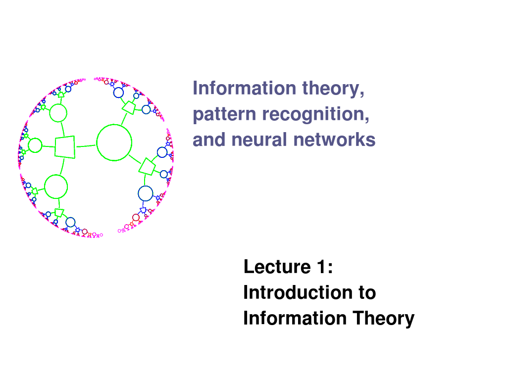

<span style="color:#2471a3;">**[lecture]**</span> 本页是课程标题页。页面右侧紫色大字为课程名 Information Theory, Pattern Recognition, and Neural Networks（信息论、模式识别与神经网络），其下黑色粗体为本次讲座标题：Lecture 1: Introduction to Information Theory（第 1 讲：信息论导论）。页面左侧是一幅圆形装饰图案：绿色圆形与方形节点自中心层层分叉、彼此连线，构成网络状分形结构，圆周边缘环绕着粉色与蓝色的小图形——即 MacKay 教材封面上的标志性图案。

### p.2 〔Lecture notes - Chapter 1（课程讲义——第 1 章）〕

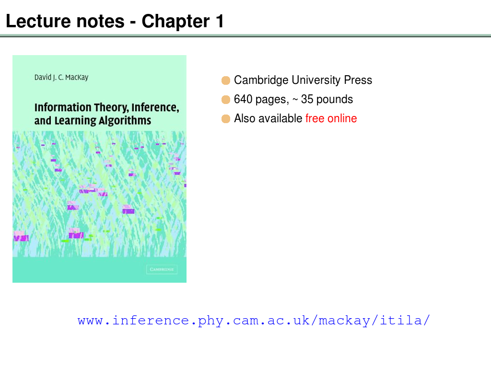

<span style="color:#2471a3;">**[note]**</span>（课程与教材信息）页面左侧展示教材封面：作者 David J. C. MacKay，书名 Information Theory, Inference, and Learning Algorithms（《信息论、推断与学习算法》），青绿色封面带草叶状装饰图案。右侧三条要点：由 Cambridge University Press（剑桥大学出版社）出版；全书 640 pages（640 页），售价约 ~ 35 pounds（35 英镑）；也可 free online（免费在线）获取（红色强调）。页面底部以蓝色等宽字体给出网址：www.inference.phy.cam.ac.uk/mackay/itila/。

### p.3 〔This lecture uses the blackboard（本讲使用黑板）〕

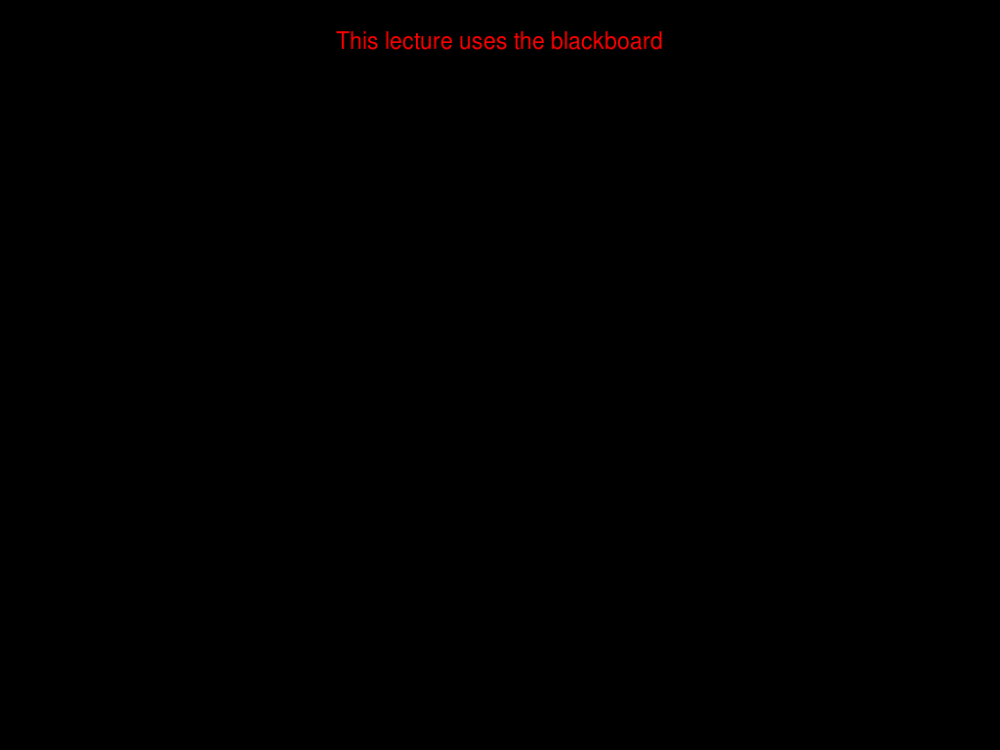

<span style="color:#2471a3;">**[note]**</span>（过场提示）整页为纯黑背景，仅顶部居中一行红色文字：This lecture uses the blackboard（本讲使用黑板）。意为本讲的主体推演将在黑板上进行，幻灯片只作辅助；黑板上的具体推导内容不包含在本扫描件中。〔本页为纯文字提示页，无其他图形内容〕

### p.4 〔Redundant glass & noisy channel, f = 0.1（"冗余的玻璃杯"与噪声信道，f = 0.1）〕

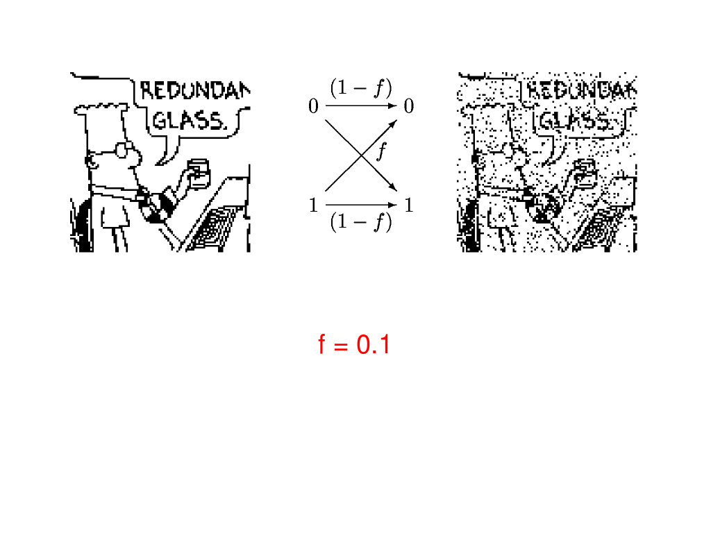

<span style="color:#2471a3;">**[example]**</span>（含噪信道演示）页面为三联图。左：一幅 Dilbert 风格漫画，人物举着一只玻璃杯，气泡中写着 REDUNDANT GLASS.（"冗余的玻璃杯"；图中尾字母被气泡边缘裁去）。中：二元对称信道示意图——上行箭头 $0 \to 0$ 标注 $(1-f)$；两条交叉箭头 $0 \to 1$ 与 $1 \to 0$ 共同标注 $f$；下行箭头 $1 \to 1$ 标注 $(1-f)$。右：同一幅漫画经过该信道后的版本——每个像素以概率 $f$ 被翻转成黑白噪点，画面与文字均被侵蚀，气泡文字已难以辨认〔无法辨认〕。页面底部红色大字：$f = 0.1$。

> <span style="color:#1e8449;">**[note] Note（译者注）:**</span> 这张三联图要回答的设计问题是：一条会翻错 bit（比特）的物理链路，究竟该用什么数学对象来描述，才能让后面所有 code（码）都面对同一个被试对象、可比可算。答案不是"线路"或"介质"这类工程名词，而是一张条件概率表。
>
> 机制上，channel（信道）的完整定义是条件分布 $P(y\mid x)$：给定输入符号 $x$，输出符号 $y$ 的取值就有一个分布。对二元输入输出，一般情形下这张表有两个自由参数，$P(1\mid 0)=f_0$ 与 $P(0\mid 1)=f_1$；BSC（binary symmetric channel，二元对称信道）再加两条假设，就把它压成只有一个参数的单参数族。第一条是 symmetric（对称性），即 $f_0=f_1=f$，物理理由是"把 0 读成 1"和"把 1 读成 0"在电路上没有任何偏好，硅片不知道哪个符号叫 0。第二条是 memoryless（无记忆性），即第 $i$ 个 bit（比特）是否被翻转，与其余任何一个 bit（比特）无关。第二条才是注 #2 那套计数能成立的前提：无记忆让 $N$ 个 bit（比特）的联合分布坍缩成边缘分布之积，"总共翻了多少位"这个随机变量才服从 binomial distribution（二项分布）。抽掉这条假设，整条计算链从第一步就断。
>
> 反过来问一句：去掉无记忆会怎样？噪声变成 burst（突发）型，一道划痕一次毁掉连续的 200 个 bit（比特）。此时联合分布不能分解成乘积，期望 $Nf$ 与标准差 $\sqrt{Nf(1-f)}$ 的估算全部作废，真实翻转数会在"0"与"200"之间大幅跳动，均值加方差的画像彻底失真。这正是磁盘与无线链路都要做 interleaving（交织）的理由：把突发错误在时间或空间上打散，人为买回近似的无记忆性。这条因果链值得记住，因为它说明 independence（独立性）从来不是自然界的礼物，而是工程上花代价换来的性质。
>
> 算两个具体数，把这张表变成手感。其一：幻灯片里那幅二值漫画若按 $500\times 500$ 像素计，共 $2.5\times 10^{5}$ 个 bit（比特），$f=0.1$ 时的期望翻转数是 $2.5\times 10^{4}$ 个 bit（比特），正确像素只剩 $90\%$；视觉上就是右图那个样子——轮廓尚在，字母的细笔画被逐段打断，"REDUNDANT GLASS" 已读不全。其二：一次 $4\ \mathrm{KiB}$ 的扇区读等于 $32768$ 个 bit（比特），若裸盘指标是 $f=10^{-5}$，期望翻转 $0.33$ 个 bit（比特），也就是平均每三次读盘就有一次拿到错数据。第二个数正是注 #3 那个"要做到多小"的问题的起点。
>
> 跨课程连接三条。第一条接 6.431（Bertsekas 概率）的转移概率矩阵：那里允许任意 $2\times 2$ 随机矩阵，四个元素只要每行归一即可；这里用对称性砍掉一个自由度，于是本章后面所有量都只是 $f$ 的函数，函数图像能画成平面曲线。第二条接 CSAPP 第 6 章：DRAM 的 soft error（软错误）就是 bit flip（位翻转），服务器内存用 ECC（error-correcting code，纠错码）在硬件层拦住，但 ECC 靠 parity（奇偶校验）位的结构做单错纠正，不靠把数据重复三份，所以开销是每 64 位加 8 位而不是三倍。第三条接 CSAPP 第 11 章：TCP 的 checksum（校验和）只有 16 位，只能 detect（检测）不能 correct（纠正），"检测便宜、纠正昂贵"这条经验，下一页的重复码会把它量化成一个 rate（码率）的代价。
>
> 再往前看半步：既然这张表是概率，就可以对它取 entropy（熵）。$f=0.1$ 时，输出符号里关于输入的不确定性是 $0.469$ 个 bit（比特），所以一次 channel（信道）使用最多只能传递 $1-0.469=0.531$ 个 bit（比特）的信息——这个数就是注 #6 里的 capacity（容量）。眼下你只需记住一件事：这幅三联图不是插图，它是本讲所有方案的统一考场，后面每一个 code（码）都要在这条 $f=0.1$ 的 channel（信道）上被押送一遍。

### p.5 〔Q: How many bits are flipped?（问：有多少位被翻转？）〕

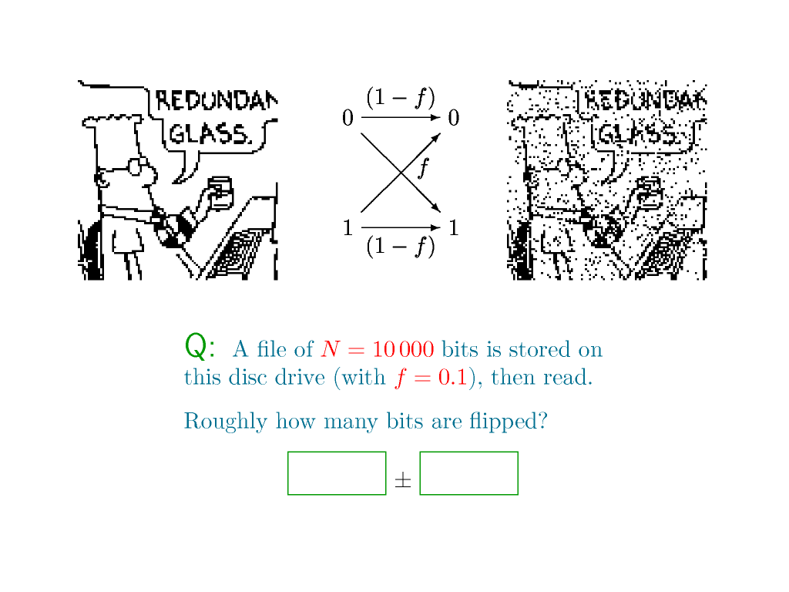

<span style="color:#2471a3;">**[example]**</span>（问题 1）顶部三联图与上一页相同：漫画原图、二元对称信道示意图、被噪点污染的漫画。下方以绿色 Q 引出问题（红色数字）：A file of $N = 10\,000$ bits is stored on this disc drive (with $f = 0.1$), then read. Roughly how many bits are flipped?（一个 $N=10\,000$ 位的文件存入这块磁盘（$f=0.1$），然后读出，大约有多少位被翻转？）问题下方画了两个绿色空心矩形框，中间夹一个 ± 号，供填写「大约值 ± 波动范围」。

> <span style="color:#1e8449;">**[note] Note（译者注）:**</span> 这道题问的不是"会不会出错"，而是"错多少"：把 channel（信道）的一次使用看成一回 Bernoulli trial（伯努利试验），$N$ 次独立试验的累计错误数就变成一个能算期望、能算波动的随机变量，于是"大约"这个词可以被换成一个区间。
>
> 推导只有两步。第一步，单 bit（比特）的翻转指示变量 $X_i\in\{0,1\}$ 满足 $P(X_i=1)=f$，于是 $E[X_i]=f$，$\mathrm{Var}(X_i)=f(1-f)$。第二步，memoryless（无记忆）意味着 $X_1,\dots,X_N$ 相互 independent（独立），而独立随机变量的期望可加、variance（方差）也可加：$E[K]=Nf$，$\mathrm{Var}(K)=Nf(1-f)$，其中 $K=\sum_i X_i$ 服从 $\mathrm{Bin}(N,f)$。"方差可加"不是巧合，它是协方差为零的直接推论；若两个试验相关，一般要补协方差项 $\mathrm{Var}\left(\sum_i X_i\right)=\sum_i\mathrm{Var}(X_i)+2\sum_{i<j}\mathrm{Cov}(X_i,X_j)$，相关越强，波动越大。这一步也解释了为什么注 #1 要把无记忆性单独拎出来强调。
>
> 为什么"期望 ± 一个标准差"就是幻灯片上两个空框夹一个 ± 号想要的东西：严格讲没有一个定理规定答案必须取 $\pm1\sigma$，但两张牌支撑这个约定。Chebyshev 不等式给出 $P(|K-\mu|\ge k\sigma)\le 1/k^{2}$，取 $k=3$ 时落在区间外最多 $11\%$，这是不依赖分布形状的粗界，代价是极松。central limit theorem（中心极限定理）给出更紧的近似：$N$ 大时 $(K-\mu)/\sigma$ 近似标准正态，于是 $\pm1\sigma$ 覆盖约 $68\%$、$\pm2\sigma$ 约 $95\%$、$\pm3\sigma$ 约 $99.7\%$。所以"$1000\pm30$"的准确读法是"以约 $68\%$ 的把握落在 $[970,1030]$"，而不是"最多错 30 位"。
>
> 代入数核对：$N=10^{4}$、$f=0.1$，$\mu=10^{3}$，$\sigma=\sqrt{Nf(1-f)}=\sqrt{900}=30$。$[970,1030]$ 约 $68\%$，$[940,1060]$ 约 $95\%$，$[910,1090]$ 约 $99.7\%$。再把文件放大一百倍：$N=10^{6}$，$\mu=10^{5}$，$\sigma=\sqrt{9\times10^{4}}=300$，相对涨落从 $3\%$ 掉到 $0.3\%$。注意绝对波动是变大的（$30\to300$），相对波动才是变小的——两个量朝相反方向走，这正是"平均掉涨落"这句话容易被误读的地方。
>
> 相对涨落的公式值得单独记住：$\sigma/\mu=\sqrt{Nf(1-f)}\,/(Nf)=\sqrt{(1-f)/(Nf)}$，代入 $f=0.1$ 得 $\sqrt{9/N}$。$N=10^{4}$ 时是 $3\%$，$N=10^{6}$ 时是 $0.3\%$，恒按 $1/\sqrt{N}$ 收缩。这是"大量独立试验的涨落被平均掉"的定量版本，也是整门课反复出现的图像。它同时提示一个反直觉的推论：$f$ 越小，同样的 $N$ 给出的相对精度越差（因为 $\mu=Nf$ 本身就小），所以要测一个很小的错误率，需要多得多的样本——这是所有 Monte Carlo（蒙特卡罗）估计的通病，注 #7 会用同一句话解释采样误差。
>
> 三条跨课程连接。接 6.431：这一段就是 Bernoulli 与 binomial 章节，区别只在于那里用它算考试题，这里用它回答一个存储工程问题，并且要求把答案写成区间而不是一个点。接 6.042J：Chernoff bound（切尔诺夫界）给出指数型尾界 $P(K\ge(1+\delta)\mu)\le e^{-\delta^{2}\mu/3}$，比 Chebyshev 的 $1/k^{2}$ 强得多，注 #5 估 R61 的错误率时就靠它把 $10^{-14}$ 这个量级算出来。接 6.006：随机化算法的平均情况分析用的是同一套"期望 + 方差 + 尾界"三件套，例如散列表的探测长度。收束回正文：这条"独立试验的涨落按 $1/\sqrt{N}$ 收缩"的图像，是理解后面"错误率能被压到多低"的第一块砖，而第二块砖要等到注 #6 的 capacity（容量）。
>
> 还有一个容易被跳过的换算：$f=0.1$ 是每个 bit（比特）的概率，而题目问的是总数。若把这 $10^{4}$ 个 bit（比特）按 8 位一个 byte（字节）切开，共 1250 个字节，平均每个字节里带 $0.8$ 个 bit（比特）的错，于是一个字节完全无损的概率是 $0.9^{8}=0.430$——超过一半的字节至少坏了一位。这个换算说明 bit error rate（位错误率）与 byte error rate（字节错误率）是两个差着量级的指标，工程文档里一旦混用，会把可靠性高估一倍以上。

### p.6 〔Q: How small does f need to be?（问：f 需要多小？）〕

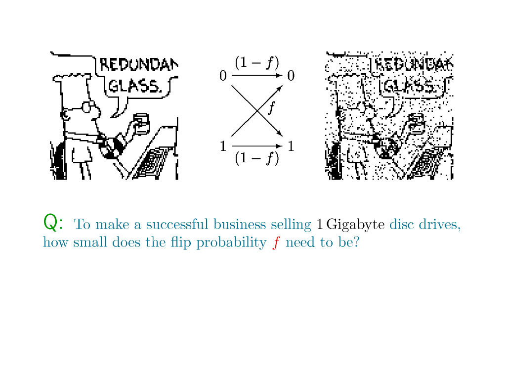

<span style="color:#2471a3;">**[example]**</span>（问题 2）顶部三联图同前（漫画原图、二元对称信道示意图、受噪漫画）。下方绿色 Q（$f$ 为红色）：To make a successful business selling 1 Gigabyte disc drives, how small does the flip probability $f$ need to be?（要想靠出售 1 Gigabyte（1 吉字节）磁盘驱动器做成一门成功的生意，翻转概率（flip probability）$f$ 需要多小？）

> <span style="color:#1e8449;">**[note] Note（译者注）:**</span> 这道题做的是三件事：先把"可靠"翻译成一个可核算的工程指标，再反解出物理层必须达到的误码率，最后指出这条路线在经济上必然走不通——从而逼出本讲的核心转折。
>
> 先把单位算清，因为后面每个结论都挂在这个数上。1 GB（gigabyte，吉字节）按 $10^{9}$ 字节计是 $8\times 10^{9}$ 个 bit（比特）；若按 $2^{30}$ 字节计是 $8.59\times 10^{9}$ 个 bit（比特）。两种口径差 $7\%$，量级都是 $10^{10}$，不影响任何结论。
>
> 机制：把"读一次盘"当成一次试验，$P(\text{至少一位出错})=1-(1-f)^{N}$，$f$ 很小时近似为 $Nf$（误差是 $O(N^{2}f^{2})$，$f=10^{-5}$ 时可以忽略）。于是"生意能不能做"就变成对 $Nf$ 这个乘积取档。第一档，要求平均每次读盘错不超过 1 个 bit（比特），$Nf\le1$ 给出 $f\lesssim1.25\times10^{-10}$。第二档，要求每一千次读盘才错一次，$Nf\le10^{-3}$ 给出 $f\lesssim1.25\times10^{-13}$。第三档，工业界对 uncorrectable error（不可纠正错误）常引的 $10^{-15}$ 每 bit（比特）指标，直接套 $Nf\le10^{-15}$ 的话，$f$ 要压到 $1.25\times10^{-25}$。
>
> 第三个数字的意义恰好在于它荒唐：$10^{-25}$ 意味着全人类所有硬盘连读 $10^{10}$ 年也未必错一位，这在物理上做不到。于是"靠把 channel（信道）本身做到完美来解决问题"这条路，在 $10^{10}$ 位这个尺度上就已经死了。为什么 $f$ 每降一个数量级都很贵？因为 $f$ 由信噪比决定，而误码率随信噪比近似指数衰减：要降 10 倍，功率或器件面积就要多花一大截；磁盘还额外受超顺磁极限（晶粒小到热扰动就能翻转磁化方向）约束，密度一上去信号就弱，$f$ 反而上升。这是"物理层堆料"撞到天花板的具体形态，不是工程师不努力。
>
> 转折就在这里。Shannon 的路线是：接受一个便宜的、$f$ 并不小的 channel（信道），用 code（码）加 redundancy（冗余），把有效错误率压到任意低，代价是 rate（码率）下降。代入算：$f=0.1$ 时 capacity（容量）是 $C=0.531$。取一个 rate（码率）$0.4$ 的码，可靠存放 1 GB 数据只需要 $8\times10^{9}/0.4=2\times10^{10}$ 个 bit（比特）的存储位，而错误率可以做到 $10^{-15}$ 以下；对照之下，若不做编码、只靠物理层，要把 $f$ 从 $10^{-5}$ 压到 $10^{-13}$，没有任何现有介质能做到，更不必说 $10^{-25}$。注意这里没有免费午餐：$2\times10^{10}$ 对比 $8\times10^{9}$，你花掉 $2.5$ 倍空间换到"任意可靠"，而这 $2.5$ 倍恰好就是 rate（码率）$0.4$ 的倒数。
>
> 三条连接。接 CSAPP 第 6 章：服务器内存的 SECDED（single error correction, double error detection，单错纠正双错检测）就是同一思路的硬件版，开销是每 64 位加 8 位校验、约 $12.5\%$，换来的是单 bit（比特）翻转被完全吃掉——但它只纠单错，与 Shannon 意义上的"任意低"差着数量级，区别在于硬件愿意付的延时与面积预算极小。接 CS144：链路上光纤的裸 BER（bit error rate，误码率）约 $10^{-12}$，加上 TCP 的 16 位 checksum（校验和），残余误检率约 $1/65536$，但 TCP 只能 detect（检测）不能 correct（纠正），纠错责任被推给重传；重传要等 RTT（round-trip time，往返时延），这就是卫星链路必须用前向纠错而不能靠重传的原因。接 6.431：读盘 $m$ 次"至少错一次"的概率是 $1-(1-f)^{mN}$，几何分布给出第一次出错的期望等待次数 $1/(Nf)$，代入第三档的数就是 $8\times10^{24}$ 次。
>
> 收束：本讲的核心转折点就藏在这道看起来平淡的应用题里——从"消灭噪声"转向"与噪声共处"，并为此明确支付 rate（码率）。下一页的重复码是第一次付款，注 #6 的定理则告诉你这笔账的最优价格是多少。

### p.7 〔Repetition code 'R3'（重复码 'R3'）〕

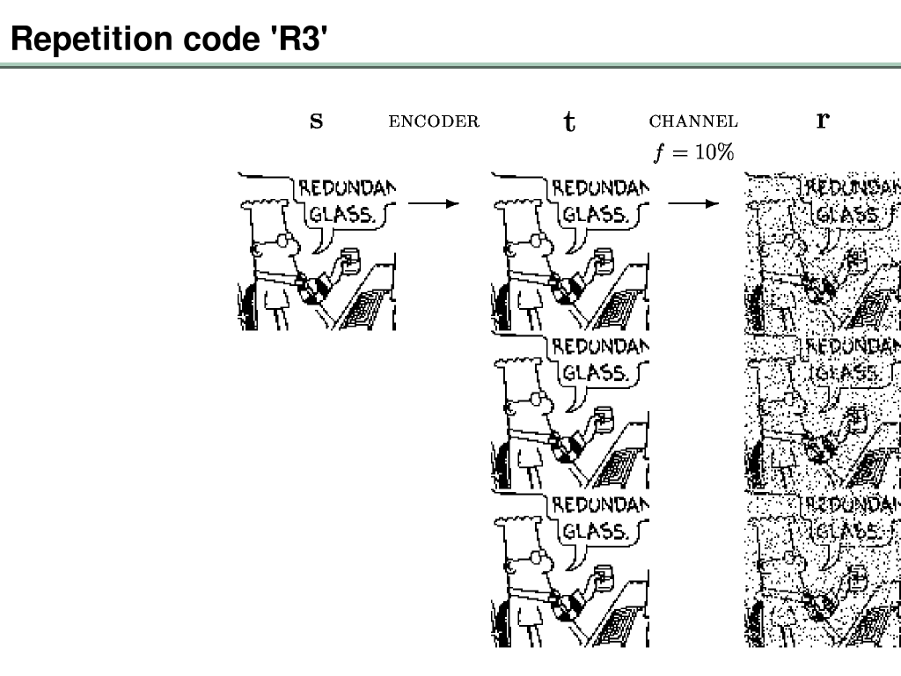

<span style="color:#2471a3;">**[section]**</span> 标题行：Repetition code 'R3'（重复码 R3）。页面主体是一张三阶段流程图，各阶段上方标注记号：源图 s —— ENCODER（编码器）→ 传输图 t —— CHANNEL（信道），$f = 10\%$ → 接收图 r。具体地：s 是那幅 REDUNDANT GLASS 漫画原图；编码器把它原样重复 3 份、纵向叠放得到 t（三份完全相同的漫画）；信道对每一份独立施加翻转概率 10% 的像素噪声，得到三份噪点各不相同的受损副本 r。这就是重复码（repetition code）R3：每个比特连发 3 次。

### p.8 〔Repetition code 'R3'（重复码 'R3'：含译码器）〕

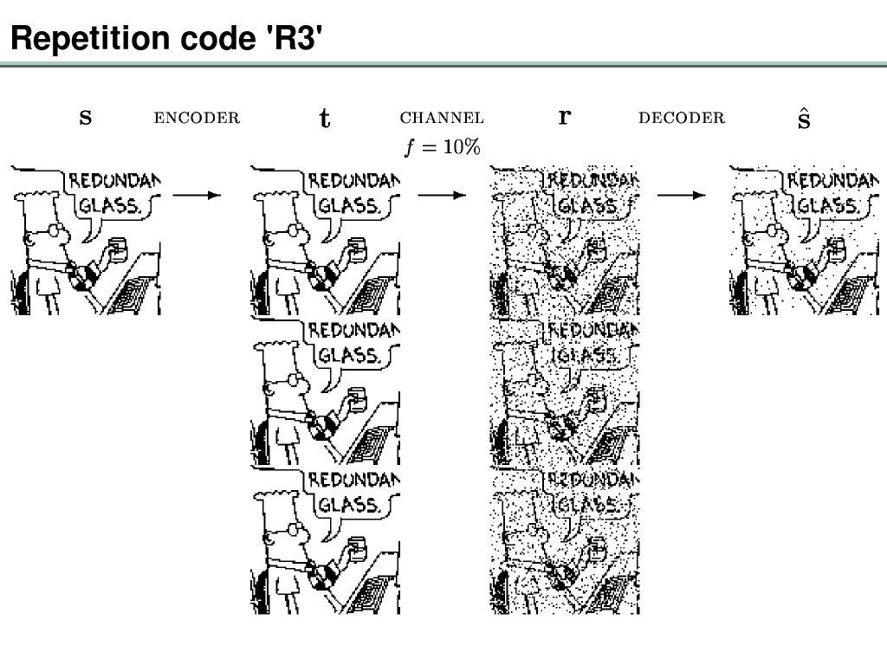

<span style="color:#2471a3;">**[section]**</span> 标题同上页：Repetition code 'R3'（重复码 R3）。流程图扩为四段：s —— ENCODER（编码器）→ t —— CHANNEL（信道），$f = 10\%$ → r —— DECODER（译码器）→ $\hat s$。前三段与上页一致：一幅漫画、三份重复副本、三份各自带噪点的副本。译码器将三份受损副本逐位对照，输出估计图 $\hat s$（读作 "s hat"，即译码器对 s 的最佳猜测）：一幅基本恢复干净、仅在气泡边缘残留少量噪点的漫画。译码规则即多数表决（majority vote）：同一位置三票中取多数。

> <span style="color:#1e8449;">**[note] Note（译者注）:**</span> decoder（译码器）要解决的问题是：三份副本都可能是坏的，凭什么相信其中一份？答案藏在一个概率事实里——"多数派的坏法必须彼此对齐"是低概率事件，于是 majority vote（多数表决）把出错率从一阶压到二阶。
>
> 机制上，R3（连发 3 次）的 code（码）只有两个 codeword（码字），$000$ 与 $111$，它们之间的 Hamming distance（汉明距离）是 $3$。decoder（译码器）做的逐位投票，等价于"把收到的三元组换成离它最近的那个 codeword（码字）"，也就是 minimum distance decoding（最小距离译码）。距离 $d=3$ 的码能纠正 $\lfloor (d-1)/2\rfloor=1$ 个错，这个公式的来历可以自己推：若错误数不超过 $1$，收到点离原 codeword（码字）至多 $1$ 步、离另一个 codeword（码字）至少 $2$ 步，最近邻唯一；若错 $2$ 个，两边距离都是 $1$，最近邻不唯一，必然出错。所以"能纠几个错"完全由距离决定，与码怎么摆无关——这就是为什么后面讨论更好的码时，首先讨论的是它的距离参数。
>
> 概率有两条推法，互相校验。正着数"至少错两份"：$P=\binom{3}{2}f^{2}(1-f)+\binom{3}{3}f^{3}=3f^{2}(1-f)+f^{3}=3f^{2}-2f^{3}$。反着数补集"至多错一份"：$1-\left[(1-f)^{3}+3f(1-f)^{2}\right]$，而 $(1-f)^{3}+3f(1-f)^{2}=(1-f)^{2}\left[(1-f)+3f\right]=(1-f)^{2}(1+2f)=1-3f^{2}+2f^{3}$，取补即得同式。两条路对得上，说明事件空间没有漏项——这种"正算一遍、补集再算一遍"的自检习惯，在算复杂事件概率时能救很多错。
>
> 代入数：$f=0.1$ 时 $P=3(0.01)-2(0.001)=0.028$，这就是图 1.4 上 R3 那个点的纵坐标。换成 $f=0.01$：$P=3\times10^{-4}-2\times10^{-6}=2.98\times10^{-4}$。再看比值：$f=0.1$ 时 $P/f=0.28$，只降 $3.6$ 倍；$f=0.01$ 时 $P/f=0.0298$，降 $33$ 倍。比值随 $f$ 线性变小，正说明 $P=\Theta(f^{2})$：第二个错误那个 $f$ 因子在小 $f$ 区把收益放大，所以 f 越小、重复码越划算。推广一步，能纠 $t$ 个错的 code（码）在低 $f$ 下满足 $p_b=O(f^{t+1})$；"错误的阶数下降一阶"是纠错码的基本机制，比记住任何一个具体公式都重要。
>
> 代价同时发生：rate（码率）从 $1$ 掉到 $1/3$，同一张图要占三倍存储、传三倍时间。reliability（可靠性）与 efficiency（效率）的权衡从第一个 code（码）就登场，图 1.4 那张平面就是这件事的地图。注意这个代价是可以直接换算的：若 $f=0.1$ 且你只肯付 $1/3$ 的 rate（码率），错误率是 $0.028$；若你想把错误率再降一个数量级到 $2.8\times10^{-3}$，解 $3f^{2}-2f^{3}=2.8\times10^{-3}$ 得 $f\approx0.0307$，也就是要求物理层先改善三倍多——重复码对"干净信道"的依赖比直觉更强。
>
> independence（独立性）假设是这里的命门。若三份副本的噪声彼此相关——比如同一道划痕在同一位置划伤三份，或者 interleaving（交织）没做好导致三次传输撞上同一段 burst（突发）——那么"至少错两份"就不再是 $f^{2}$ 量级，而可能退回 $f$ 量级，表决等于白做。这条因果链解释了一个真实的工程惯例：冗余要错开物理位置（不同磁盘、不同机架、不同供电支路），本质是在人为制造 independence（独立性）。反过来，若已知噪声有结构（例如总是整行翻转），正确做法不是加三份副本，而是先设计一个与噪声结构匹配的 code（码），这就是后面的 BCH 码要做的事。
>
> 三条连接。接 6.042J 的 $\binom{n}{k}$ 组合计数与"至少"事件用补集，上面两条推导就是这套工具的直接实战。接 CSAPP 第 6 章：RAID 1（镜像）只用两份而不投三票，读时靠 CRC（cyclic redundancy check，循环冗余校验）判定哪份坏掉，区别在于 RAID 1 有可靠的坏块标记，不需要多数决；RAID 5 用 parity（奇偶校验）重建单盘失效，逻辑上与 R3 同源，但冗余开销是 $1/n$ 而不是 $2/3$。接 6.006/CLRS：最近邻译码就是在度量空间里做一次查询——codeword（码字）集是字典，Hamming distance（汉明距离）是排序键，本质与二分查找是同一个抽象，区别在于这里的目标空间是离散不连续的，没有序关系可二分。
>
> 收束：R3 的价值不在它好用，而在于它把"用结构换可靠"的机制摆上桌面——多一个错误的代价是乘法而不是加法，这个"乘法"字样会在注 #5 的指数曲线上放大成整整一个数量级。

### p.9 〔Performance of repetition codes（重复码的性能）〕

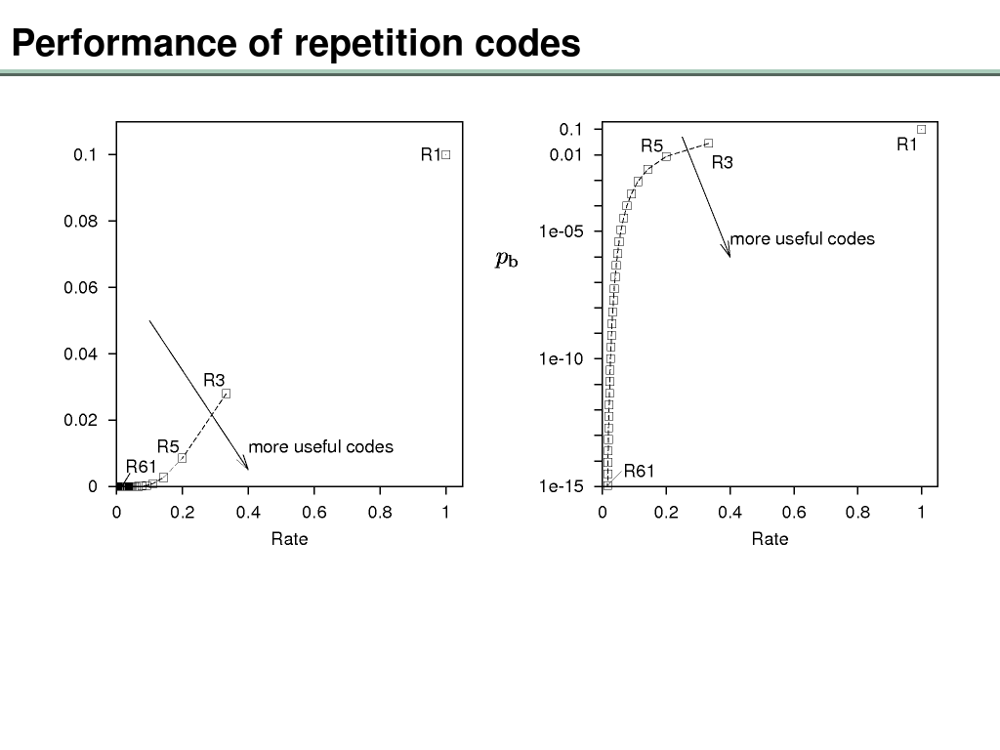

<span style="color:#2471a3;">**[section]**</span> 标题：Performance of repetition codes（重复码的性能）。左右两张散点图共享横轴 Rate（码率，0 到 1）：左图纵轴为线性刻度，从 0 到 0.1（步长 0.02）；右图纵轴为对数刻度，记作 $p_{\mathrm b}$（比特错误率），刻度自 1e-15 到 0.1。图中的方块点标注为：R1 位于右上角码率 1、错误率 0.1 处（不编码，错误率就是信道本身的 $f$）；R3 位于码率约 $1/3$ 处、错误率约 0.03；R5 位于码率 $1/5$，更靠左下；R61（连发 61 次）几乎贴着纵轴，右图中其点已落到 $10^{-15}$ 附近的图底。一条虚线自 R61 经 R5、R3 连向 R1；另有一条带箭头的斜线指向右下方，标注 more useful codes（更有用的码）。

> <span style="color:#1e8449;">**[note] Note（译者注）:**</span> 这两张图构成了本讲的第一个核心图像：它把"可靠"与"效率"两个互相打架的目标画在同一张平面上，于是任何 code（码）都只是平面上的一个点，好坏立刻可比、优劣一眼可见。
>
> 机制：R_n（连发 $n$ 次）的 rate（码率）恒为 $1/n$，因为 1 个信息 bit（比特）占用了 $n$ 个信道 bit（比特）。它的错误率是 $p_b=P\left(\mathrm{Bin}(n,f)\ge\lceil (n+1)/2\rceil\right)$，即"多数派本身也被污染"的概率。$n$ 增大时点沿 $x=1/n$ 向左移动，同时沿 $y$ 方向指数下降，于是整族点连成一条贴向左下角、向纵轴弯曲的曲线。它"横向一动不动"——只有让 rate（码率）趋近 $0$ 才换来错误率趋近 $0$，这就是它被判低效的全部理由。把它与理想角对照：理想的 code（码）应当在 $x$ 接近 $1$ 的地方把 $y$ 压到 $10^{-15}$，而重复码在 $x=1$ 处的 $y$ 就是 $f=0.1$ 本身，一点都没有改善的余地。
>
> 为什么是"指数"下降：用 Chernoff bound（切尔诺夫界），设 $X\sim\mathrm{Bin}(n,f)$、阈值 $\theta>f$，则 $P(X\ge n\theta)\le 2^{-nD(\theta\Vert f)}$，其中 $D(\theta\Vert f)=\theta\log_2\frac{\theta}{f}+(1-\theta)\log_2\frac{1-\theta}{1-f}$ 是二元 KL divergence（KL 散度）。取 $\theta=1/2$、$f=0.1$：$D=0.5\log_2 5+0.5\log_2\frac{0.5}{0.9}=0.5(2.3219)+0.5(-0.8480)=1.1610-0.4240=0.7370$ 个 bit（比特）。于是 $p_b\lesssim2^{-0.737n}$：指数 $\theta$ 与 $f$ 的差距越大，衰减越快，这就是"信道越差，重复越不划算"的定量来源。
>
> 代入三档核对。$n=61$：指数 $0.737\times61=44.96$，$2^{-44.96}\approx3.1\times10^{-14}$，与图上 R61 落在 $10^{-15}$ 附近同量级。这里要说清的是 Chernoff 给的是上界，真实值可以更小，所以图上的点更靠下是合理的。$n=5$：精确式 $P=\sum_{k=3}^{5}\binom{5}{k}f^{k}(1-f)^{5-k}=10(10^{-3})(0.81)+5(10^{-4})(0.9)+10^{-5}=0.0081+0.00045+0.00001=0.00856$，对应图上 R5 那个约 $0.0086$ 的点。$n=3$：精确值 $0.028$（注 #4 已算），Chernoff 上界给出 $2^{-2.21}=0.216$，松了不少——于是顺便记住一条经验：Chernoff 在 $n$ 小时只保证"上界有效"，不能拿来当估计值。
>
> 三条连接。接 6.006/CLRS 的比较排序下界：那里先用"共有 $n!$ 种排列、每次比较只有 2 种结果"给出 $\log_2(n!)$ 的下界，再让归并排序去逼近它；这里先用 Shannon 定理划出"$C$ 右侧不可达"，再让重复码去"够"它。论证骨架完全相同：先划界，再看具体方案离界多远。区别在于排序下界是紧的（归并排序达到），而噪声信道的可达性在 1948 年只是存在性证明，第一个真正接近 capacity（容量）的实用码要等到 1993 年的 turbo code（涡轮码），以及 1996 年被重新发现的 LDPC（low-density parity-check，低密度奇偶校验码）。接 Boyd 凸优化：这张 rate（码率）与 error 平面的右上方就是 Pareto 前沿，"设计更好的码"精确地等于"把前沿往右上推"，而重复码族只是前沿内部的一条内凹曲线。接 Strang 线代：rate（码率）就是维数比 $k/n$，即信息子空间维数占全空间维数的比例——这个维数视角在注 #6 计算 capacity（容量）时变得关键，因为"能用几个维度装信息"正是维数比。
>
> 收束：请把「右上不行、左下太慢」这个困局记住。图上那支标着 more useful codes（更有用的码）的箭头，指向的正是 Shannon 定理承诺存在、而工程界要花五十年才真正找到的地方——这也是为什么 1948 年那篇论文至今仍被当作信息时代的起点。
>
> 再看 R1 与 R3 这条连线为什么显得平缓：从 $(1,0.1)$ 到 $(1/3,0.028)$，横坐标缩到 $1/3$，纵坐标只降到 $0.28$ 倍；而从 R5 到 R61 的这一段，横坐标从 $1/5$ 走到 $1/61$、缩了 $12$ 倍，纵坐标却降了十几个数量级。同一族 code（码）在不同区段的斜率差着好几个量级，这就解释了为什么右图必须换对数纵轴：若沿用线性刻度，R61 的点会与横轴完全重合、肉眼看不见，而 R3 与 R5 的差别又会被压缩在顶端一小段里。

### p.10 〔What's achievable?（究竟什么是可达的？）〕

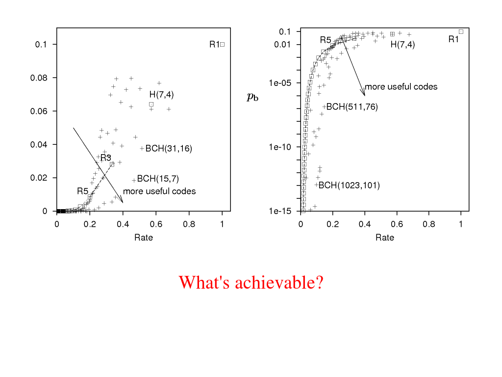

<span style="color:#2471a3;">**[section]**</span> 无标题续页：两张图与上页完全同轴、同布局（左线性、右对数，横轴 Rate，右图纵轴 $p_{\mathrm b}$），但在重复码的方块点之外，新加入一批以 + 号标出的真实编码方案的数据点，标注有：H(7,4)（即 (7,4) 汉明码（Hamming code））、BCH(31,16)、BCH(15,7)、BCH(511,76)、BCH(1023,101)（BCH 码一族，括号内为「码长, 信息位数」）。这些 + 点大多位于重复码虚线的右上方：同等错误率下码率明显更高，但距「高码率又零错误」的理想角仍远。页面底部一行红色大字：What's achievable?（究竟什么才是可达的？）

### p.11 〔Shannon's noisy-channel coding theorem（Shannon 噪声信道编码定理）〕

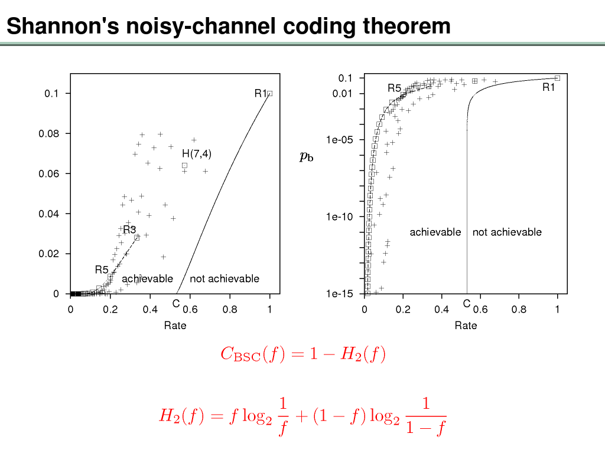

<span style="color:#2471a3;">**[theorem]**</span> 标题：Shannon's noisy-channel coding theorem（Shannon 噪声信道编码定理）。两张图沿用前页的坐标与数据点（方块为重复码 R1/R3/R5/R61，+ 为 H(7,4) 与各 BCH 码），并新增一条实线分界曲线：曲线左下方区域标注 achievable（可达），右上方标注 not achievable（不可达）；分界曲线与横轴的交点标注 $C$，即该信道的信道容量（channel capacity）。左图（线性坐标）中分界线自 $C$（约 0.5）升向右上角的 R1 点；右图（对数坐标）中分界曲线在 $C$ 之后近乎竖直跌落至图底——码率一旦越过 $C$，错误率便无从谈起。图下两行红色公式给出容量表达式：

```math
C_{\text{BSC}}(f) = 1 - H_2(f)
```

```math
H_2(f) = f \log_2 \frac{1}{f} + (1-f) \log_2 \frac{1}{1-f}
```

即：二元对称信道的容量 $C_{\text{BSC}}(f)$ 等于 1 减去二元熵（binary entropy）$H_2(f)$。

> <span style="color:#1e8449;">**[note] Note（译者注）:**</span> 这条红字公式给出本讲的终点，也是整门课的起点：一个 channel（信道）能以多快的速度可靠地传信息，存在一个与"具体用什么码"无关的天花板，叫 capacity（容量）。
>
> capacity（容量）的定义是 $C=\max_{P(x)}I(X;Y)$，即在所有可能的输入分布上取 mutual information（互信息）的最大值。为什么是互信息而不是"传输速率"：互信息 $I(X;Y)=H(Y)-H(Y\mid X)$ 度量"看到输出之后，对输入的不确定性减少了多少"，单位是 bit（比特）每次信道使用，正好就是速率的上界；而"传输速率"是设计者选的参数，没有理由成为天花板。对 BSC（binary symmetric channel，二元对称信道），$H(Y\mid X)=H_2(f)$ 且与输入分布无关（无论输入是 0 还是 1，输出都以 $f$ 的概率被翻转），所以最大化 $I$ 等价于最大化 $H(Y)$；而 $H(Y)\le1$ 且等号在输出等概率时成立，输入取 $P(0)=P(1)=1/2$ 即可。一行推完，这就是 $C=1-H_2(f)$ 的全部来历。
>
> 定理有两个方向，只记结论会漏掉最要紧的一半。converse（反向，即"超过 $C$ 不可能"）用 Fano 不等式做夹逼：设消息 $M$ 均匀取 $2^{nR}$ 个值，$P_e$ 为译码错误率，则 $H(M\mid Y^{n})\le1+nP_eR$（译错了也多少知道"大概落在哪一档"，最多再补 1 个 bit（比特）），而 $I(M;Y^{n})\le nC$（data processing inequality，数据处理不等式，多绕几步不会增加信息），两式再与 $H(M\mid Y^{n})=H(M)-I(M;Y^{n})\ge nR-nC$ 联立，得 $P_e\ge1-C/R-\frac{1}{nR}$。所以只要 $R>C$，$P_e$ 就有一个不随 $n$ 消失的正下界——这正是图中曲线在 $C$ 处近乎竖直跌落的原因：$R$ 越过 $C$ 一点点，误差就再也不能靠加大 $n$ 压下去。achievability（正向，即"低于 $C$ 就能做到"）用 random coding（随机编码）的存在性论证：随机抽一个码本，对每个码本算错误率，再对所有码本取平均，证明平均错误率随 $n$ 指数衰减，于是至少存在一个足够好的码。这条思路的要点是"不必构造，只证存在"——它解释了为什么这条定理在 1948 年之后半个世纪里都无法直接用来做工程，却依然统治着整个学科。
>
> 代入数。$f=0.1$：$H_2(0.1)=0.1\log_2 10+0.9\log_2\frac{1}{0.9}=0.1(3.3219)+0.9(0.1520)=0.3322+0.1368=0.4690$，$C=0.5310$，与图上交点约 $0.5$ 吻合。$f=0.01$：$H_2=0.01(6.6439)+0.99(0.01450)=0.0664+0.0144=0.0808$，$C=0.9192$——信道本来就很干净时，可靠传输只要多花约 $8.8\%$ 的带宽。$f=0.5$：$H_2=1$，$C=0$。工程含义具体化：$f=0.1$ 的 1 GB 数据，理论上最少需要 $8\times10^{9}/0.531=1.51\times10^{10}$ 个 bit（比特）的信道容量；若你的 code（码）只有 rate（码率）$0.4$，则需要 $2\times10^{10}$ 个，多出的 $25\%$ 就是"码不够好"所交的税，而重复码 R3 的税更高，是 $\frac{0.531}{0.333}=1.6$ 倍。
>
> 一句对称性说明：$H_2(f)=H_2(1-f)$，所以 $f=0.9$ 的 channel（信道）容量与 $f=0.1$ 完全相同——把每个输出 bit（比特）取反即可，这是一次"免费"的固定置换，不改变任何信息量。这也顺带说明 capacity（容量）只关心"输出里关于输入还剩多少"，不关心符号的名字；工程上这叫差分编码的思想雏形。
>
> 三条连接。接 Boyd 凸优化：$H_2$ 在 $[0,1]$ 上严格凹，于是 $C=1-H_2$ 是凸的，"最大值的唯一性"来自严格凹性而不是别的；Jensen 不等式一步给出 $H_2(f)\le1$，等号只在 $f=1/2$。接 6.042J：$H\le\log_2|\mathcal X|$ 的证明用的是 $\ln x\le x-1$（在 $x=1$ 取等），这是 KL divergence（KL 散度）非负性的初等版本，只需要求导，不需要任何超出微积分的工具。接 CS144：capacity（容量）与 TCP 的 bandwidth-delay product（带宽时延积）是两种不同的"上限"——前者是物理层的绝对上界，与协议无关；后者是端到端管道一次能装下的 bit（比特）数，受接收窗口与 RTT（round-trip time，往返时延）约束。区别在于后者把协议开销、拥塞控制全算进了账，前者一分不算。
>
> 收束：把注 #5 那条"沿纵轴下降"的重复码曲线与这里的竖直跌落放在一起，本讲要说的全部就清楚了——界在哪里、旧方法离界多远、以及为什么"差一点到 capacity（容量）"和"刚超过 capacity（容量）"是天壤之别。这个二分法（要么指数小、要么指数不小）是信息论最锋利的结论之一。

### p.12 〔Lecture notes - Chapter 1（课程讲义——第 1 章：阅读任务）〕

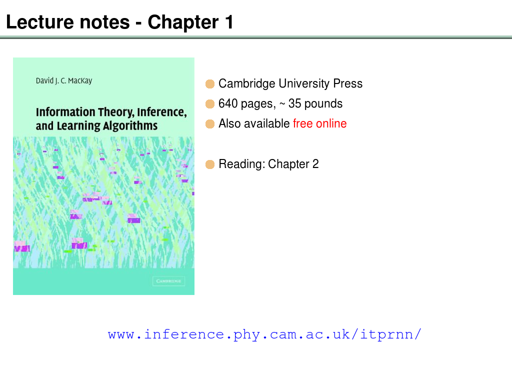

<span style="color:#2471a3;">**[note]**</span>（课程信息：阅读任务）教材信息页再次出现：左侧为 Information Theory, Inference, and Learning Algorithms 封面图。右侧要点：由 Cambridge University Press（剑桥大学出版社）出版；640 pages, ~ 35 pounds（640 页，约 35 英镑）；Also available free online（也可免费在线获取，红色强调）；新增一条要点：Reading: Chapter 2（课前阅读：第 2 章）。页面底部蓝色等宽字体网址：www.inference.phy.cam.ac.uk/itprnn/。

### p.13 〔Course outline（课程大纲）〕

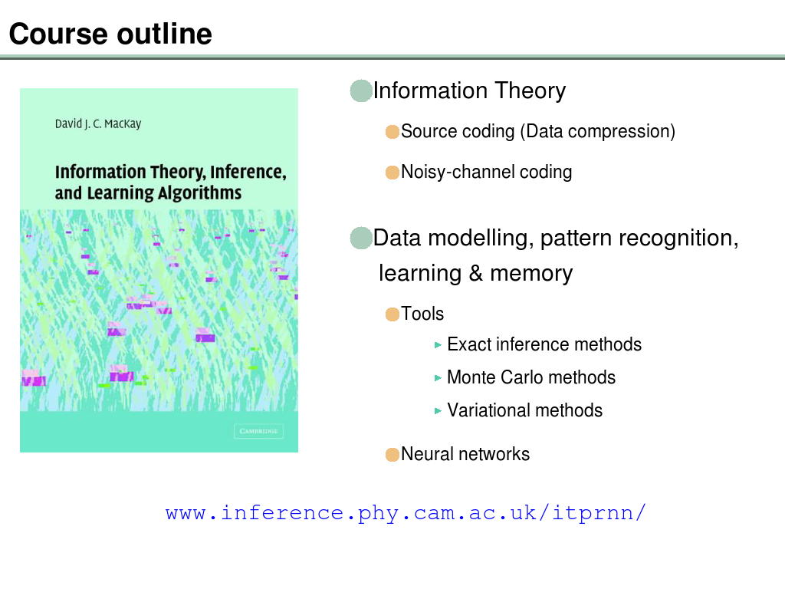

<span style="color:#2471a3;">**[section]**</span> 标题：Course outline（课程大纲）。左侧仍为教材封面。右侧两级要点列表：

- Information Theory（信息论）
  - Source coding (Data compression)（信源编码，即数据压缩）
  - Noisy-channel coding（噪声信道编码）
- Data modelling, pattern recognition, learning & memory（数据建模、模式识别、学习与记忆）
  - Tools（工具）
    - Exact inference methods（精确推断方法）
    - Monte Carlo methods（蒙特卡罗方法）
    - Variational methods（变分方法）
  - Neural networks（神经网络）

页面底部蓝色等宽字体网址：www.inference.phy.cam.ac.uk/itprnn/。

> <span style="color:#1e8449;">**[note] Note（译者注）:**</span> 这份大纲看起来是把两门课拼在一起，其实是一条主干分成两枝：前半段问"信息怎么度量、怎么搬"，后半段问"给定数据怎么反推模型"，而两枝共用的骨架是同一个概率分布——同一堆数，两种用法。
>
> 先看信息论那一枝。source coding（信源编码，即数据压缩）的目标是"用尽量少的 bit（比特）表示数据"，其极限是 entropy（熵）$H(X)$；noisy-channel coding（噪声信道编码）的目标是"在 $f>0$ 的 channel（信道）上可靠地传"，其极限是 capacity（容量）$C$。两者的共同工具是同一个量：$-\log_2 P(x)$。对单个符号 $x$，把码长取成 $-\log_2 P(x)$ 时平均码长恰好等于 $H(X)$（Kraft 不等式保证这样一组长度在语法上能拼成一棵前缀树），于是"压缩到极限"精确地等于"用真实分布给每个符号分配码长"。这一步是全课程最重要的翻译，值得停下来自己验一遍：常见符号给短码、罕见符号给长码，正是我们在直觉上会做的事。
>
> 再看推断那一枝。给定数据 $D$，想知道参数 $\theta$，写 $P(\theta\mid D)=P(D\mid\theta)P(\theta)/P(D)$：prior（先验）编码"看数据之前信什么"，likelihood（似然）编码"若参数取这个值，数据有多像"，posterior（后验）是两者相乘再归一化，分母的 evidence（证据）$P(D)=\int P(D\mid\theta)P(\theta)\,d\theta$ 衡量模型整体的解释力。这条公式的全部难点都在分母那个积分上：一般没有解析解，变量一多连数值积分都做不动，而大纲列的三类 tools（工具）正是绕开它的三种办法。
>
> 三类工具的机制分工要分清楚。exact inference（精确推断）适用于变量少、结构稀疏的模型，直接求和或变量消元，代价随图结构的树宽指数增长，所以只能在小规模上做到零误差。Monte Carlo methods（蒙特卡罗方法）用采样近似积分，误差按 $1/\sqrt{S}$ 收缩（$S$ 为样本数）——这与注 #2 的 $\sigma/\mu=\sqrt{(1-f)/(Nf)}$ 是同一个规律，采样估计一样逃不掉 $1/\sqrt{S}$，想要多一位十进制精度就得多花一百倍样本。variational methods（变分方法）不求真 posterior（后验），而是在一族可计算的分布里找与真后验 KL divergence（KL 散度）最小的那个，把推断变成优化问题，代价是引入 bias（偏置）：结果有偏，但方差小、算得快。三者的取舍本质就是统计里那个"偏差–方差"三角，没有哪一类普遍最优。
>
> 两枝的接缝在这里显形：把"给数据分配概率"这件事同时看作压缩与推断。算一个能复核的小例子：抛一枚硬币，$P(\text{正})=\theta$，观测 10 次得 7 正 3 反。取 prior（先验）为均匀分布，等价于 $\mathrm{Beta}(1,1)$，则 posterior（后验）是 $\mathrm{Beta}(8,4)$，均值 $8/12=0.667$，比 maximum likelihood（最大似然）估计 $7/10=0.7$ 更靠近 $0.5$——先验把小样本往回拉了一点，这就是小样本下两种学派差别最直观的体现。再看码长：数据在"均匀先验模型"下的概率是 $P(D)=\int_0^1\theta^{7}(1-\theta)^{3}d\theta=\frac{7!\,3!}{11!}=\frac{1}{1320}$，对应码长 $-\log_2\frac{1}{1320}=10.366$ 个 bit（比特）。若改用拟合好的 $\theta=0.7$ 直接编码，码长是 $-7\log_2 0.7-3\log_2 0.3=7(0.5146)+3(1.7370)=3.602+5.211=8.813$ 个 bit（比特）。两者相差 $1.553$ 个 bit（比特），这多出来的一段正是"描述参数本身"的开销——MDL（minimum description length，最小描述长度）原理的全部内容：模型越好，参数编码与数据编码两段之和越短。
>
> 三条连接。接 6.431：全概率公式与条件概率是这条公式的全部零件，区别在于这里对连续参数做积分而不是对离散事件求和，于是"归一化"变成"积分为 1"。接 Cover 信息论前 6 章：Kraft 不等式与"$H$ 是最优平均码长的下界"给出压缩侧的全部严格性；读它时把注 #6 的 $C$ 与这里的 $H$ 并列看，会发现两者是同一种"极值 + 存在性"论证的两个面孔。接 18.065（Strang 矩阵方法）：概率单纯形是一个凸集，posterior（后验）更新是其中一条曲线，而变分推断就是在单纯形上做投影——区别在于线代课本不谈归一化约束的概率含义，只谈正交投影的几何含义。
>
> 收束：大纲的两枝不是并列，而是同一件事的两种说法——会压缩、会建模、会推断，在数学上是同一个动作。这也是 MacKay 把三个词并列写进书名的原因。

### p.14 〔The weighing problem（称球问题）〕

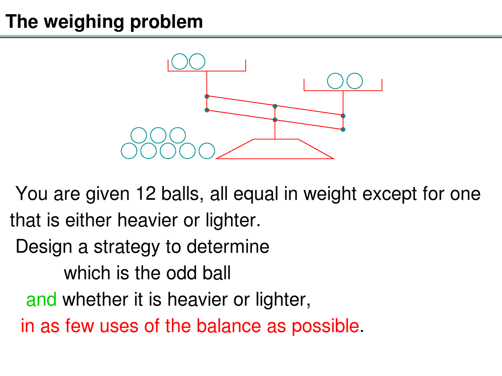

<span style="color:#2471a3;">**[example]**</span>（称球问题）页面上方是一幅红色线条画的天平：横梁向右倾斜，左盘翘起、右盘下沉，两个盘中各放 2 个青绿色小球（示意一次 2 对 2 的称量），底座旁的地面另散放 8 个小球，合计 12 只。正文：You are given 12 balls, all equal in weight except for one that is either heavier or lighter.（给你 12 只球，除了一只球的重量或偏重或偏轻外，其余全部等重。）Design a strategy to determine which is the odd ball and whether it is heavier or lighter, in as few uses of the balance as possible.（请设计一种策略，判定哪一只是异常球（odd ball）、它偏重还是偏轻，并且尽可能少地使用天平。）其中连词 and 为绿色强调，in as few uses of the balance as possible 为红色强调。

> <span style="color:#1e8449;">**[note] Note（译者注）:**</span> 这道称球题是下一讲的信息论热身，它要你建立一个动作顺序：动手之前先数一数总共有几种可能，再数一数每次实验最多能区分几种，最后才去想策略。
>
> 计数：odd ball（异常球）有 12 种选择，偏重或偏轻 2 种，共 $12\times 2=24$ 种情形。一次称量只有 left heavy（左沉）、right heavy（右沉）、balance（平衡）3 种结果，$k$ 次称量的 decision tree（决策树）至多 $3^{k}$ 片叶子，每片叶子只能对应一种情形，故 $3^{k}\ge24$，取整得 $k\ge\lceil\log_3 24\rceil=3$。换成信息论语言：问题本身带 $\log_2 24=4.585$ 个 bit（比特）的不确定性，每次称量至多提供 $\log_2 3=1.585$ 个 bit（比特），$4.585/1.585=2.893$，同样得 3 次。两种算法是同一件事的两种写法，因为换底只差一个常数因子。
>
> 但"3 次够不够"不能只靠这条下界，必须再过一道构造性关卡。设第一次称 $k$ 对 $k$，则未上秤的 $12-2k$ 只球各带 2 种情形（可能重也可能轻），共 $2(12-2k)$ 种，必须不超过剩余 2 次能分辨的 $3^{2}=9$ 种，故 $12-2k\le4.5$，得 $k\ge4$。而上秤的 $2k$ 只球每种只贡献 1 种情形（倾斜方向已经把这球的可能状态锁定：左沉只能是"左盘某球偏重"或"右盘某球偏轻"），共 $2k$ 种，也须 $\le9$，得 $k\le4$。两式夹出 $k=4$，即第一次必须 4 对 4。这就是下界论证之后的第二件事：把约束代进去，看下界究竟可达还是不可达。
>
> 同一个夹逼用到 13 只球立刻自相矛盾：未上秤需 $13-2k\le4.5$ 得 $k\ge5$，上秤需 $2k\le9$ 得 $k\le4$，无解。所以广为人知的"12 球 3 次"做法无法推广到 13 球，尽管纯计数条件 $3^{3}=27\ge26$ 看起来绰绰有余。这条反例的价值在于它说明：信息下界只是必要条件，构造可行性是独立的第二关，而两关之间留出的空隙可能正好把候选方案全部卡死。记住"下界不紧"这个词，它在算法课里会以同样的方式出现（比较排序下界紧、而很多具体问题的计数下界并不紧）。
>
> 12 球的具体策略，可逐步复核。第一次称 1,2,3,4 对 5,6,7,8。情形 A：平衡，则异常必在 9,10,11,12 之中，且 1 至 8 全部是正常球。第二次称 9,10,11 对 1,2,3：若平衡则 12 号异常，第三次 12 对 1 定出轻重；若左沉则 9,10,11 中有一只偏重，第三次 9 对 10，左沉即 9 重、右沉即 10 重、平衡即 11 重；若右沉则 9,10,11 中有一只偏轻，同法三分。情形 B：左沉，则候选是"1 至 4 中一只偏重"或"5 至 8 中一只偏轻"，共 8 种。第二次称 1,2,5 对 3,6,9（9 号已证正常）：若左沉，候选收缩为 1 重、2 重、6 轻三种，第三次 1 对 2 即可三分；若右沉，候选是 3 重、5 轻两种，第三次 3 对 9，左沉即 3 重、平衡即 5 轻；若平衡，候选是 4 重、7 轻、8 轻三种，第三次 7 对 8，左沉即 8 轻、右沉即 7 轻、平衡即 4 重。情形 C：右沉，与情形 B 完全左右对称。全程恰好 3 次，每一片叶子对应一种情形，$24$ 种情形与 $3^{3}=27$ 片叶子之间留出 3 片冗余——这 3 片冗余正是"下界 3 次可达"的余量。
>
> 两条连接。接 6.006/CLRS 的决策树下界：比较排序用 $\log_2(n!)$，这里用 $\log_3 24$，骨架完全相同——"结果序列的条数 $\ge$ 情形数"是任何下界论证的原型。区别只在分支因子由实验设计决定：比较只能给出"小于/大于"两个方向，分支因子 2 是硬约束；而称量的三分结果是可设计的，你能决定放几个球上去。接 Cover 信息论：把"称量结果"看作随机变量，一次称量提供的平均信息量不超过 $\log_2 3$，这就是注 #6 里 capacity（容量）的雏形——"每次使用最多给多少信息"有个天花板，与你怎么设计无关。再补一条 6.042J 的连接：$3^{k}\ge24$ 是 pigeonhole（鸽巢）论证的最简形式，"下界 + 构造"这个两段式模板此后在算法课里会反复出现。
>
> 收束：这道题真正教的不是称球，而是"先数一数"这个动作——它在信息论里会被提升成一个定理，也就是注 #6 的那条曲线。

### p.15 〔Lecture notes - Chapter 1（课程讲义——第 1 章：购书信息）〕

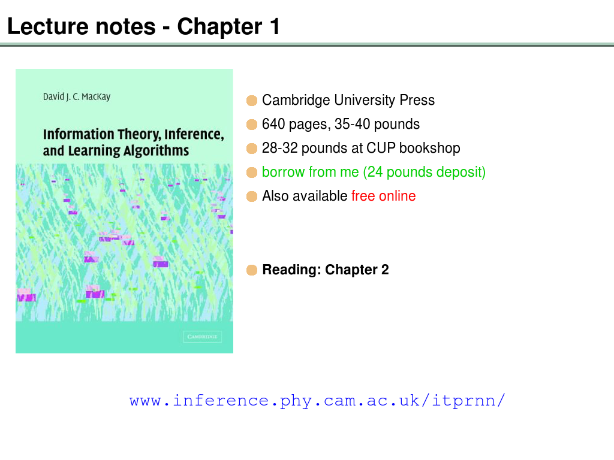

<span style="color:#2471a3;">**[note]**</span>（课程信息：购书方式）教材信息页（收尾版）最后一次出现：左侧为 Information Theory, Inference, and Learning Algorithms 封面图。右侧要点：由 Cambridge University Press（剑桥大学出版社）出版；640 pages, 35-40 pounds（640 页，35–40 英镑）；28-32 pounds at CUP bookshop（在 CUP 书店购价为 28–32 英镑）；borrow from me (24 pounds deposit)（可向授课人借阅，押金 24 英镑，绿色强调）；Also available free online（也可免费在线获取，红色强调）；间隔之后一条：Reading: Chapter 2（课前阅读：第 2 章）。页面底部蓝色等宽字体网址：www.inference.phy.cam.ac.uk/itprnn/。
