> <span style="color:#7f8c8d;">Source: MacKay《Information Theory, Inference, and Learning Algorithms》课程手写讲义 l2 · 行内双语视觉转录版 · 原图见 fig/l2/</span>

### p.1 〔Information theory, pattern recognition, and neural networks（信息论、模式识别与神经网络）〕

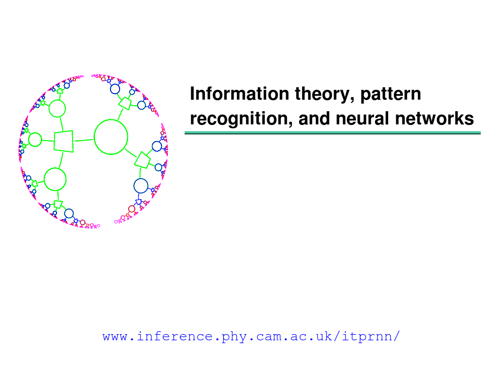

<span style="color:#2471a3;">**[lecture]**</span> **Information theory, pattern recognition, and neural networks（信息论、模式识别与神经网络）**——课程封面页。右侧为课程全名大标题，页面底部标出课程网址 `www.inference.phy.cam.ac.uk/itprnn/`。左侧是一幅圆形图案：一个圆盘内部画着一棵递归分形树，主干与粗枝为绿色（节点有圆形、方形、菱形等形状），末梢细枝呈蓝色与品红色，逐层分叉并向圆盘边缘加密延伸。〔本页除标题与网址外为纯手绘图示〕

### p.2 〔The binary symmetric channel（二元对称信道）〕

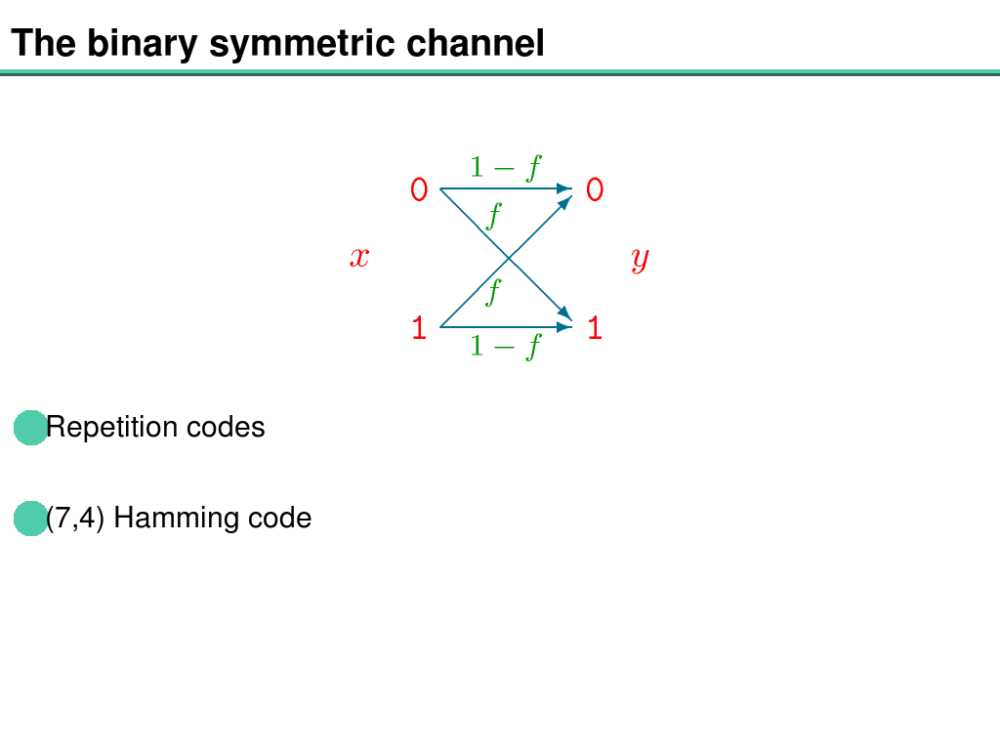

<span style="color:#2471a3;">**[definition]**</span> **The binary symmetric channel（二元对称信道）**：页面中央是一张信道转移图——左端标红色输入 $x$，含两个输入节点 $0$ 与 $1$；右端标红色输出 $y$，含两个输出节点 $0$ 与 $1$。四条青色箭头：直箭头 $0 \to 0$ 与 $1 \to 1$ 各标绿色概率 $1-f$，交叉箭头 $0 \to 1$ 与 $1 \to 0$ 各标绿色概率 $f$。即输入比特以概率 $f$ 被翻转、以概率 $1-f$ 原样通过的最简噪声模型。

本页列出本讲要讨论的两个编码方案：

- Repetition codes（重复码）
- (7,4) Hamming code（(7,4) 汉明码）

> <span style="color:#1e8449;">**[note] Note（译者注）:**</span> 这一页要回答的 design problem（设计问题）只有一个：把"噪声"这件事压到最少的参数，同时别丢掉它最关键的失效方式。binary symmetric channel（二元对称信道）这个名字里的三个词各自删掉了一种复杂性，逐个拆开，你就得到整门课反复出场的那只"果蝇"。
>
> 第一层，channel（信道）在概率论里就是一张条件概率表。给定 input（输入）随机变量 $X$，output（输出）随机变量 $Y$ 服从 conditional distribution（条件分布）$P(Y\mid X)$，表里每一行是一个概率分布、行和为 1。两个输入两个输出的一般情形需要 $2\times(2-1)=2$ 个自由参数；binary symmetric channel（二元对称信道）只留 1 个，就是 flip probability（翻转概率）$f$。被删掉的那个自由度恰好是"噪声怎么依赖输入"这一维，而这次删除是所有后续计算能做得下去的唯一理由 —— 剩下的表由单个实数决定，你才可能把整条编码链条上的概率写成闭式。
>
> 第二层，symmetric（对称）的精确含义不是"看上去对称"，而是 transition matrix（转移矩阵）的两行互为置换：$P(Y\mid X=0)$ 与 $P(Y\mid X=1)$ 只差交换坐标。由此立刻得到一个可验的推论：若 $X$ 均匀，则 $Y$ 也均匀，与 $f$ 取多少无关，因为 $0.5(1-f)+0.5f=0.5$。这条推论的份量在于信息方向：光看输出分布，你读不到任何关于信道的线索，必须同时知道发了什么、再看输入输出的联合关系，才谈得上恢复输入。译码之所以必须"prior（先验）加 likelihood（似然）"两件东西一起用，根子在这里，不是技巧偏好。
>
> 第三层，noise（噪声）可以写成一次模 2 加法：$y=x\oplus e$，其中 error pattern（错误图样）$e$ 的每一位独立地以概率 $f$ 取 1。$\oplus$ 就是 CSAPP 第 2 章里那条 XOR 位运算，同时也就是模 2 的逐位加法。这个写法把"信号"与"噪声"在代数上彻底分开，于是"信道对码字做了什么"变成"码字被加上了什么"，加法可以逐位搬动、可以叠加，分析才有了抓手。反过来检验"独立"这条假设的必要性：若 $e$ 依赖 $X$，极端情形 $e=x$ 给出 $y\equiv 0$，capacity（容量）掉到 0；若 $e$ 恒为某个未知常数，$y$ 只是坐标置换，capacity（容量）变成 1。所以"与输入无关"不是技术细节，它正好把 capacity（容量）钉死在两个极端之间，这也是"对称"能给出一个干净公式的原因。
>
> 算一个能复核的：取 $f=0.1$，把消息切成 3 bit（比特）一组。全对概率 $0.9^{3}=0.729$；恰好错 1 位 $3\times 0.1\times 0.9^{2}=0.243$；至少错 1 位 $0.271$。这个换算是天天要用的：per-bit（每位）错误率 10% 绝不等于每个分组 10% 出错，3 bit 一组时是 27%。再看后验：先验 $P(X=1)=0.9$、收到 $y=1$，则 $P(X=1\mid y=1)=0.81/(0.81+0.01)\approx 0.9878$；先验均匀时同一后验是 0.9，正好等于 $1-f$。先验越强，一次翻转越难推翻结论 —— 这就是 MAP（最大后验）译码的全部机制。
>
> 跨课程连接三条。Bertsekas 的概率论给你 conditional distribution（条件分布）与全概率公式这套语法，这条信道就是它最简的一个例子；CSAPP 第 2 章把 bit（比特）当作二进制表示的最小构件、把 XOR 当作一条指令与一族函数，区别在于那里的 XOR 是确定性位运算，这里的 $\oplus$ 带上了概率参数 $f$，是一个随机算子。第三条留在本课程内部：$f=0.1$ 时 $C=1-H_2(0.1)\approx 0.531$ bit 每次使用，而 p.4 那张图的分界点 $C$ 正落在 0.5 略右 —— 两个数对上，说明这张图画的正是翻转概率 0.1 的那条信道。把 $f$ 记牢，本讲后面演示 Hamming code（汉明码）表现全靠它。

### p.3 〔（无标题页）通信系统框图：编码器—噪声信道—译码器〕

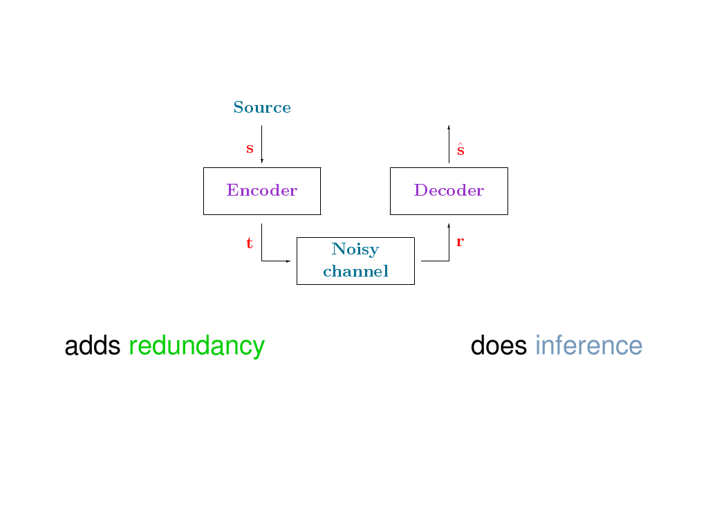

页面是一张框图：顶部青绿色字 **Source（信源）**，向下箭头（旁标红色 $s$）进入紫色方框 **Encoder（编码器）**；编码器输出红色 $t$，向右折入青绿色方框 **Noisy channel（噪声信道）**；信道输出红色 $r$，向上折入右侧紫色方框 **Decoder（译码器）**；译码器向上输出红色 $\hat{s}$（即信源的重构/估计）。框图下方左右各有一句点评：左边 **adds redundancy**（增加冗余，其中 redundancy 一词为绿色强调），右边 **does inference**（做推断，其中 inference 一词为灰蓝色强调）。

> <span style="color:#1e8449;">**[note] Note（译者注）:**</span> 这一页把整条链子劈成两半：encoder（编码器）负责"加 redundancy（冗余）"，decoder（译码器）负责"做 inference（推断）"。要害在于 redundancy（冗余）的本质不是"多抄一份"，而是"在 codeword（码字）之间撑开距离"；一旦这么看，"加冗余"就从手工技巧变成一个可以计数、可以优化、可以算出极限的设计问题。
>
> 机制先走极端。若一个 bit（比特）都不浪费，$n$ 位全部用来装信息，那就有 $2^{n}$ 个 codeword（码字）铺满 $2^{n}$ 个可能串，任意两个 codeword（码字）的 Hamming distance（汉明距离）只有 1；此时收到任何串都是"合法码字"，你连"出错了"都判断不了，纠错能力为零。加 redundancy（冗余）就是只挑一个子集 $C$，让 $|C|=2^{k}$、最小距离为 $d$，多出来的 $n-k$ 位不装信息，专买距离。为什么距离能换来纠错：以每个 codeword（码字）为心、半径 $t=\lfloor (d-1)/2\rfloor$ 的球互不相交，于是任何一个被噪声推离不超过 $t$ 个位置的 received word（接收字）只落在一个球里，最近邻译码的结果唯一。这就是"球不相交"论证，也是 sphere packing（球填充）视角的全部内容。
>
> 计数给出天花板：$|C|\cdot\sum_{i=0}^{t}\binom{n}{i}\le 2^{n}$，即球的体积乘码字个数不能超过整个空间。Hamming(7,4) code（(7,4) 汉明码）恰好把不等式取等：16 个 codeword（码字），每个半径 1 的球含 $1+7=8$ 个串，$16\times 8=128=2^{7}$，一个不剩地铺满，这类码叫 perfect code（完美码）。把 Hamming bound（汉明界）反解成 rate（码率）上限更能看出它有多紧：$t=1$ 时 $R\le 1-\log_{2}(n+1)/n$，取 $n=7$ 得 $1-3/7=4/7$，正好等于 Hamming(7,4) 的 rate（码率）—— 也就是说在"只纠 1 位错"这一档里，它已经把界取到等号，没有任何码能在同一码长下做得更省。
>
> 三个数放在一起就能看出设计的好坏。不编码：rate（码率）1，块错误率 0.1。repetition code（重复码）R3：rate（码率）$1/3$，块错误率 $3f^{2}(1-f)+f^{3}=0.028$，也就是拿 3 倍传输换来 3.6 倍可靠。Hamming(7,4)：rate（码率）$4/7\approx 0.571$，同样纠 1 位错，却只用 1.75 倍传输。同样的纠错能力，一个花 3 倍一个花 1.75 倍，差别全在"距离怎么买"。再补一句避免误用：当 $f>0.5$ 时，$P(r\mid s)=f^{d}(1-f)^{n-d}$ 随距离递增，最近邻反而最不可能，此时正确做法是把每位取反化成 $1-f$ 的信道，或者直接用 MAP（最大后验）判据。这就是"照抄最小距离会翻车"的地方。
>
> "译码等于推断"要把话说全：$P(s\mid r)\propto P(r\mid s)P(s)$，likelihood（似然）由信道给出（每一位是 $1-f$ 还是 $f$），prior（先验）描述信源本身的规律。若先验均匀且 $f<0.5$，后验最大者恰是距离最小者，两套说法重合；若先验偏斜，改判就可能合法 —— 这是贝叶斯观点比"纠错位数"更强的部分，它连"你的消息本来更可能是什么"一起用上了。
>
> 跨课程连接：CSAPP 第 11 章的 TCP checksum（校验和）也是 redundancy（冗余），但只做检测不做纠正，纠正被外包给"超时重传"这个时间维度；CSAPP 第 6 章的 cache tag（标记位）同样是多存几位换辨识度，只是它辨识的是地址不是错误。区别一句话：checksum（校验和）用空间换"知道错了"，纠错码用空间换"知道错在哪、直接改回来"。前者靠重传付费，后者靠带宽付费，选哪个取决于重传一次有多贵。再补一个容易漏掉的接口：若收到的串落在所有球之外（错位数超过 $t$），译码器只能报告"检测到错误"，不能改回来 —— 这就是 detection（检测）与 correction（纠正）的分界，也正是上一段 checksum（校验和）与纠错码的分界；同一个几何图像，半径取多大决定了你能做哪一件事。

### p.4 〔Shannon's noisy channel coding theorem（Shannon 噪声信道编码定理）〕

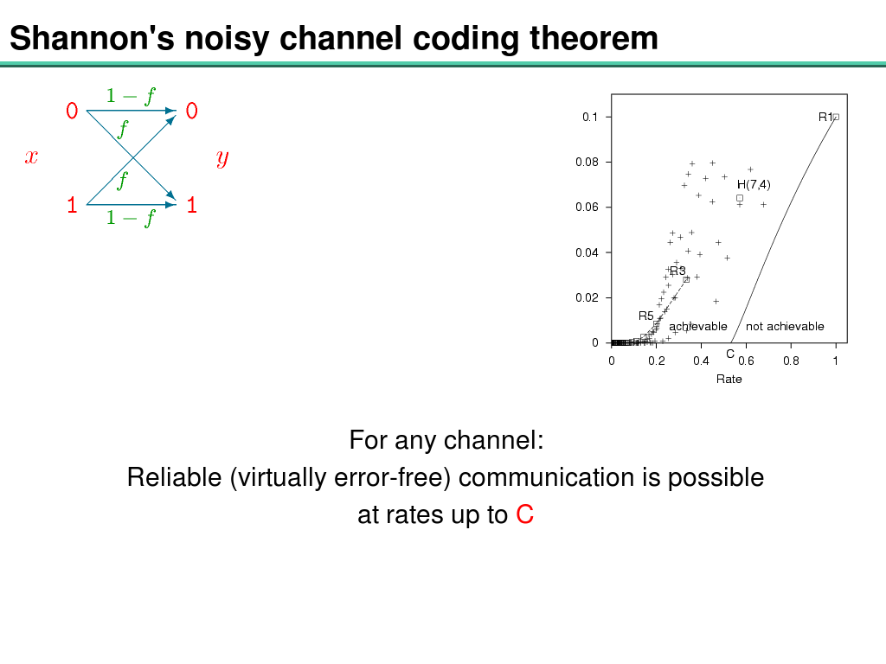

<span style="color:#2471a3;">**[theorem]**</span> 页面左侧重画了 p.2 的二元对称信道转移图（左端 $x$ 的节点 $0/1$，右端 $y$ 的节点 $0/1$，直通箭头标 $1-f$，交叉箭头标 $f$）。右侧是一张 x-y 散点图：横轴标 **Rate（码率）**，从 0 到 1；纵轴为错误率，刻度 0 到 0.1（间隔 0.02）。图面散布大量十字形数据点（各种编码方案实测的"码率—错误率"表现），并有若干标注点：右上角 $R1$（码率约 1.0、错误率约 0.1）；$H(7,4)$（码率约 0.57、错误率约 0.06）；$R3$（码率约 0.28、错误率约 0.03）；$R5$（码率约 0.19、错误率约 0.02）。一条从横轴上 $C$（约 0.5 略右）出发、向右上延伸到 $R1$ 的曲线把图面分成两半：曲线左下方标 **achievable（可达）**，右上方标 **not achievable（不可达）**。

图下方结论文字：**For any channel: Reliable (virtually error-free) communication is possible at rates up to C.**（对任何信道：只要码率不超过 $C$，就可以实现几乎无差错的可靠通信。）

> <span style="color:#1e8449;">**[note] Note（译者注）:**</span> 这张散点图承载的不是经验曲线，而是一条硬阈值：channel capacity（信道容量）$C$ 之上，无论你多聪明，错误率都压不到零；$C$ 之下，错误率能压到任意小。理解它要同时握住两半证明，一半说"不可能"，一半说"可能"。
>
> 先看"不可能"这一半，它是纯计数，思路可以复用到任何下界论证。设消息有 $M=2^{nR}$ 个，码长 $n$，接收串 $Y^{n}$ 只有 $2^{n}$ 种取值。若译码错误率为 $P_{e}$，Fano 不等式给出 $H(M\mid Y^{n})\le 1+P_{e}\cdot nR$：给定输出后还剩多少不确定性，最多是"错的时候全错"再加 1 bit（用来标记到底错没错）。另一方面，任何信道每次使用搬不了超过 $C$ bit，故 $I(M;Y^{n})\le nC$，于是 $H(M\mid Y^{n})=H(M)-I(M;Y^{n})\ge nR-nC$。两条夹住同一个量：$nR-nC\le 1+P_{e}nR$，解出 $P_{e}\ge 1-\dfrac{C}{R}-\dfrac{1}{nR}$。当 $R>C$ 且 $n$ 变大，右端趋于一个正常数，错误率不可能归零。这就是"上确界夹逼"模板：从两头各给一个界，被夹住的量就暴露出结构。
>
> 再看"可能"那一半：random coding（随机编码）。随手按输入分布独立抽 $2^{nR}$ 个 codeword（码字）组成码本，用 joint typicality（联合典型性）做译码，可以证明平均错误率随 $n$ 指数衰减，只要 $R<C$。既然平均值这么小，就至少存在一个好码本。注意这条证明的性质：它只说"存在"，没告诉你怎么造 —— 这是 Shannon 论断与工程实现之间那道几十年的缝。历史坐标：Shannon 1948 年在 Bell System Technical Journal 第 27 卷发表 A Mathematical Theory of Communication（第 3 期 379–423 页、第 4 期 623–656 页），定理给出了极限却没给出码；直到 1993 年 turbo codes（涡轮码）与 1990 年代中期被重新发现的 LDPC（低密度奇偶校验码，Gallager 1960 年代提出后长期沉寂）才把差距压到零点几分贝。
>
> 把这把尺子架到具体数上。$f=0.1$ 时 $C=1-H_2(0.1)\approx 0.531$ bit 每次使用，于是传 $10^{6}$ bit（比特）至少需要 $10^{6}/0.531\approx 1.88\times 10^{6}$ 次信道使用，这是物理下界，任何编码器都绕不过。再看图上三点：R3 的 rate（码率）$1/3\approx 0.333<C$，原则上可达，可它的错误率卡在 0.028 不降，因为 $n=3$ 太短、码本太稀；Hamming(7,4) 的 rate（码率）$4/7\approx 0.571>C$，超出 0.040 bit 每次使用，所以它再优化也压不到零，图上那个约 0.06 的位置就是它的天花板。一句话：rate（码率）低于 $C$ 只是必要条件，另一个必要条件是码要够长、够随机。顺手做三个端点检验，公式的可信度立刻上升：$f=0$ 时 $C=1-H_2(0)=1$，无噪声就该无损；$f=0.5$ 时 $C=1-H_2(0.5)=0$，输出与输入独立，再聪明的编码也无处借力；而 $H_2(0.9)=H_2(0.1)=0.469$，故 $C(0.9)=C(0.1)=0.531$，把每一位取反的信道与原来等价。三个值一代，这条公式的含义就清楚了：噪声拿走多少不确定性，capacity（容量）就扣掉多少。
>
> 跨课程连接：CLRS 第 8 章用决策树证比较排序下界 $\log_{2}(n!)=\Omega(n\log n)$，骨架一模一样 —— 叶子数不能少于要区分的输入数。区别有两处：排序的叶子数 $n!$ 是精确可数的，所以界紧；信道编码的"叶子数"是概率性的，只能靠对随机码本取平均来证，因此给不出构造性算法。这也解释了为什么同一套计数思想，在算法课里直接变成复杂度结论，在信息论里却要继续追问"那到底怎么造"。最后一个口径提醒：$C$ 的单位是 bit（比特）每次使用，不是 bit（比特）每秒；再乘上每秒能用多少次信道（相当于你熟悉的 bandwidth（带宽）那个角色）才是吞吐量，两者混用会把结论算错一个量级。

### p.5 〔Homework（课后作业）〕

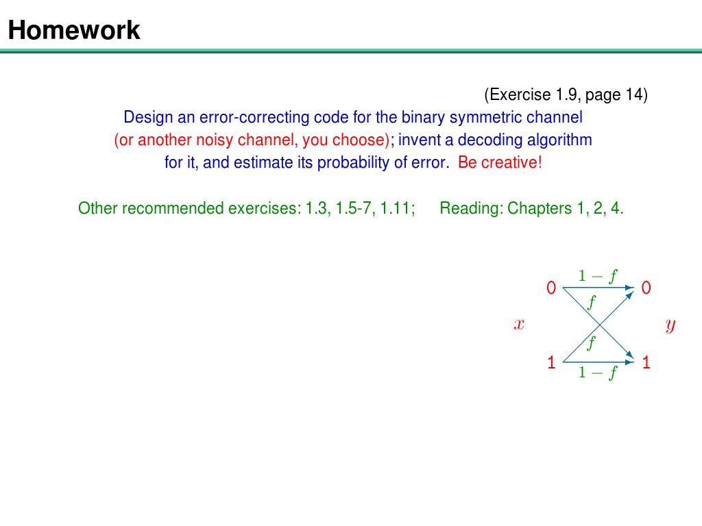

页面右上角标注 **(Exercise 1.9, page 14)（练习 1.9，第 14 页）**。主体作业题（蓝红两色书写）：

Design an error-correcting code for the binary symmetric channel（为二元对称信道设计一个纠错码），or another noisy channel, you choose（或者选一个你自己挑的噪声信道）；invent a decoding algorithm for it, and estimate its probability of error.（为它发明一个译码算法，并估计其错误概率。）Be creative!（发挥创意！）

下面一行绿色小字：**Other recommended exercises: 1.3, 1.5-7, 1.11; Reading: Chapters 1, 2, 4.**（其他推荐练习：1.3、1.5–7、1.11；阅读：第 1、2、4 章。）

右下角重画了 p.2 的二元对称信道转移图（左端 $x$ 节点 $0/1$、右端 $y$ 节点 $0/1$，直通箭头标 $1-f$，交叉箭头标 $f$）。

### p.6 〔（无标题页）被打码的文本：《Emma》开篇〕

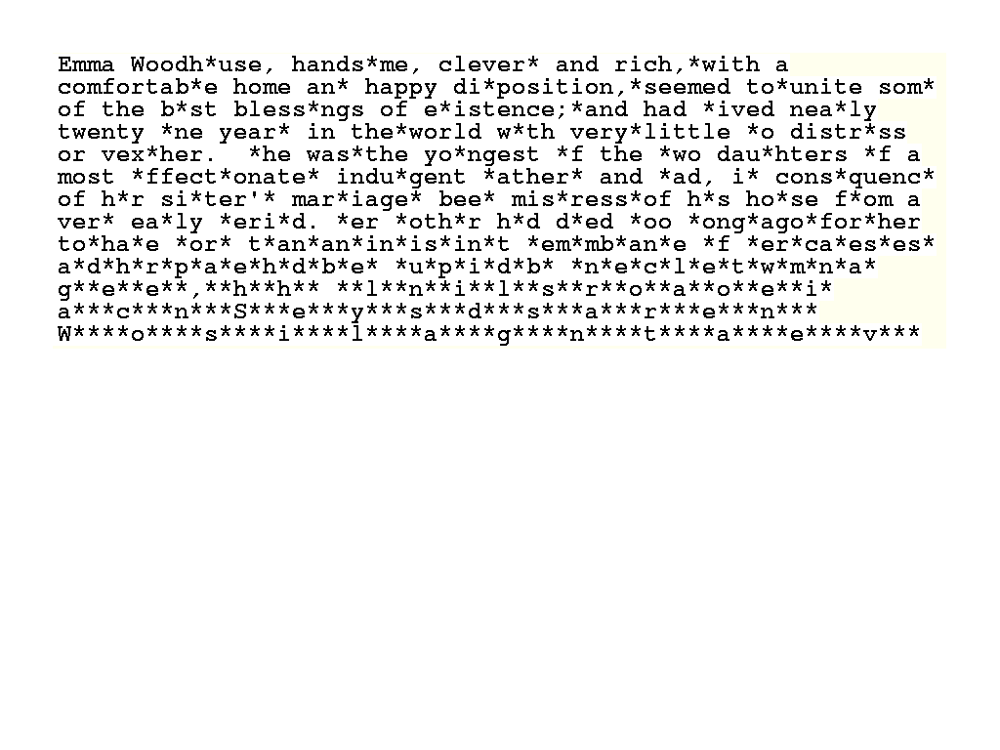

整页是一大块打字机字体的英文文本（浅黄色底）：内容为 Jane Austen 小说《Emma》的开篇段落，其中大量字母被替换成星号 `*`（模拟"字符经噪声信道后丢失"的输出）。按图逐行转录如下（星号位置忠实于图）：

```
Emma Woodh*use, hands*me, clever* and rich,*with a
comfortab*e home an* happy di*position,*seemed to*unite som*
of the b*st bless*ngs of e*istence;*and had *ived nea*ly
twenty *ne year* in the*world w*th very*little *o distr*ss
or vex*her.   *he was*the yo*ngest  *f the *wo dau*hters  *f a
most *ffect*onate*  indu*gent  *ather*  and  *ad,  i*  cons*quenc*
of h*r si*ter'* mar*iage*  bee*  mis*ress*of h*s ho*se f*om a
ver*  ea*ly  *eri*d.  *er  *oth*r  h*d  d*ed  *oo  *ong*ago*for*her
to*ha*e *or* t*an*an*in*is*in*t *em*mb*an*e *f *er*ca*es*es*
a*d*h*r*p*a*e*h*d*b*e*  *u*p*i*d*b*  *n*e*c*l*e*t*w*m*n*a*
g**e**e**,*h**h**  **l**n**i**l**s**r**o**a**o**e**i*
a***c**n**S**e***y***s**d**s**a**r**e***n**
W***o***s***i***l***a***g***n***t***a***e***v***
```

其完整原文与中文翻译见下一页（p.7）。

### p.7 〔（无标题页）《Emma》片段：完整原文与打码版对照〕

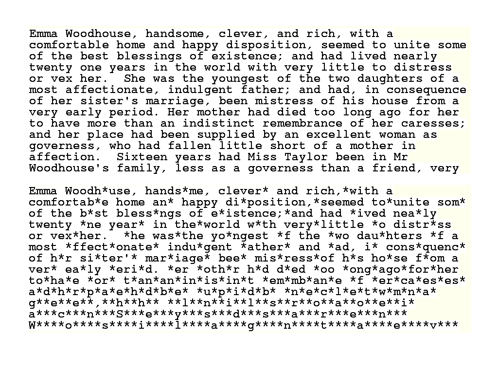

页面为上下两块同一段文字的对照版。**上块是完整原文**（Jane Austen《Emma》第一章开头），逐句行内双语转录：

> Emma Woodhouse, handsome, clever, and rich, with a comfortable home and happy disposition, seemed to unite some of the best blessings of existence; and had lived nearly twenty one years in the world with very little to distress or vex her.（爱玛·伍德豪斯又漂亮、又聪明、又有钱，家境舒适、性情开朗，似乎集人间最好的福气于一身；她在世上过了将近二十一年，几乎没什么事让她痛苦或烦恼。）
>
> She was the youngest of the two daughters of a most affectionate, indulgent father; and had, in consequence of her sister's marriage, been mistress of his house from a very early period.（她是两姐妹中的小女儿，父亲极其慈爱、百般纵容；也正因姐姐出了嫁，她年纪轻轻便当家做了女主人。）
>
> Her mother had died too long ago for her to have more than an indistinct remembrance of her caresses; and her place had been supplied by an excellent woman as governess, who had fallen little short of a mother in affection.（母亲去世太久，她对母亲的抚爱只剩一点模糊的记忆；母亲的位置由一位极出色的家庭女教师补上，她的疼爱几乎不亚于生母。）
>
> Sixteen years had Miss Taylor been in Mr Woodhouse's family, less as a governess than a friend, very（泰勒小姐在伍德豪斯先生家已经待了十六年，与其说是家庭女教师，不如说更像一位朋友，非常……〔原文在此页被截断〕）

**下块是打码版**，与上一页（p.6）逐行转录的星号文本完全相同，不再重复；两相对照可见：约一半字母被抹去后，句子仍然可读——这正是本例要演示的现象。

> <span style="color:#1e8449;">**[note] Note（译者注）:**</span> 这两页是整门课的招牌开场实验：把一段英文随机抹掉一部分字母，你几乎仍能顺畅读出全文。它要回答的问题是"一段文字到底有多少信息"，而它给出的答案是可量化的：文字里能被安全抹掉的那部分，就是 redundancy（冗余）；剩下抹不掉的部分，就是 entropy（熵）。
>
> 先把量纲摆正。英文字母加空格共 27 个符号，若它们等概率独立，每个 character（字符）承载 $\log_{2}27\approx 4.75$ bit（比特）；若按 ASCII 存储则是 8 bit。真实英文远离"等概率独立"：字母频率极不均匀，e 与 z 的出现频率差着两个数量级；字母之间有强依赖，q 后面几乎必是 u。Shannon 1951 年在 Bell System Technical Journal 第 30 卷 50–64 页的 Prediction and Entropy of Printed English 里用逐字母预测实验测这个量：让受试者在看到前文的条件下猜下一个字母，记录第几次猜中，猜中的名次越靠前说明该字母越可预测、信息量越低，由此给出 printed English（印刷英文）每字符约 0.6 到 1.3 bit（比特）的估计。取中位数 1.0，意味着 redundancy（冗余）约 $1-1.0/4.75\approx 79\%$ —— 将近五分之四的符号是"上下文已经替你说出来"的。
>
> 拿图上这段文字自己测两个数，比背结论有用。第一，把 p.6 逐行转录里存活的字母与星号数一遍：425 个存活字母、214 个星号，被抹掉的比例是 $214/(425+214)\approx 33.5\%$，而且越往下的段落抹得越狠，最后几行几乎只剩星号 —— 抹除比例其实是"你还能不能读"的实验变量。第二，只对存活的 425 个字母做 order-0（零阶）统计，算出它们的经验 entropy（熵）约 4.08 bit（比特）每字符。这个 4.08 与 1.0 的差，就是 context（上下文）买来的东西：单看字母频率你只能省一半，看上下文才能省到八分之七。
>
> 再算一笔存储账，看看这个差有多贵。100 KB 的纯英文文本是 102400 个字符，按 ASCII 要 819200 bit（比特）；若每字符只需 1.0 bit（比特），只要 102400 bit（比特）即 12.5 KB，压缩上限 8 倍。而只利用 letter frequency（字母频率）的编码（例如对字母表建一棵 Huffman tree（哈夫曼树））平均码长约 4.1 bit（比特）每字符，只能做到 2 倍左右。差的那 4 倍不是实现不够聪明，是模型里没有上下文。
>
> 最要紧的一层：此刻正在"译码"的就是你。残存字母提供 likelihood（似然），你对英语词汇与语法的知识提供 prior（先验），你在做一次不自觉的 MAP（最大后验）推断，补出的是后验上最可能的字母序列；抹掉比例低时后验几乎单峰，抹得多了就出现歧义（同一串星号能补出两个都通顺的句子），这正是后验开始多峰的可感知版本。跨课程连接：CLRS 第 16 章的 Huffman coding（哈夫曼编码）用贪心把平均码长压到 $H\le L<H+1$，但它的模型是"每个符号独立"，所以天花板就在 order-0 的 4.08 那一档；要碰到 1.0 必须让模型记住长上下文，代价是编码器和解码器都要维护一个状态。沿着这条线往现代走一步：你以后训练 language model（语言模型）时最小化的 cross-entropy（交叉熵）损失，单位正是 bit（比特）每字符，而 perplexity（困惑度）就是 $2^{H}$ —— 这两页打码文字与那个损失函数是同一个量的两端。

### p.8 〔（无标题页）两级通信系统框图：压缩/解压 + 编码/译码〕

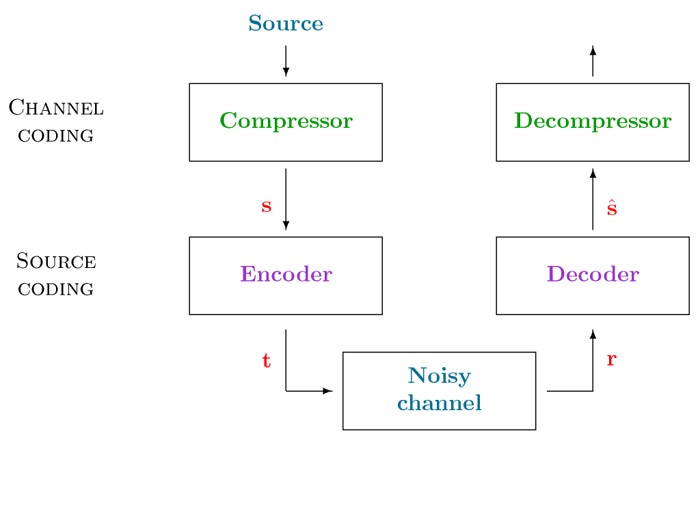

页面是一张四级框图，数据流自上而下：顶部青绿色 **Source（信源）** 向下进入绿色方框 **Compressor（压缩器）**，输出红色 $s$ 进入紫色方框 **Encoder（编码器）**，输出红色 $t$ 进入中下方青绿色方框 **Noisy channel（噪声信道）**，输出红色 $r$ 进入右侧紫色方框 **Decoder（译码器）**，输出红色 $\hat{s}$ 向上进入绿色方框 **Decompressor（解压器）**，最终向上输出。左侧有两行大写标注：**CHANNEL CODING**（信道编码，位于 Compressor/Decompressor 一行的左侧）、**SOURCE CODING**（信源编码，位于 Encoder/Decoder 一行的左侧）。

> <span style="color:#1e8449;">**[note] Note（译者注）:**</span> 这张四级框图是全书总纲，也是唯一一处需要你先纠正标注再读的图。按位置，CHANNEL CODING（信道编码）写在 Compressor（压缩器）与 Decompressor（解压器）那一行旁边，SOURCE CODING（信源编码）写在 Encoder（编码器）与 Decoder（译码器）那一行旁边，而按功能恰好相反：真正做 source coding（信源编码）的是压缩那一对，它把信源压到信息论极限，也就是"去冗余"；真正做 channel coding（信道编码）的是编码那一对，它往压缩后的 bit（比特）流里加回精心设计的 redundancy（冗余）以抗噪。请以数据流 $s\to t\to r\to \hat{s}$ 与方框位置为准，别被标签牵着走。
>
> 为什么两级不能换顺序，这是本页真正的机制。compressor（压缩器）的定义是"删掉一切可预测的部分"，channel code（信道码）的定义是"加入一切可预测的部分"—— 校验位之所以能纠错，正因为它与信息位之间有确定的代数关系。若你先加冗余再压缩，压缩器看到的是一段"有规律"的 bit（比特）流，它会把这些规律原样当成 redundancy（冗余）删掉，你辛苦加的保护位被当垃圾扔掉，纠错能力直接归零。因果关系一句话：两级的操作作用在同一个维度（可预测性）上、方向相反，所以顺序不可交换；先压缩把数据变成"白"的，再加冗余才有东西可加、也不会被下一次压缩吃掉。
>
> 理论上这叫 separation theorem（分离定理）：对单用户 point-to-point（点对点）信道，只要压缩后 rate（码率）不超过 channel capacity（信道容量）$C$，两级分开做就能达到任意小误差，不会比联合设计差。它的适用边界要说清：多用户共享信道、有硬 delay（时延）约束、信道状态未知或快速变化时，分离会损失性能，因为它们要求"信源与信道一起看"。
>
> 算一个把两级乘起来的数。信源按每字符 1.0 bit（比特）算，信道取 $f=0.1$ 的 binary symmetric channel（二元对称信道），$C\approx 0.531$ bit（比特）每次使用。于是每个字符需要 $1.0/0.531\approx 1.88$ 次信道使用；若不压缩，每字符 8 bit（比特），需要 $8/0.531\approx 15.1$ 次，正好差 8 倍 —— 这个 8 倍就是 source coding（信源编码）在账单上的全部价值，与信道好坏无关。再放大到 1 MB 文本：$1.048\times 10^{6}$ 个字符，两级都做需 $1.97\times 10^{6}$ 次使用，不压缩需 $1.58\times 10^{7}$ 次。两条流水线各管一个量纲，乘起来才是总成本，这也是为什么工程上总能分别优化。
>
> 跨课程连接：CSAPP 第 6 章的 memory hierarchy（存储层次）用同一套哲学 —— 每层只解决一个目标（容量、延迟、单价），组合靠 AMAT（平均访存时间）把命中时间与缺失代价相加相乘。区别在"下界"这三个字：cache（高速缓存）的组合靠概率命中率，你只能算平均表现，算不出"物理上不可能更快"；这里每一级都有硬下界（信源侧是 $H$，信道侧是 $C$），算出的是不可能性。同一张图的另一处对偶也值得记：压缩器努力让序列看起来随机、逼近 entropy（熵）最大，channel code（信道码）却故意往近乎随机的 bit（比特）里注入结构 —— 方向相反，用的是同一套数学。

### p.9 〔A simple redundant source - a bent coin（一个简单冗余信源——弯硬币）〕

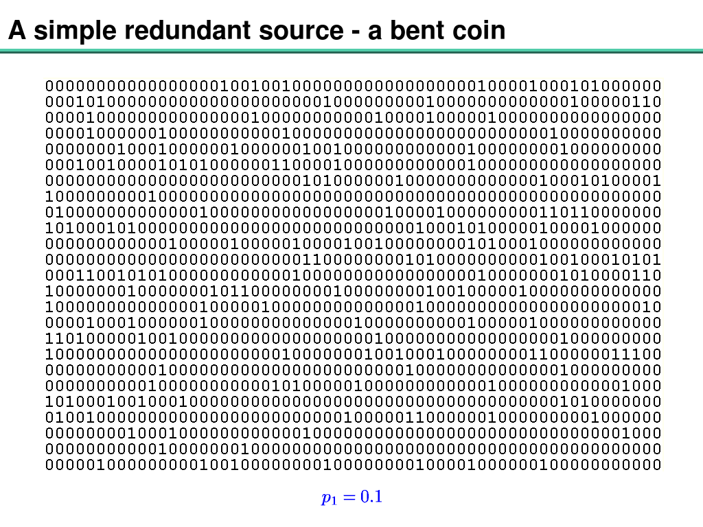

<span style="color:#2471a3;">**[example]**</span> 整页为一大块打字机字体的 0/1 位串（约 28 行、每行约 70 字符），其中 1 十分稀疏（约占十分之一）、0 占绝对多数，直观呈现一个高度冗余的二进信源；页面底部以蓝色标出参数：$p_1 = 0.1$（输出 1 的概率为 0.1）。〔本页主体为数据图示，位串不逐位转录〕

> <span style="color:#1e8449;">**[note] Note（译者注）:**</span> bent coin（弯硬币）是全书最耐用的教具，因为它是"冗余"能被精确计价的最小例子：每一位都是独立的 Bernoulli trial（伯努利试验），$p_1=0.1$，于是整页密密麻麻的 0 里只稀疏地插着 1。这一页要建立的等式是：冗余不是形容词，它等于 $1-H$，其中 $H$ 是每位的 entropy（熵）。
>
> 先说 $H$ 为什么长成 $-\sum p\log_{2}p$ 这个形状。你要求"平均信息量"满足三条：连续依赖于概率；等概率时随符号数单调增；两个独立信源连起来，总信息量必须等于两部分之和。最后一条最硬，写成函数方程就是 $f(pq)=f(p)+f(q)$，唯一的连续解是 $f(p)=-k\log p$，取 $k=1$、底取 2 就以 bit（比特）为单位。所以 entropy（熵）不是随便挑的一个公式，是"可加性"这一个要求逼出来的唯一形式，而它恰好等于 self-information（自信息）$-\log p$ 的期望。
>
> 代入 $p_1=0.1$：$-\log_{2}0.1\approx 3.3219$，$-\log_{2}0.9\approx 0.1520$，加权得 $H_2(0.1)=0.1\times 3.3219+0.9\times 0.1520\approx 0.469$ bit（比特）。读法：平均要掷 2.13 次才积累出 1 bit（比特）的不确定性；若 0 与 1 等概率则每位整整 1 bit（比特），所以这一个 $0.469$ 就把"这片位串有多水"量化了，冗余约 $1-0.469=53\%$。
>
> 再往深一层是大数定律的推论，asymptotic equipartition property（渐近均分性，AEP）。掷 $N=1000$ 次，含 $k$ 个 1 的某条具体序列概率是 $0.1^{k}0.9^{N-k}$，取对数得 $-N\left[\frac{k}{N}\log_{2}0.1+\left(1-\frac{k}{N}\right)\log_{2}0.9\right]$；当 $k/N$ 逼近 $p_1$，方括号就是 $H$，于是每条典型序列概率都约等于 $2^{-NH}=2^{-469}$。既然总概率为 1、每条又都是 $2^{-469}$，典型集的成员数就约 $2^{NH}=2^{469}$，而全体序列有 $2^{1000}$ 个，占比 $2^{-531}$。这正是"高维空间里质量集中在低维面附近"的离散版：$2^{1000}$ 个超立方体顶点中，概率几乎全部挤在约 $2^{469}$ 个顶点上。
>
> 手算复核一处，顺便埋下下一页的伏笔。$k=100$ 时单条序列概率 $0.1^{100}0.9^{900}=2^{-469}$；而这样的序列有 $\binom{1000}{100}=2^{464.4}$ 条（我按 Stirling 估过并对过），它们合起来只占 $0.042$，也就是 4.2%。也就是说"最可能的单条序列"与"整个典型集"差着数量级，AEP 的严格陈述是 $|T|\le 2^{N(H+\varepsilon)}$，只有 $\varepsilon\to 0$ 才敢写等号 —— 下一页的彩票会把这个差别变成真金白银。
>
> 压缩怎么落地：把 $2^{469}$ 个典型序列重新编号成 469 bit（比特）的 binary（二进制）码字，非典型序列另加一个逃逸前缀，平均码长就压到约 $469/1000=0.469$ bit（比特）每次投掷，与 $H$ 相等。换个读法更直接：独立同分布时联合 entropy（熵）可加，$H(X_1X_2\ldots X_{1000})=1000	imes 0.469=469$ bit（比特），这就是无损压缩的绝对下界；平凡编码老老实实写 1000 个 bit（比特），两者差的 531 bit（比特）全是 redundancy（冗余），任何压缩器都不可能再往下压。跨课程连接：Strang 的线性代数里"高维数据能量集中在前几个奇异向量方向"是同一类直觉，投影到 $r$ 维子空间误差按奇异值衰减；但必须点出区别 —— 典型集不是线性子空间，它是超立方体顶点的一个子集，不封闭于加法，投影定理与特征分解在这里一概用不上，我们只有计数这一个工具。Bertsekas 那边的连接则干净得多：AEP 就是把弱大数定律作用在随机变量 $-\log p(X_i)$ 上，$k/N\to p_1$ 一步到位。最后看一眼图本身：那片 0 的密度不是装饰，把 $p_1$ 从 0.1 调到 0.5，位串就长得跟随机噪声一样，$H$ 升到 1，压缩余地归零 —— 整条流水线上唯一变化的参数就是这个 $p_1$。

### p.10 〔How to compress a redundant file?（如何压缩一个冗余文件？）〕

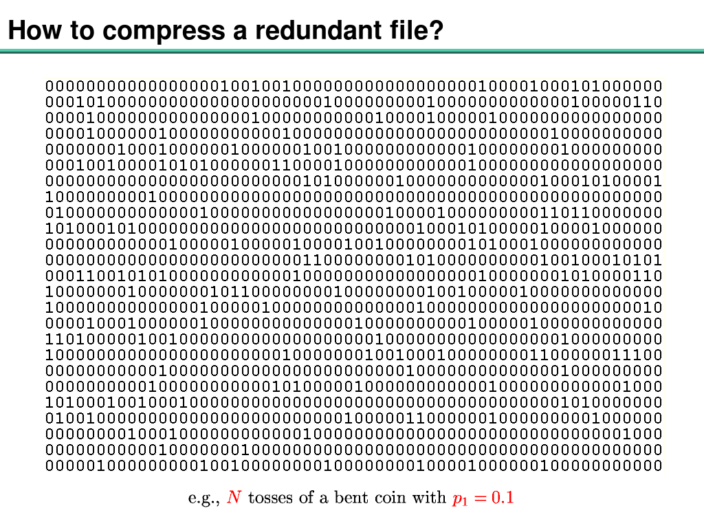

页面同样是一大块 0/1 位串（与 p.9 同为弯硬币输出样式：1 稀疏、0 密集，约 28 行、每行约 70 字符），底部以红色标注数据来源：**e.g., $N$ tosses of a bent coin with $p_1 = 0.1$**（例如：一枚 $p_1=0.1$ 的弯硬币掷 $N$ 次的输出）。页标题即本页提出的问题：**How to compress a redundant file?**（如何压缩一个冗余文件？）

### p.11 〔The weighing problem（称重问题）〕

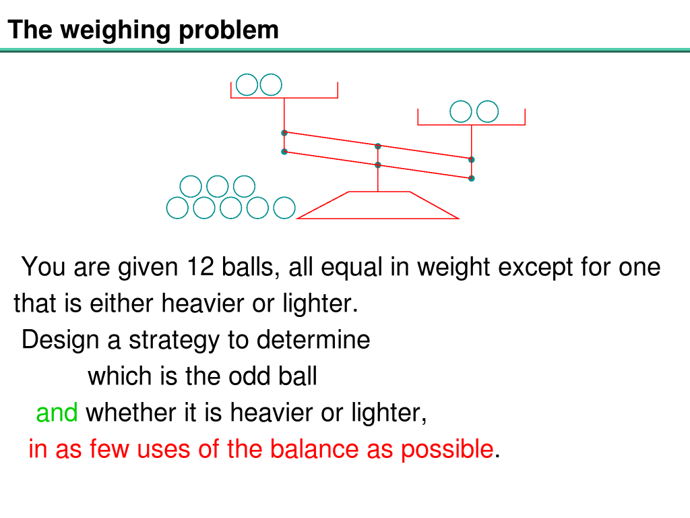

页面上半是一幅红色简笔画：一架带梯形底座的天平明显向右倾斜，左右两盘各放 2 只青绿色圆球，天平左侧地面上还堆着另外 8 只球（合计 12 只）。下半是题目正文：

You are given 12 balls, all equal in weight except for one that is either heavier or lighter.（给你 12 只球，它们全部等重，只有一只例外——它要么偏重、要么偏轻。）

Design a strategy to determine which is the odd ball（设计一套策略，判定哪一只是坏球）and whether it is heavier or lighter,（以及它究竟是偏重还是偏轻，）in as few uses of the balance as possible.（并且所用天平次数要尽可能少。）

> <span style="color:#1e8449;">**[note] Note（译者注）:**</span> 称球问题是信息论下界论证最好的一块试金石，因为它小到可以手算、又严到能逼出唯一解：12 只球、一只偏重或偏轻，天平三次，既要找出是哪只、又要判定轻重。它要教的是"假设空间有多大、一次实验能切几刀、切不匀就白切"。
>
> 先把假设数清楚：坏球可能是 12 只中的任何一只，且各有偏重、偏轻两种状态，共 $12\times 2=24$ 个 hypothesis（假设）。注意"3 号偏重"与"3 号偏轻"是两个不同的假设，混为一谈会把下界算小一半。每次称重只有三种结局：左重、右重、平衡，所以 $k$ 次称重构成一棵 ternary decision tree（三叉决策树），叶子至多 $3^{k}$ 片。要区分 24 个假设必须 $3^{k}\ge 24$：$3^{2}=9<24$，$3^{3}=27\ge 24$，所以三次是信息论下界，而且只剩 3 片叶子可浪费（$24/27\approx 0.889$），意味着每一步都必须几乎三等分，不能有任何一次"称了等于没称"。
>
> 下界只说明"三次不多余"，不说明"三次够用"。把可行性加上，会逼出一个漂亮的夹逼论证。设第一次左盘放 $a$ 只、右盘放 $a$ 只。若平衡，坏球在没上秤的 $12-2a$ 只里、轻重未知，剩 $2(12-2a)$ 个假设，必须塞进剩下的 $3^{2}=9$ 片叶子，故 $2(12-2a)\le 9$，即 $a\ge 3.75$，取整 $a\ge 4$。若倾斜，左边的 $a$ 只只可能偏重、右边的 $a$ 只只可能偏轻，共 $2a$ 个假设，同样要 $\le 9$，故 $a\le 4.5$，取整 $a\le 4$。两头一夹，$a=4$ 是唯一解 —— 第一称必须 4 对 4，这不是经验，是被两个不等式挤出来的。核对中间值：$a=3$ 时平衡分支剩 12 个假设 $>9$；$a=5$ 时倾斜分支剩 10 个 $>9$；都死。
>
> 顺手多算一个边界值，才知道 12 这个数有多紧。把球数改成 13：平衡分支要求 $2(13-2a)\le 9$ 得 $a\ge 4.5$ 即 $a\ge 5$；倾斜分支要求 $2a\le 9$ 得 $a\le 4$；两个条件不可能同时满足，所以 13 只球在"既找出、又判轻重"的要求下三次不可能。这个结论有个封闭形式：允许判轻重的上限是 $(3^{n}-3)/2$，$n=3$ 时得 12；若只要求找出是哪只、不要求判轻重，上限是 $(3^{n}-1)/2$，$n=3$ 时得 13。多出来的那 1 只，正是"放弃方向信息"换来的。
>
> 策略长什么样，走一遍平衡分支就够了。编号 1 到 12，第一称 1,2,3,4 对 5,6,7,8。若平衡，坏球在 9,10,11,12 中，且 1 到 8 全是真的好球（这是免费获得的参照物，别浪费）。第二称 9,10,11 对 1,2,3：若平衡，则 12 号是坏球，第三称 12 对 1 定轻重；若不平（设 9,10,11 这边重），则坏球是 9、10、11 之一且偏重，第三称 9 对 10，重者即坏球、平衡则 11。这一支恰好处理 8 个假设，用掉 $3^{2}=9$ 片叶子里的 8 片，剩下 1 片（"9 对 10 平衡且 11 也重"不可能）自然空着。倾斜分支同理，只是要把"可能重"与"可能轻"的球交叉摆放，让三种结局各自分到接近 8 个假设。
>
> 跨课程连接：CLRS 第 8 章的 comparison sort（比较排序）下界用的是同一副骨架 —— 决策树叶子数不能少于要区分的输入数，$n!$ 个排列逼出 $\log_{2}(n!)=\Omega(n\log n)$。区别有三处值得记牢：分支因子不同，比较是 binary（二值）、称重是 ternary（三值），所以一个底是 2、一个底是 3；排序的假设空间 $n!$ 精确已知因而界是紧的，称球的 24 是结构化的，能不能达到界要靠构造；排序讨论的是 $n\to\infty$ 的渐近阶，称球是固定规模下的组合设计，边界值（12 与 13）比阶更重要。再补一条同源的工具：给等概率的 24 个假设建最优 ternary（三值）前缀码，最优树就是等分树 —— 这与 CLRS 第 16 章 Huffman 的贪心合并是同一件事，只是权重全相等，退化成"每次尽量三等分"。
>
> 一句话收束：一次实验能产生几种结局，就决定了它最多能砍掉多少不确定性；这个"结局数 $\ge$ 假设数"的计数，是全课程所有下界论证的原型。

### p.12 〔The weighing problem（称重问题）〕

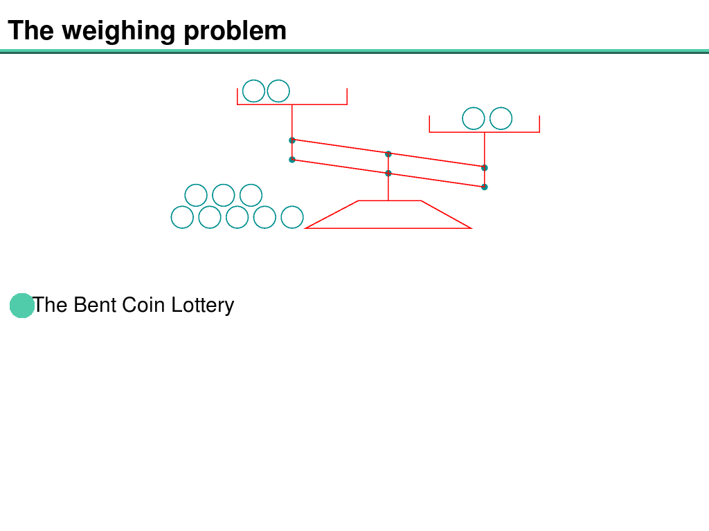

本页重复 p.11 的红色天平简笔画（两盘各 2 只球、旁边地面 8 只球），其下仅列出一条主题：

- The Bent Coin Lottery（弯硬币彩票）

### p.13 〔The Bent Coin Lottery（弯硬币彩票）〕

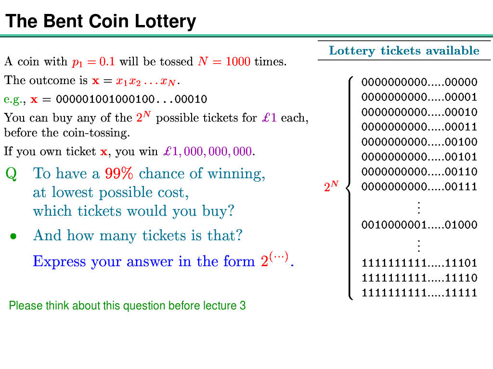

<span style="color:#2471a3;">**[example]**</span> 左栏题目：

A coin with $p_1 = 0.1$ will be tossed $N = 1000$ times.（一枚 $p_1=0.1$ 的硬币将被掷 $N=1000$ 次。）

The outcome is $\mathbf{x} = x_1x_2\ldots x_N$.（结果记为 $\mathbf{x} = x_1x_2\ldots x_N$。）

e.g., $\mathbf{x}$ = 000001001000100…00010（例如 $\mathbf{x}$ = 000001001000100…00010）

You can buy any of the $2^N$ possible tickets for £1 each, before the coin-tossing.（掷币开始前，你可以每张 £1 的价格购买 $2^N$ 种可能彩票中的任意若干张。）

If you own ticket $\mathbf{x}$, you win £1,000,000,000.（若你持有的票与最终结果 $\mathbf{x}$ 完全一致，即赢得 £1,000,000,000。）

Q　To have a 99% chance of winning, at lowest possible cost, which tickets would you buy?（问：想以 99% 的概率中奖、且花费尽可能低，你会买哪些票？）

•　And how many tickets is that?（那总共是多少张？）

Express your answer in the form $2^{(\cdots)}$.（请把答案表示成 $2^{(\cdots)}$ 的形式。）

页面底部绿色小字：Please think about this question before lecture 3（请在第 3 讲之前思考这个问题）。

右栏是一个标题为 **Lottery tickets available（可供购买的彩票）** 的列表框：左侧大括号（旁标 $2^N$）括起全部 $2^N$ 张票，按字典序从上到下列出——开头为 `0000000000....00000`、`0000000000....00001`、`0000000000....00010`、`0000000000....00011`、`0000000000....00100`、`0000000000....00101`、`0000000000....00110`、`0000000000....00111`，中部竖排省略号后出现 `0010000001....01000`，再经省略号直到末尾 `1111111111....11101`、`1111111111....11110`、`1111111111....11111`。

> <span style="color:#1e8449;">**[note] Note（译者注）:**</span> 彩票问题是渐近均分性的付费验证版：$p_1=0.1$、$N=1000$，$2^{1000}$ 张票每张 £1，全买要 £$2^{1000}$；想在 99% 概率中奖的前提下花最少的钱。这题的价值在于它把"典型集"这个模糊词逼成一个可以直接穷举、可以复核的具体整数。
>
> 最优解的结构由 exchange argument（交换论证）定下来：若你买了两张票 $A$、$B$，而 $p(A)<p(B)$ 却漏掉了 $B$，把 $A$ 换成 $B$ 后票数不变、中奖概率不降。反复替换直到无法改进，结论是"最优解必然是概率最高的前 $m$ 张票"。于是问题从"在 $2^{1000}$ 张里挑子集"降成一维排序问题。
>
> 票的概率只依赖 1 的个数 $k$：$p(\mathbf{x})=0.1^{k}0.9^{1000-k}$，随 $k$ 偏离 100 单调下降。于是按 $k$ 从 100 往两侧扩，每一层把 $\binom{1000}{k}$ 张票整批买下。算第一步：$k=100$ 的单张票概率 $0.1^{100}0.9^{900}=2^{-469}$，这样的票有 $\binom{1000}{100}=2^{464.4}$ 张，全买下只覆盖 $0.042$，也就是 4.2% 的中奖概率 —— 光买"最可能的那些票"远远不够。
>
> 继续往外扩。$k$ 近似服从均值 100、标准差 $\sqrt{1000\times 0.1\times 0.9}=9.49$ 的正态分布，双侧留 1% 尾部需要约 $2.58$ 倍标准差即 $k\approx 24$，故典型带约是 $[76,124]$。把这条带上的票数加起来得 $\sum_{k=76}^{124}\binom{1000}{k}=2^{536.26}$（我按 $k$ 从 0 到 1000 逐个穷举累加得到，累计概率 0.9902）。所以答案形式是 $2^{(536)}$，量级 $2^{536}$。
>
> 这个数与"背公式"得到的 $2^{NH_2(0.1)}=2^{469}$ 差着 $2^{67}$ 倍，必须说清为什么，否则公式会骗你。三个实测数摆在一起：买 $2^{469}$ 张只覆盖 20.8%；买 $2^{500}$ 张覆盖 81.3%；买到 $2^{536}$ 张才到 98.9%。原因是二项式系数 $\binom{1000}{k}$ 在 $k=500$ 附近取到最大值 $2^{995.7}$，在 $k=124$ 处仍有 $2^{536.1}$，比 $k=100$ 处的 $2^{464.4}$ 大得多 —— 票数由"带的上沿"决定，而不是由"最可能的单张票"决定。$2^{NH}$ 是典型集规模的渐近估计，严格陈述只有 $|T|\le 2^{N(H+\varepsilon)}$，$\varepsilon$ 一放宽规模就涨。顺便对照一个保守做法：若用 Chebyshev 单边 10 倍标准差直接取 $k\le 195$，会算出 $2^{NH_2(0.195)}=2^{712}$ 张（$H_2(0.195)\approx 0.712$），比最优解多花 $2^{176}$ 倍 —— 界要用对，宽松的界在指数上就是天文数字的浪费。
>
> 省钱省了多少，以及为什么仍然买不起。$2^{1000}$ 与 $2^{536}$ 相差 $2^{464}$ 倍，这就是 redundancy（冗余）在价格上的标度：你在为"可能发生的事"付费，而不是为"全部可能的事"付费。但这笔钱依旧不可实现：即使每秒买 $10^{9}$ 张，宇宙年龄约 $4.3\times 10^{17}$ 秒也只够买 $4.3\times 10^{26}\approx 2^{88}$ 张，与 $2^{536}$ 差 $2^{448}$ 倍。这个反差正是本讲的要点 —— 指数上的常数不是细节，$469$ 与 $536$ 看起来只差一点，落到钱上就是 $2^{67}$。
>
> 跨课程连接与可复用模板：这题把 Bertsekas 里的大数定律（$k/N\to p_1$，所以典型带极窄）与 CLRS 附录、6.042J 里的二项式计数缝在一起。抽象成三步模板，以后遇到"用最少的资源覆盖给定概率质量"都可以照抄：先用交换论证证明最优解的结构是"按权重降序取前缀"；再把问题降到一维参数（这里是 $k$）；最后用渐近估计（正态近似或 Stirling）把 $k$ 的范围与总票数定下来。本题还预演了 source coding theorem（信源编码定理）的证明路线：只对典型集编码就能让平均码长逼近 $NH$ —— 但要记住，逼近的是"平均"，覆盖 99% 与覆盖 100% 在指数上不是一回事。最后解释题目为什么非要你写成 $2^{(\cdots)}$：这些数全在指数上比较，$2^{536}$ 与 $2^{469}$ 用十进制写出来差二十位，写成幂才看得出"差多少个 2 倍"，而工程判断恰恰只看这个比值。

### p.14 〔Course outline（课程大纲）〕

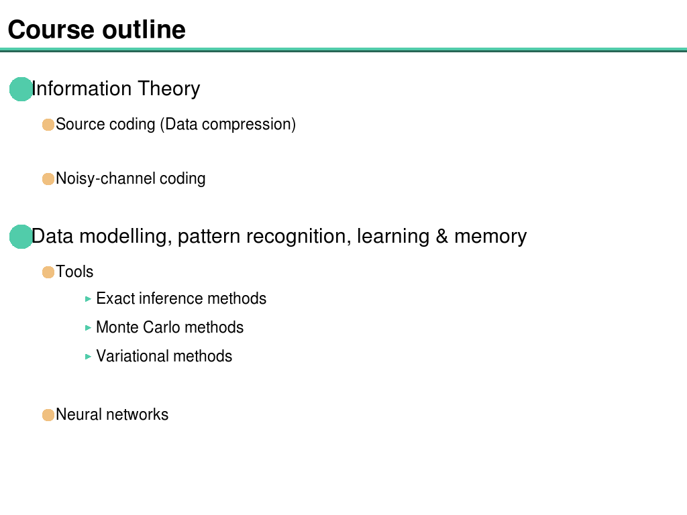

- **Information Theory（信息论）**
  - Source coding (Data compression)（信源编码（数据压缩））
  - Noisy-channel coding（噪声信道编码）
- **Data modelling, pattern recognition, learning & memory（数据建模、模式识别、学习与记忆）**
  - Tools（工具）
    - Exact inference methods（精确推断方法）
    - Monte Carlo methods（蒙特卡洛方法）
    - Variational methods（变分方法）
  - Neural networks（神经网络）
