> <span style="color:#7f8c8d;">Source: MacKay《Information Theory, Inference, and Learning Algorithms》课程手写讲义 l5 · 行内双语视觉转录版 · 原图见 fig/l5/</span>

### p.1 〔Information theory, pattern recognition, and neural networks（信息论、模式识别与神经网络）〕

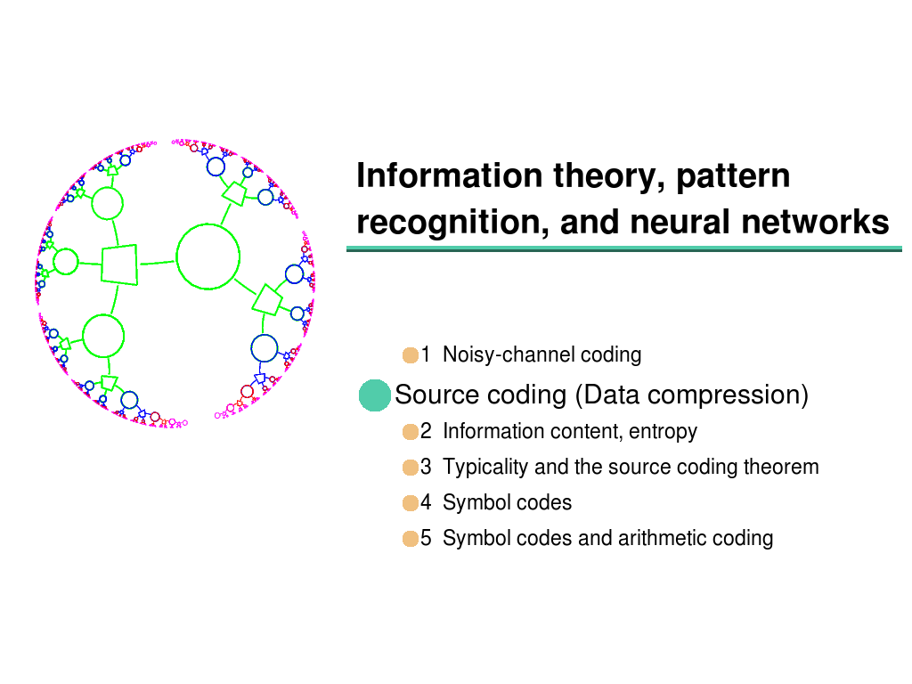

<span style="color:#2471a3;">**[lecture]**</span> 课程封面页：大标题为 Information theory, pattern recognition, and neural networks（信息论、模式识别与神经网络），标题下衬一条青绿色横线。页面左侧是一张圆形装饰图：绿色圆圈与方块节点连成的网络不断向边缘递归细分，圆周边缘环绕粉红色分形小圆圈。〔本页图形为纯装饰性图示〕

右侧为本讲在课程中的位置（大纲，当前主题以大号青绿色圆点标出）：

- 1 Noisy-channel coding（噪声信道编码）
- **Source coding (Data compression)（信源编码，即数据压缩）** ← 青绿色大圆点标记，为本讲主题
- 2 Information content, entropy（信息量、熵）
- 3 Typicality and the source coding theorem（典型性与信源编码定理）
- 4 Symbol codes（符号码）
- 5 Symbol codes and arithmetic coding（符号码与算术编码）

### p.2 〔Practical data compression（实用数据压缩）〕

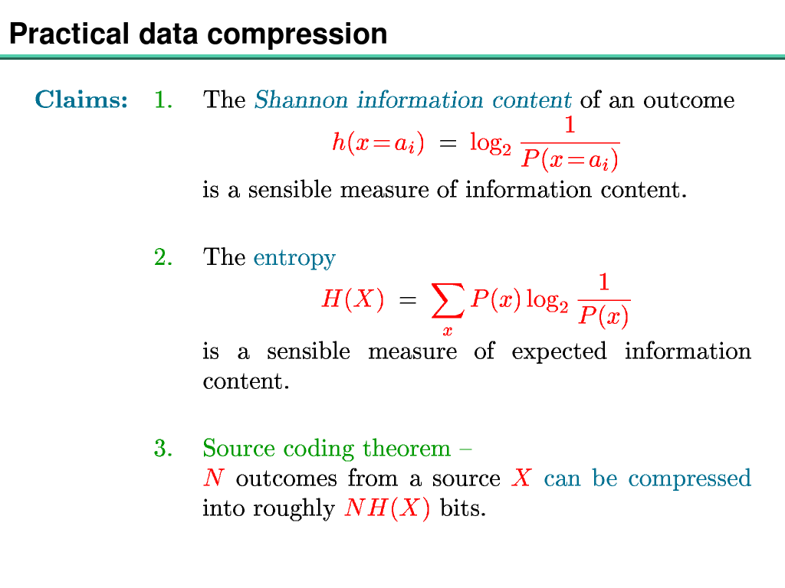

<span style="color:#2471a3;">**[definition]**</span> Claims:（论断：）

1. 一个结果（outcome）的 Shannon information content（香农信息量）

```math
h(x=a_i) = \log_2 \frac{1}{P(x=a_i)}
```

是信息量的一种合理度量。

2. entropy（熵）

```math
H(X) = \sum_x P(x) \log_2 \frac{1}{P(x)}
```

是期望信息量（expected information content）的一种合理度量。

3. <span style="color:#2471a3;">**[theorem]**</span> Source coding theorem（信源编码定理）——来自信源 $X$ 的 $N$ 个结果可以被压缩成大约 $NH(X)$ 比特。

> <span style="color:#1e8449;">**[note] Note（译者注）:**</span> 这条 claim（论断）真正要解决的设计问题是：把「信息量」这个日常词降解成一个能被概率论直接操作的对象，好让第 3 条的 source coding theorem（信源编码定理）有东西可证；它要防的失败模式是「信息量只是个比喻」。
>
> 第一步是减掉一个自由度。固定 source（信源）的分布 $P$ 之后，$h(x)=\log_2\frac{1}{P(x)}$ 就是一个普通随机变量：每个 outcome（结果）$x$ 配一个实数，仅此而已。为什么非要是 $\log$ 与 $1/P$ 这两个构件？$1/P$ 保证稀有事件携带更多信息（单调性）；$\log$ 保证独立事件的信息可加 —— 若 $x,y$ 独立，则 $P(x,y)=P(x)P(y)$，取对数后 $h(x,y)=h(x)+h(y)$ 自动成立。若不取对数而直接用 $1/P$，两个独立事件的信息会变成相乘的 $1/(P(x)P(y))$，你无法把「各自的信息」拼成「合起来的信息」，可加性当场断裂。注意这条要求足够强：连续、单调、满足可加性的函数只差一个常数因子，所以 $\log$ 不是选择，是被逼出来的唯一形状。
>
> 第二步是取期望。$H(X)=\mathbb{E}_P[h]$ 与 Bertsekas 概率论里「期望 = 按概率加权的平均」完全同构，所以 entropy（熵）在数学上不引入任何新机制，它只是 self-information（自信息）的一阶矩。MacKay 写的是 sensible（合理）而不是 correct（正确），意思是这个定义本身无所谓对错，是定理替它背书。
>
> 可算的例子：设 $P=\{1/2,1/4,1/8,1/8\}$，则 $h=(1,2,3,3)$ bit（比特），$H=0.5\times1+0.25\times2+0.125\times3+0.125\times3=1.75$ bit（比特）。现在发 $N=1000$ 个独立符号，总自信息 $-\log_2P(x_1,\dots,x_{1000})$ 的均值是 $1750$ bit（比特）；方差也能手算：$\mathbb{E}[h^2]=0.5\cdot1+0.25\cdot4+0.125\cdot9+0.125\cdot9=3.75$，故 $\mathrm{Var}(h)=3.75-1.75^2=0.6875$，标准差 $\sqrt{1000\times0.6875}\approx26.2$ bit（比特），相对波动只有 $26.2/1750\approx1.5\%$。这就是 concentration（集中）：中心随 $N$ 线性长大，宽度只随 $\sqrt{N}$ 长大，比值趋于零。
>
> 带宽收窄的直接后果是typical set（典型集）出现：把所有总自信息落在 $1750\pm26$ 内的序列收拢起来，每条约 $2^{-1750}$ 的概率，这样的序列约 $2^{1750}$ 个，而全部 $1000$ 长序列共 $4^{1000}=2^{2000}$ 个，占比 $2^{-250}\approx10^{-75}$。一块极小极小的区域承载了几乎全部概率质量，剩下的地方面积巨大却几乎不出现 —— 压缩之所以在物理上可能，就是因为只需要给这一小撮序列编号。
>
> 跨课程连接三条。其一，Bertsekas 的 weak law of large numbers（弱大数定律）只说 $-\frac1N\log_2P$ 依概率收敛到 $H$，它承诺收敛但不告诉你收敛到的那块区域有多大；信息论多走一步，用收敛去数集合的势，得到 $2^{NH}$ 这个组合结论，这是概率论本身没有的产物。其二，CSAPP 第 2 章把 byte（字节）拆成 8 个 bit（比特），那里 bit（比特）是可寻址的最小存储单位，是硬件事实；这里 bit（比特）是一次二分判定的最小单元，是度量单位。两者数值上通约、含义不同：存储问「占几格」，信息问「消掉多少不确定性」。其三，Strang 的线性代数把分布看成概率单纯形（各分量非负、和为 1 的向量）上的点是合法类比 —— entropy（熵）是这个凸集上的凹函数，最大值在重心（均匀分布）取到 —— 但单纯形不是线性子空间而是仿射集与坐标象限的交，「凹函数在凸集上取极值」这套语言能用，内积那套不能用。
>
> 收束：熵没有新机制，但「没有新机制」恰恰是它强的地方 —— 一个只由一阶矩构成的对象，却能兑现成压缩业绩，这条兑现的桥就是下一讲的典型集。

### p.3 〔Symbol codes（符号码）〕

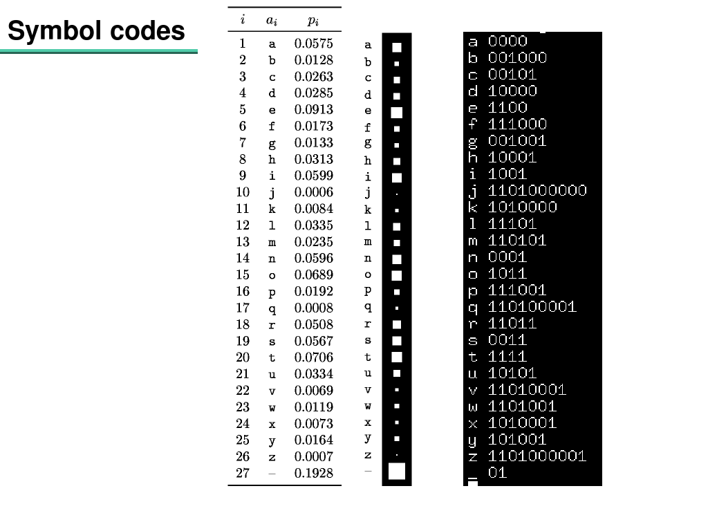

<span style="color:#2471a3;">**[example]**</span> 本页是一张 27 行的表格：左侧三列为编号 $i$、符号 $a_i$、概率 $p_i$（英文文本的 26 个字母加空格「–」）；右侧黑底白字给出每个符号的二进制码字，与左表按行一一对应（此处合并转录为四列）：

| $i$ | $a_i$ | $p_i$ | $c(a_i)$ |
|---|---|---|---|
| 1 | a | 0.0575 | 0000 |
| 2 | b | 0.0128 | 001000 |
| 3 | c | 0.0263 | 00101 |
| 4 | d | 0.0285 | 10000 |
| 5 | e | 0.0913 | 1100 |
| 6 | f | 0.0173 | 111000 |
| 7 | g | 0.0133 | 001001 |
| 8 | h | 0.0313 | 10001 |
| 9 | i | 0.0599 | 1001 |
| 10 | j | 0.0006 | 1101000000 |
| 11 | k | 0.0084 | 1010000 |
| 12 | l | 0.0335 | 11101 |
| 13 | m | 0.0235 | 110101 |
| 14 | n | 0.0596 | 0001 |
| 15 | o | 0.0689 | 1011 |
| 16 | p | 0.0192 | 111001 |
| 17 | q | 0.0008 | 110100001 |
| 18 | r | 0.0508 | 11011 |
| 19 | s | 0.0567 | 0011 |
| 20 | t | 0.0706 | 1111 |
| 21 | u | 0.0334 | 10101 |
| 22 | v | 0.0069 | 11010001 |
| 23 | w | 0.0119 | 1101001 |
| 24 | x | 0.0073 | 1010001 |
| 25 | y | 0.0164 | 101001 |
| 26 | z | 0.0007 | 1101000001 |
| 27 | – | 0.1928 | 01 |

（「–」即空格符，概率 0.1928 为全表最大；概率栏与码字栏在原页分列于左右两块面板，首行码字「0000」后有一处屏幕光标残影。）

### p.4 〔Last time（上次课回顾）〕

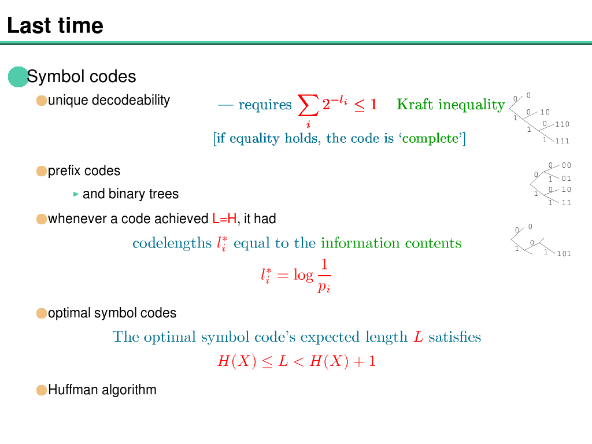

<span style="color:#2471a3;">**[section]**</span> Symbol codes（符号码）回顾要点：

- unique decodeability（唯一可译性）——requires（要求）

```math
\sum_i 2^{-l_i} \le 1
```

即 Kraft inequality（Kraft 不等式）；[if equality holds, the code is 'complete']（等号成立时，称该码是「完备的 / complete」）

- prefix codes（前缀码）
  - ▸ and binary trees（与二叉树）
- whenever a code achieved $L=H$, it had（凡达到 $L=H$ 的码，其 codelengths（码长）$l_i^*$ 都等于 information contents（信息量））

```math
l_i^* = \log \frac{1}{p_i}
```

- optimal symbol codes（最优符号码）——The optimal symbol code's expected length $L$ satisfies（最优符号码的期望长度 $L$ 满足）

```math
H(X) \le L < H(X) + 1
```

- Huffman algorithm（Huffman 算法）

> <span style="color:#7f8c8d;">旁注：页面右侧竖排三棵小二叉树示意图——第一棵叶标 0、10、110、111；第二棵叶标 00、01、10、11；第三棵可见标注 0 与 101（未用满预算的树）。</span>

> <span style="color:#1e8449;">**[note] Note（译者注）:**</span> 这条要回答的设计问题是：为什么先把自己限制在 prefix code（前缀码）里，而不是一上来就追求最优？答案是前缀条件把译码变成一次树上的下降，代价是码长必须整数、且要交一份预算守恒。
>
> 先说为什么必须有某种约束。若 $c(a)$ 是 $c(b)$ 的真前缀，那么 $c(b)$ 的开头恰好就是 $c(a)$：译码器读到 $c(a)$ 那么长时无法判断「这个符号到此结束」还是「后面还有」，同一条比特流随之有两种切分方式，unique decodability（唯一可译性）当场破产。前缀条件是杀掉这个歧义最直接的一刀，而且在所有能杀掉歧义的约束里它最好实现 —— 你不需要回溯，不需要缓存前缀表。
>
> 再说为什么它能翻译成树。二进制码字无非是一串向左、向右的选择，于是全部码字天然落在一棵 binary tree（二叉树）上：码字就是从根到某节点的路径。前缀条件在这套语言里的等价物是「有码字的节点不能再有后代」，也就是「它必须是叶」。译码器于是只能做一件事：从根出发，读一位走一步，踩到叶就吐出一个符号、退回根。
>
> 预算守恒的推导也只用一步，而且这一步顺手埋了后面算术编码的种子。把每个码字 $c_i$ 想象成 $[0,1)$ 上按字典序从左到右摆放的区间，第 $i$ 个占长度 $2^{-l_i}$。前缀条件恰好保证这些区间两两不重叠：两个码字既然互不为前缀，它们在某个比特位第一次分叉，之后各自占住互不相交的半边。于是 $\sum_i2^{-l_i}\le1$ 既是必要又是充分 —— 必要来自区间挤不出 $[0,1)$，充分来自「挤得下就真摆得下，取每个区间左端点的 $l_i$ 位二进制小数当码字」，这些小数天然互不为前缀。这就是 Kraft inequality（Kraft 不等式）的第一性原理版本。
>
> 可算的例子直接用 p.3 那张 27 符号的表。按码长统计：长度 2 有 1 个、4 有 7 个、5 有 6 个、6 有 6 个、7 有 3 个、8 有 1 个、9 有 1 个、10 有 2 个，代入得 $0.25+0.4375+0.1875+0.09375+0.0234375+0.00390625+0.001953125+0.001953125=1$，恰好等于 1，说明树被种满，这个 code（码）是 complete（完备）的。顺手也能算出它值多少钱：期望长度 $L=4.1462$ bit（比特），源自身的 entropy（熵）$H=4.1094$ bit（比特），只多丢 $0.0368$ bit（比特）每符号，冗余 $0.89\%$。
>
> 反例也必须有一个。四个等概率符号若硬用码长 $1,2,2,2$，预算 $0.5+0.75=1.25>1$，超支；直觉上就是把 $0$ 这一整根枝条（面积 $1/2$）配给了一个符号，剩四分之三的面积怎么摆也放不下其余份额。换成 $1,3,3,3$，预算 $0.875$，摆得下但树有空缺，还能再塞一个长度 3 的码字把预算补到 1，所以它不 complete（完备）。
>
> 跨课程三条。CSAPP 的 UTF-8 是「自同步」的教科书例子：首字节的前缀位型宣布这个字符占几个 byte（字节），续字节一律以 `10` 开头，于是从流中任意位置开始读、最多误判一个字符就能重新对齐。它用前缀结构换来无分隔符的有序性，直觉与这里完全相同；区别在 UTF-8 的码长由字节内容决定、不做概率压缩，是固定长度表。CLRS 第 16 章把 Huffman 看成贪心合并，代价是加权外部路径长度，而这里多了一条 Kraft 约束 —— 恰好在这类整数码长下两者最优解重合。6.006 的 trie（字典树）是同一结构的另一副面孔：前缀码的译码器就是一个只走 $l_i$ 步的 trie（字典树），查询代价是码长而不是符号数。
>
> 往前看一句：Huffman 要一张表逐位查，快但精度被整数锁死；arithmetic coding（算术编码）精度无锁但要逐位做区间更新，慢。rANS（range Asymmetric Numeral Systems，区间非对称数字系统）把两者缝合 —— 用状态转移表拿到算术编码的精度和查表的速度，zstd 一类现代压缩器的 entropy stage（熵编码层）走的就是这条路。这条路线之所以成立，根子在这条注开头那个「区间摆放」的构造上。

### p.5 〔What is the optimal symbol code for …（这两个系综的最优符号码是什么？）〕

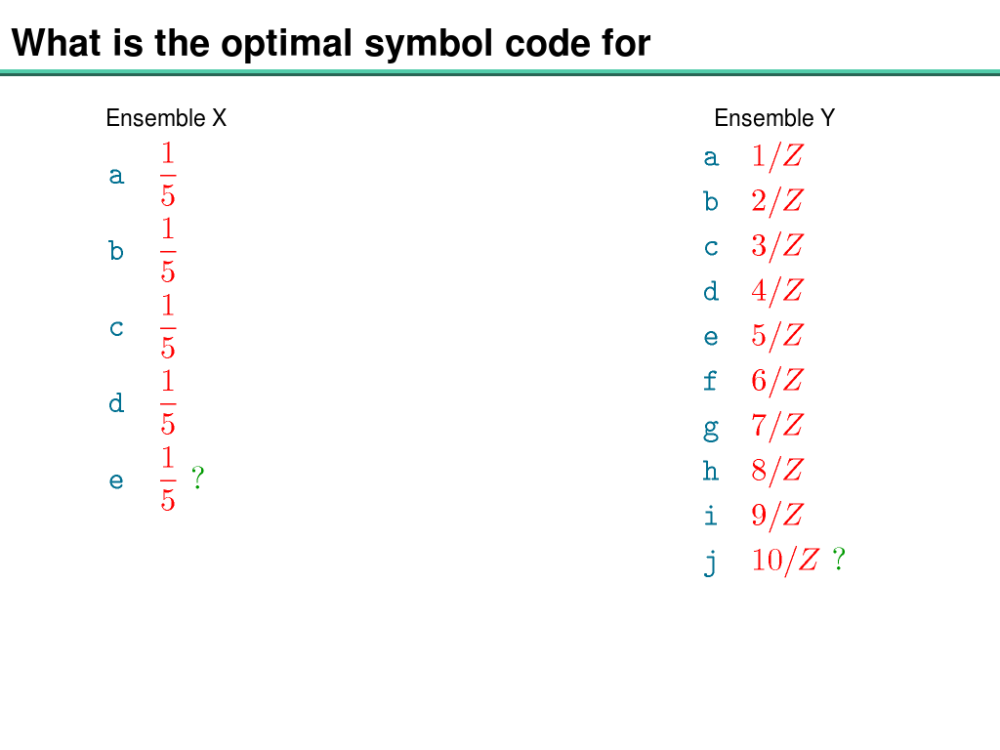

<span style="color:#2471a3;">**[example]**</span> 标题句接排两个例子：

Ensemble X（系综 X）：五个符号等概率——a $1/5$，b $1/5$，c $1/5$，d $1/5$，e $1/5$（e 的概率后附一个绿色问号，提示此处需要思考）。

Ensemble Y（系综 Y）：十个符号，概率与 $1/Z, 2/Z, \dots, 10/Z$ 成比例——a $1/Z$，b $2/Z$，c $3/Z$，d $4/Z$，e $5/Z$，f $6/Z$，g $7/Z$，h $8/Z$，i $9/Z$，j $10/Z$（j 的概率后同样附一个绿色问号）。

> <span style="color:#7f8c8d;">旁注：两处绿色「?」为幻灯片自带的提问标记，页面上未写出答案，供课堂当场讨论。</span>

### p.6 〔Prefix codes suffice（前缀码就足够了）〕

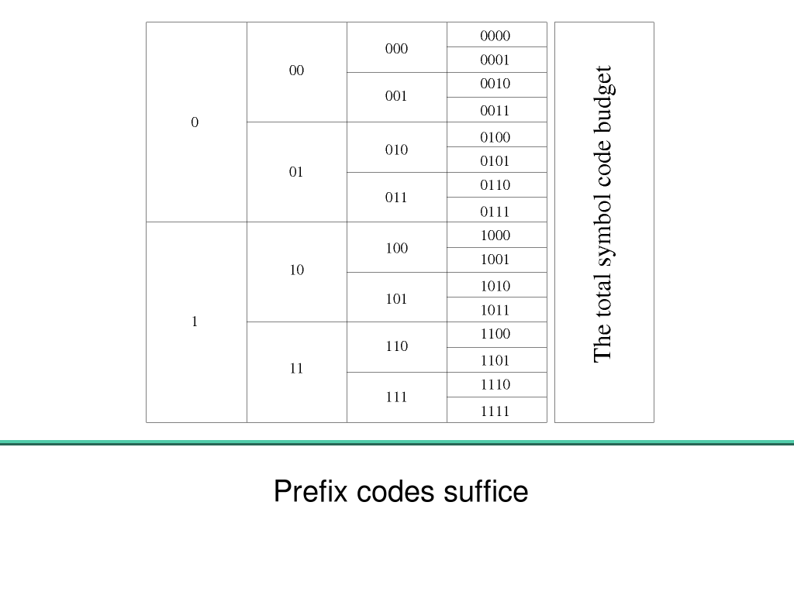

本页主体是一张占满页面的二叉树「预算表」：最左一列是树根的 0 与 1 两格；第二列为 $00, 01 \mid 10, 11$ 四格；第三列为 $000, 001, \dots, 111$ 八格；第四列为 $0000, 0001, \dots, 1111$ 十六格，逐层二分。右侧竖排长框标注 The total symbol code budget（全部符号码的总预算）。图下方为页标题大字：Prefix codes suffice（前缀码就足够了）。

> <span style="color:#1e8449;">**[note] Note（译者注）:**</span> 这张「预算图」真正在讲一个可以反复搬用的证明模板：leaf-budget argument（叶子预算法）—— 想知道「只能用树表示的东西最多能装多少」，不要数节点，数叶子面积。
>
> 机制拆成两步。第一步，为什么第 $l$ 层恰好 $2^l$ 个节点：根在第 0 层，每往下一层每个节点分裂成左右两个孩子，节点数翻倍，于是第 $l$ 层是 $2^l$ 个 —— 层号就是二进制位数，这是 $\{0,1\}^l$ 共有 $2^l$ 个串的直接推论。第二步，给长度 $l_i$ 的码字分配份额：把它下沉到深度 $L$（$L$ 取不小于所有 $l_i$ 的任意值）的完整网格，它下面那一整块共占 $2^{L-l_i}$ 个格点。不同码字互不为前缀，所以各自的下沉块两两不交，总数不超过 $2^L$：$\sum_i2^{L-l_i}\le2^L$。两边同除 $2^L$，Kraft inequality（Kraft 不等式）就出来了。
>
> 之所以必须先「下沉到同一层」再比，是因为长短码字本来不在同一深度，没法直接说谁占得多；下沉等于给所有码字换一把共同的尺子。这一步是整套论证的枢轴 —— 换尺子的动作，在别的地方叫「归一化」，在这里叫「补齐到共同深度」。
>
> 反过来看为什么超支一定出事：若 $\sum_i2^{-l_i}>1$，下沉后就是 $\sum_i2^{L-l_i}>2^L$，而格点一共只有 $2^L$ 个且每块非空，鸽笼原理立刻给出两个码字抢同一格 —— 那就是一个码字是另一个的前缀。所以超支不是「浪费了资源」，是「不存在这样的码」。
>
> 可算的例子。27 符号字母表若用fixed-length code（等长码），最短可行长度是 $\lceil\log_227\rceil=5$ bit（比特），此时预算 $27\times2^{-5}=27/32=0.84375$，空缺 $0.15625$ —— 对应的就是树上 $32-27=5$ 个空叶位，也就是等长码永远不 complete（完备）的算术证据。它也解释了那 $5$ bit（比特）比 entropy（熵）$4.11$ bit（比特）多出来的部分从哪儿来：多出来的不是信息，是分配颗粒太粗。再看两个真实的不等式：长度集合 $\{1,2,2,2\}$ 预算 $0.5+0.75=1.25>1$，不存在；$\{1,3,3,3\}$ 预算 $0.875<1$，存在但不 complete（完备），还能再插一个长度 3 的码字把预算补到 1。
>
> 跨课程第一条，也是这条注最值钱的连接：6.006 与 CLRS 的比较排序下界用的是同一个模板，但方向相反。那里是「$n!$ 种合法输出每种至少占一片叶子，故叶子数 $\ge n!$」，再由「高度 $h$ 的二叉树最多 $2^h$ 片叶子」反解出 $h\ge\log_2(n!)$；这里是「叶子数被预算上限卡住，故短码字数量有限」。前者是下界（至少这么多叶子），后者是上界（最多只能这么多叶子），而两者能对上的原因，是同一条结构定理：深度 $h$ 的二叉树叶子数不超过 $2^h$。给个可核对的数：$n=10$ 时 $\log_2(10!)=\log_2 3628800\approx21.79$，故 $h\ge22$，这就是「十个元素排序至少要 22 次比较」的出处。把这条模板写成一句可复用的话：任何树状决策结构，先数「合法输出需要几片叶子」，再数「高度 $h$ 能给几片叶子」，两边一夹，界就出来了。
>
> 第二条连接是 CSAPP 第 6 章的 cache（缓存）：块对齐会把对象尾部浪费掉，浪费量是对象大小对行长取模的余数；Kraft 预算的浪费则是 $\sum_i2^{-l_i}$ 与 1 的差额。两者是同一种经济账 —— 资源按固定颗粒分配，颗粒以下的部分只能丢掉。区别在于 cache（缓存）丢的是真实 byte（字节），可以靠提高局部性摊薄（一次搬 64 byte（字节）远比逐 byte（字节）读便宜），Kraft 丢的是概率质量，摊薄的方式是换更细的颗粒，也就是后面算术编码要把「长度必须整数」这条锁链拆掉。
>
> 最后一句话指向下一节：正因为「长度 $l$ 的码字占 $2^{-l}$ 的区间」这条几何解释是充分的，你就可以把区间切到任意精细而不必是 $2$ 的整数次幂。那一步的合法性，正是这张预算图给的。

### p.7 〔（无标题页）Huffman 编码表与码树〕

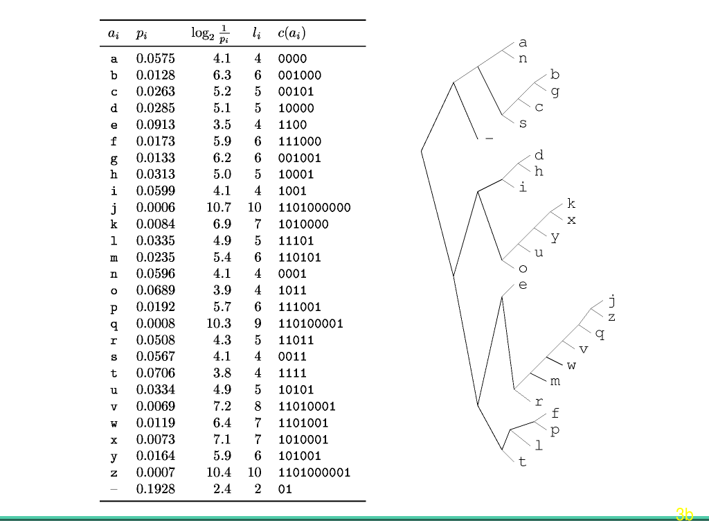

<span style="color:#2471a3;">**[example]**</span> 本页是 p.3 字母表的 Huffman 编码结果，表格五列：符号 $a_i$、概率 $p_i$、理想码长 $\log_2 \frac{1}{p_i}$、实际码长 $l_i$、码字 $c(a_i)$：

| $a_i$ | $p_i$ | $\log_2 \frac{1}{p_i}$ | $l_i$ | $c(a_i)$ |
|---|---|---|---|---|
| a | 0.0575 | 4.1 | 4 | 0000 |
| b | 0.0128 | 6.3 | 6 | 001000 |
| c | 0.0263 | 5.2 | 5 | 00101 |
| d | 0.0285 | 5.1 | 5 | 10000 |
| e | 0.0913 | 3.5 | 4 | 1100 |
| f | 0.0173 | 5.9 | 6 | 111000 |
| g | 0.0133 | 6.2 | 6 | 001001 |
| h | 0.0313 | 5.0 | 5 | 10001 |
| i | 0.0599 | 4.1 | 4 | 1001 |
| j | 0.0006 | 10.7 | 10 | 1101000000 |
| k | 0.0084 | 6.9 | 7 | 1010000 |
| l | 0.0335 | 4.9 | 5 | 11101 |
| m | 0.0235 | 5.4 | 6 | 110101 |
| n | 0.0596 | 4.1 | 4 | 0001 |
| o | 0.0689 | 3.9 | 4 | 1011 |
| p | 0.0192 | 5.7 | 6 | 111001 |
| q | 0.0008 | 10.3 | 9 | 110100001 |
| r | 0.0508 | 4.3 | 5 | 11011 |
| s | 0.0567 | 4.1 | 4 | 0011 |
| t | 0.0706 | 3.8 | 4 | 1111 |
| u | 0.0334 | 4.9 | 5 | 10101 |
| v | 0.0069 | 7.2 | 8 | 11010001 |
| w | 0.0119 | 6.4 | 7 | 1101001 |
| x | 0.0073 | 7.1 | 7 | 1010001 |
| y | 0.0164 | 5.9 | 6 | 101001 |
| z | 0.0007 | 10.4 | 10 | 1101000001 |
| – | 0.1928 | 2.4 | 2 | 01 |

页面右侧是一棵以细线条画出的 Huffman 码树：叶从上到下依次标注 a, n, b, g, c, s, –, d, h, i, k, x, y, u, o, e, j, z, q, v, w, m, r, f, p, l, t，枝权向左逐级汇聚到根。

> <span style="color:#7f8c8d;">旁注：右下角有黄色页码「3b」；逐行可见实际码长 $l_i$ 基本贴着理想码长上下取整（如 –：2.4→2，e：3.5→4，j：10.7→10）。</span>

> <span style="color:#1e8449;">**[note] Note（译者注）:**</span> 「最优符号码」这个词要三个限定同时在场才成立：最优只在 symbol code（符号码）这个类里，symbol code（符号码）的码长必须是正整数，而它的下界由 entropy（熵）看守。
>
> 先说 Huffman algorithm（Huffman 算法）为什么对。关键不是贪心这一步本身，而是一条被贪心藏起来的引理：最深的两片叶子可以假设为兄弟。证明靠交换 —— 设 $a,b$ 是深度最大、概率最小的两个符号。因为 $a$ 最深，它的兄弟若有后代就与「最深」矛盾，故兄弟是叶；把兄弟与 $b$ 换位，代价变化是 $(p_x-p_b)(l_b-l_x)$，而 $l_b\ge l_x$、$p_x\ge p_b$，乘积非正，代价不增。于是存在一棵最优树使两个最小概率符号为兄弟；把它们收缩成一个概率为 $p_a+p_b$ 的伪符号，规模减一，归纳成立。这个论证的形状要记住：不去构造最优解，而是证明「最优解可以被迫长成这样」，然后把选择权夺回来。
>
> 再说两条锁链各管什么。整数锁链：$l_i$ 必须是正整数，所以概率 $0.990$ 的符号即使理想码长只有 $0.0145$ bit（比特），也得付整整 1 bit（比特）—— 这是 p.11 那个九倍差距的全部来源。预算锁链：Kraft inequality（Kraft 不等式）$\sum_i2^{-l_i}\le1$ 卡住短码字的总量，「把便宜都让给一个人」因此无法自由进行。
>
> 但有一条常见的误解必须拆掉：$l_i$ 并不需要 $\ge\log_2(1/p_i)$。表里 $q$ 的理想长度 $10.3$ bit（比特），实得 $9$ bit（比特），比理想值还低。原因是 Huffman algorithm（Huffman 算法）优化的对象是加权和 $\sum_ip_il_i$ 这一个数，不是逐行贴合自己的理想值；$q$ 的概率只有 $0.0008$，它的码长偏 1 bit（比特）只让总和变动 $0.0008$ bit（比特），而树形由合并顺序唯一决定，谁深谁浅是全局最优的副产品，允许个别行「占便宜」。表里那条梳状结构正是证据：$z$ 与 $j$ 先合并，再与 $q$ 合并，于是 $q$ 反而比它们浅。
>
> 可算的例子：整表 27 行代入得 $L=4.1462$ bit（比特），源 entropy（熵）$H=4.1094$ bit（比特），差 $0.0368$ bit（比特）每符号，相对冗余 $0.89\%$。放到一份 100 万字符的英文文本上：$4.1462\times10^6$ 对 $4.1094\times10^6$，多花 $36\,800$ bit（比特），约 $4.6$ KB。这个量级说明：字母表大小适中、分布不太极端时，符号码已经够用；换 arithmetic coding（算术编码）能省下这 $4.6$ KB 的大部分，代价是速度与实现复杂度。
>
> 跨课程连接。CLRS 第 16.3 节把交换论证当作贪心正确性的标准模板，6.006 的「最优文件归并顺序」是同一个贪心、同一个代价函数（加权外部路径长度），但那里没有前缀约束，问题更松。区别在于：合并问题只在整数合并次数上谈最优，而这里多了一条 Kraft 约束 —— 巧的是前缀码允许的码长集合恰好就是整数正数集合，约束重合，最优性得以保留。若把字母表换成三进制，Huffman 要改成每次合三个，出现的「余数补齐」问题就是这条约束开始咬人的地方。
>
> 工程上的第三层约束来自文件格式：DEFLATE（RFC 1951）规定码长不超过 $15$ bit（比特），于是 zlib 的做法是先跑 Huffman、再修补超长枝；理论上无损的解法是 package-merge（打包归并算法），它能给出长度受限下真正最优的码，代价是那一点点冗余。这说明「最优」永远相对于你允许的参数空间 —— 这类限定词，是读任何最优性定理时第一眼要去找的。

### p.8 〔Symbol code summary（符号码小结）〕

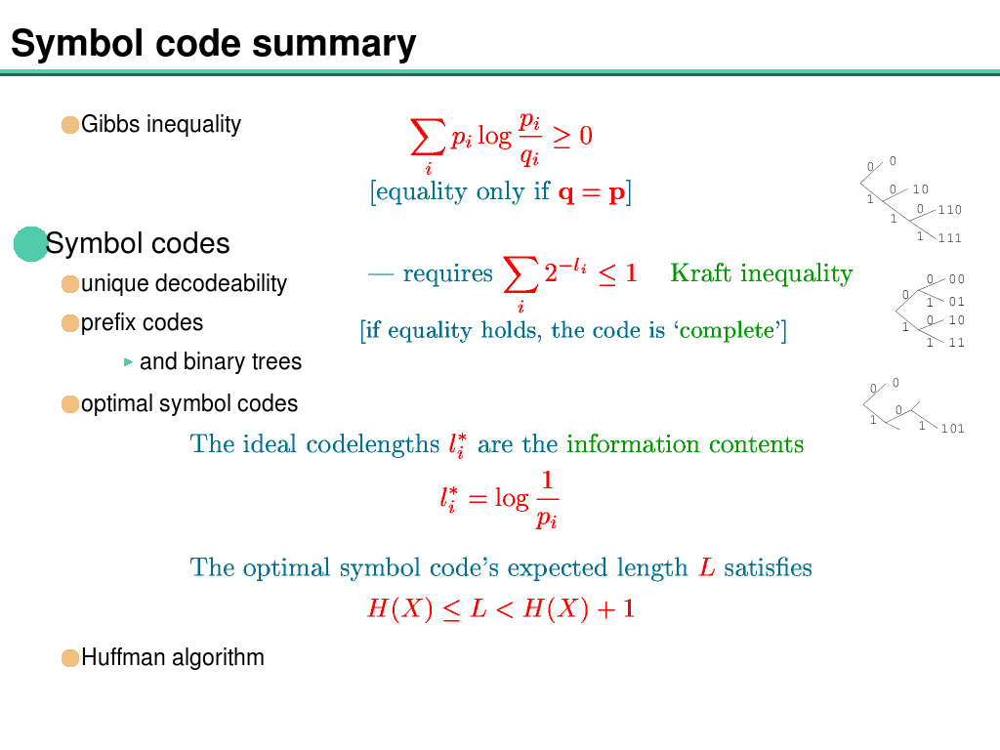

<span style="color:#2471a3;">**[theorem]**</span> Gibbs inequality（Gibbs 不等式）：

```math
\sum_i p_i \log \frac{p_i}{q_i} \ge 0
```

[equality only if $\mathbf{q} = \mathbf{p}$]（仅当 $\mathbf{q}=\mathbf{p}$ 时取等号）

<span style="color:#2471a3;">**[section]**</span> Symbol codes（符号码）：

- unique decodeability（唯一可译性）——要求 $\sum_i 2^{-l_i} \le 1$，即 Kraft inequality（Kraft 不等式）；[若等号成立，该码是「完备的」]
- prefix codes（前缀码）▸ and binary trees（与二叉树）
- optimal symbol codes（最优符号码）——The ideal codelengths $l_i^*$ are the information contents（理想码长 $l_i^*$ 就是信息量）

```math
l_i^* = \log \frac{1}{p_i}
```

The optimal symbol code's expected length $L$ satisfies（最优符号码的期望长度 $L$ 满足）

```math
H(X) \le L < H(X) + 1
```

- Huffman algorithm（Huffman 算法）

> <span style="color:#7f8c8d;">旁注：右侧与 p.4 相同的三棵小二叉树示意（0/10/110/111、00/01/10/11、0/101）。</span>

> <span style="color:#1e8449;">**[note] Note（译者注）:**</span> 这条的定位要摆正：Gibbs inequality（Gibbs 不等式）不是一个附在符号码结论旁边的技术引理，它是「entropy（熵）是任何可译码的期望长度下界」这件事的唯一发动机；它要防的失败模式是「$L\ge H$ 只是一个巧合」。
>
> 证明用一条比 Jensen 更硬的切线不等式，两行就能写完：对任意 $x>0$ 有 $\log_2x\le(x-1)\log_2e$，等号只在 $x=1$ 取到 —— 几何上就是「凹曲线永远压在它的切线下」。把 $x=q_i/p_i$ 代进去，两边乘 $p_i$ 求和：$\sum_ip_i\log_2\frac{q_i}{p_i}\le\log_2e\sum_ip_i\left(\frac{q_i}{p_i}-1\right)=\log_2e\left(\sum_iq_i-\sum_ip_i\right)=0$。翻符号得 $\sum_ip_i\log_2\frac{p_i}{q_i}\ge0$，等号要求每个 $q_i/p_i=1$，即 $q=p$。整条证明只用了一个事实：两个分布各自求和为 1，连独立性都没用到。
>
> 这个模板可以命名：tangent-line method（切线法）。把一个只在一处取等号的全局不等式（这里是 $\log x\le x-1$）当作上界去夹住求和，等号条件会自动告诉你取等情形。它与用 Jensen 说同一件事，但切线法不需要你先承认 Jensen，而且它解释了一个关键细节：为什么等号会「卡死」—— 每一项都必须同时待在自己的切点上，差一点都不行。
>
> 第二步，把它变成 $L\ge H$。设 $Z=\sum_i2^{-l_i}\le1$（Kraft inequality（Kraft 不等式）已保证），取 $q_i=2^{-l_i}/Z$，这是合法的 distribution（分布）。于是
>
> $L-H=\sum_ip_il_i+\sum_ip_i\log_2p_i=\sum_ip_i\log_2\frac{p_i}{2^{-l_i}}=\sum_ip_i\log_2\frac{p_i}{q_i}-\log_2Z=D_{\mathrm{KL}}(p\,\|\,q)-\log_2Z$。
>
> 因为 $Z\le1$ 所以 $-\log_2Z\ge0$，又有 $D_{\mathrm{KL}}\ge0$，两项都非负，$L\ge H$ 得证。这个分解还顺带交代了 +1 从哪来：两项各管一种浪费 —— $D_{\mathrm{KL}}$ 管「码长偏离理想值」的浪费，$-\log_2Z$ 管「树没种满」的浪费。想把 $L$ 压到 $H$ 附近，就得同时把这两种浪费压小：前者靠让 $2^{-l_i}\propto p_i$，后者靠让树 complete（完备）。
>
> 可算的例子：$p=(1/2,1/4,1/4)$，$q=(1/3,1/3,1/3)$。逐项算 $\frac12\log_2\frac{1/2}{1/3}=\frac12(0.585)=0.2925$，$\frac14\log_2\frac{1/4}{1/3}=\frac14(-0.415)=-0.1038$，出现两次合计 $-0.2075$；相加得 $D_{\mathrm{KL}}(p\,\|\,q)=0.085$ bit（比特）。交叉验证：$H(p)=1.5$，而 $\sum_ip_i\log_2\frac1{q_i}=\log_23\approx1.585$，$1.5+0.085=1.585$ —— 「交叉熵 = 熵 + KL」在这个例子里分毫不差。KL 非负这一条翻译成人话就是：用错的分布编码永远亏，亏多少正好是这个数。
>
> 再算同一个式子的反方向，说明它不是距离：取 $p=(1/2,1/2)$、$q=(0.9,0.1)$。$D_{\mathrm{KL}}(p\,\|\,q)=0.5\log_2\frac{0.5}{0.9}+0.5\log_2\frac{0.5}{0.1}=0.5(-0.848)+0.5(2.322)=0.737$ bit（比特）；反过来 $D_{\mathrm{KL}}(q\,\|\,p)=0.9\log_21.8+0.1\log_20.2=0.763-0.232=0.531$ bit（比特）。两个数差 $0.206$ bit（比特），对称性直接破产：「从 $p$ 看 $q$ 偏了多少」和「从 $q$ 看 $p$ 偏了多少」是两个不同的问题。
>
> 跨课程连接。Bertsekas 的概率论给你期望的线性性与凸函数的极值判据，Gibbs inequality（Gibbs 不等式）是把这些工具用得最狠的一处；两者的关系是「同一个不等式换个包装」：$\log$ 的凹性 ⟺ 切线在曲线上方 ⟺ KL 非负。Strang 的线性代数提供另一层直觉：概率分布住在概率单纯形（各分量非负、和为 1 的向量集合）里，KL 是这个凸集上的有向量，与内积诱导的范数不是一回事 —— 范数有对称性和三角不等式，KL 两者都没有。这个区别要记牢：范数量长度，KL 量「用错模型的代价」，只有后者能接到压缩和最大似然估计上。
>
> 再验一个边界值，把「非负」画出来：固定 $p=(1/2,1/2)$，让 $q=(1-\varepsilon,\varepsilon)$ 变化。$\varepsilon=0.01$ 时 $D_{\mathrm{KL}}(p\,\|\,q)=0.5\log_2\frac{0.5}{0.99}+0.5\log_2\frac{0.5}{0.01}=0.5(-0.986)+0.5(5.644)=2.33$ bit（比特）；$\varepsilon=0.1$ 时降到 $0.737$ bit（比特）；$\varepsilon=0.5$ 时恰好是 $0$。三个点连起来是一条下凸曲线，唯一的最低点落在 $q=p$ 处 —— 这就是「KL 非负」的图像版：函数有底，底在两分布重合处。
>
> 顺带回答一个常见追问：最优符号码的上界为什么偏偏是 $+1$ 而不是 $+2$？因为把码长取成 $\lceil\log_2(1/p_i)rceil$ 时，每一项最多多花 1 bit（比特），而 $L$ 正是各项按 $p_i$ 的加权和，所以总共最多多花 $\sum_ip_i	imes1=1$ bit（比特）。这个码也合法，因为 $\sum_i2^{-\lceil\log_21/p_irceil}\le\sum_ip_i=1$。可见 $+1$ 不是凑出来的常数，而是「上取整每次亏不到 1」的累积。
>
> 收束：KL 非负、$L\ge H$、最大熵原理（均匀分布最不可预测），三条陈述看着不同，其实是同一个凸性事实的三副面孔。

### p.9 〔Today（本课内容）〕

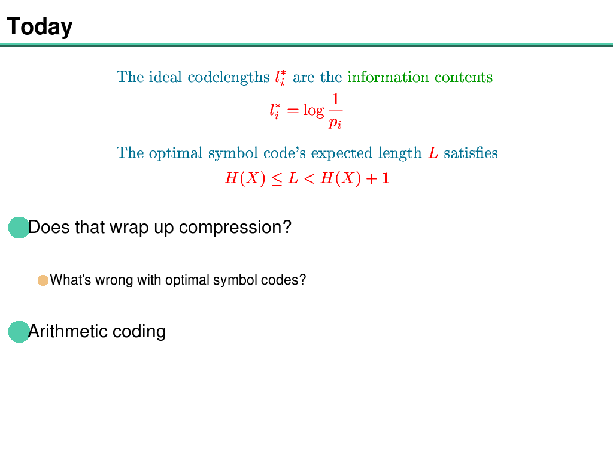

开场复述两条上节结论：The ideal codelengths $l_i^*$ are the information contents（理想码长 $l_i^*$ 就是信息量）$l_i^* = \log \frac{1}{p_i}$；最优符号码的期望长度 $L$ 满足

```math
H(X) \le L < H(X) + 1
```

<span style="color:#2471a3;">**[section]**</span> Does that wrap up compression?（这样压缩就到此为止了吗？）

- What's wrong with optimal symbol codes?（最优符号码还有什么问题？）

<span style="color:#2471a3;">**[section]**</span> Arithmetic coding（算术编码）

### p.10 〔The Guessing Game（猜谜游戏）〕

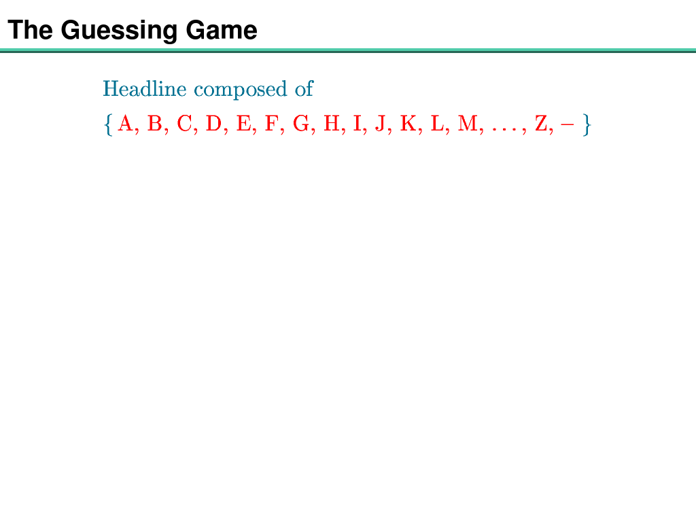

Headline composed of（一条由以下字符集写成的新闻标题）

{ A, B, C, D, E, F, G, H, I, J, K, L, M, …, Z, – }

（「–」代表空格。）

> <span style="color:#7f8c8d;">旁注：本页正文仅此一行，其余留白；标题文字为青绿色，字符集为红色。</span>

### p.11 〔Realistic compression（真实的压缩场景）〕

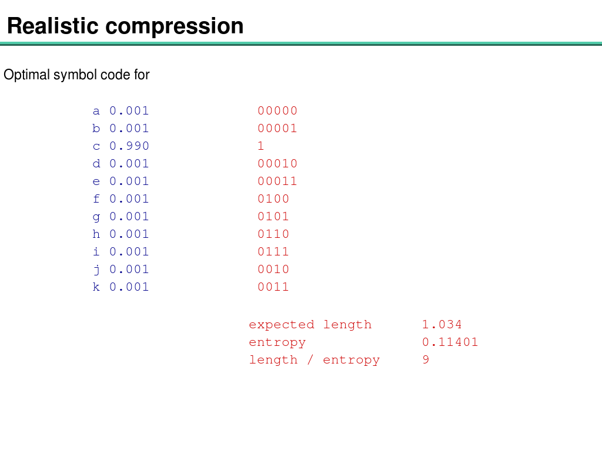

<span style="color:#2471a3;">**[example]**</span> Optimal symbol code for（为如下信源构造的最优符号码）——11 个符号的极端偏斜分布：

| 符号 | $p_i$ | 码字 |
|---|---|---|
| a | 0.001 | 00000 |
| b | 0.001 | 00001 |
| c | 0.990 | 1 |
| d | 0.001 | 00010 |
| e | 0.001 | 00011 |
| f | 0.001 | 0100 |
| g | 0.001 | 0101 |
| h | 0.001 | 0110 |
| i | 0.001 | 0111 |
| j | 0.001 | 0010 |
| k | 0.001 | 0011 |

expected length（期望长度）1.034；entropy（熵）0.11401；length / entropy（长度 ÷ 熵）9。

> <span style="color:#7f8c8d;">旁注：图中符号与概率为蓝紫色等宽字体，码字与末尾三行汇总数据为红色等宽字体。</span>

> <span style="color:#1e8449;">**[note] Note（译者注）:**</span> 这张表要解决的不是「Huffman 还能不能改进」，而是给出一个上限判据：符号码在分布极偏时会差到九倍，而这不是实现没写好，是这一类码的结构下限；它要防的失败模式是「换个更聪明的符号码就能救」。
>
> 机制从两条约束各自的作用讲起。第一条，码长必须是正整数。为什么不能是 0？长度 0 的码字只有一个候选（空串），只要还有别的符号分配了正长度，空串就是它们的前缀，前缀条件立刻破坏；换个说法，在 Kraft 预算里长度 0 的码字占 $2^0=1$ 的份额，把整份预算吃光，别的符号一分不剩。所以再怎么省，占 99% 质量的那个符号也得付整整 1 bit（比特）。它的理想码长是 $\log_2(1/0.99)=0.0145$ bit（比特），实付 1 bit（比特），单个符号就浪费 $0.985$ bit（比特）。
>
> 第二条，$L<H+1$ 只约束差值，不约束比值。源自身的 entropy（熵）只有 $0.114$ bit（比特），$+1$ 的上界在 $H$ 这么小的时候形同虚设 —— 上界 $1.114$ 与下界 $0.114$ 之间差十倍。表上 $L=1.034$，几乎顶到上界，浪费 $0.920$ bit（比特），占 $L$ 的 $89\%$。所以「九倍」与定理毫不冲突，定理只是没为这个比值提供任何保护。
>
> 预算守恒在这里算得极干净，值得手抄一遍：$c$ 的码字 `1` 拿走 $1/2$ 的预算，剩下 $1/2$ 必须分给十条支流。实际分配是 6 个长度 4（$6/16=0.375$）加 4 个长度 5（$4/32=0.125$），合计 $0.5$，加上 $c$ 的 $0.5$ 正好等于 1 —— complete（完备）。于是期望长度 $=0.99\times1+6\times0.001\times4+4\times0.001\times5=0.99+0.024+0.020=1.034$ bit（比特），与表上数字吻合。那十个稀有符号「被优惠」到 4–5 bit（比特）而理想值是 $9.97$ bit（比特），原因就在这里：预算只剩一半，十条支流平均每条 $1/20$，对应长度约 $4.32$ bit（比特）。优惠和浪费是同一份预算的两面。
>
> 可算的分组实验，可以直接复现：把 $N$ 个符号打包成一个超级符号再做 Huffman。$N=1$ 时 $L/N=1.034$；$N=2$（$121$ 个块）$0.5446$；$N=3$（$1331$ 个块）$0.3833$；$N=4$（$14641$ 个块）$0.3049$。每一档都满足理论界 $H+1/N$（依次 $1.114$、$0.614$、$0.447$、$0.364$），并且肉眼可见地逼近 $0.114$。$N=100$ 时界是 $0.124$，比单符号好 $8.3$ 倍 —— 这就是「一次编码一串」的全部价值：把每个符号固定的那一份整数化开销除以 $N$。
>
> 但 $N$ 不能乱涨：$N=100$ 的块表要 $11^{100}\approx10^{104}$ 行，宇宙里存不下。arithmetic coding（算术编码）绕开的正是这张表 —— 它不枚举块，只维护一个 $[lo,hi)$ 区间，逐符号收缩，每步工作量正比于字母表大小，$N$ 步后区间长度约 $2^{-NH}$，输出区间里最短的那个二进制小数即可。表越大越不可行这件事，被「用几何代替枚举」化解。
>
> 跨课程连接。CSAPP 第 6 章的 cache（缓存）是同一个经济账：块对齐让每个对象尾部平均浪费半个块，颗粒越粗浪费越大，但粗颗粒换来更少的寻址开销；这里颗粒是 1 bit（比特），颗粒以下的概率质量只能被丢掉。区别在 cache（缓存）丢的是真实 byte（字节），能靠提高局部性摊薄 —— 一次搬 64 byte（字节）远比逐 byte（字节）读便宜；而符号码的浪费无法在单符号层面摊薄，唯一的办法就是提高 $N$，也就是提高「块大小」。
>
> 第二个连接是概率论的 weak law of large numbers（弱大数定律）：分组之所以有效，是因为 $N$ 个符号的经验分布几乎必然贴近 $p$，于是总有约 $2^{NH}$ 个高概率序列共享几乎全部质量，其余绝大多数序列几乎不出现。这条推理就是asymptotic equipartition principle（AEP，渐近均分性）的实质，p.11 这张表正是它的动机页 —— 表本身只是症状，AEP 才是病理。

### p.12 〔Arithmetic coding（算术编码）〕

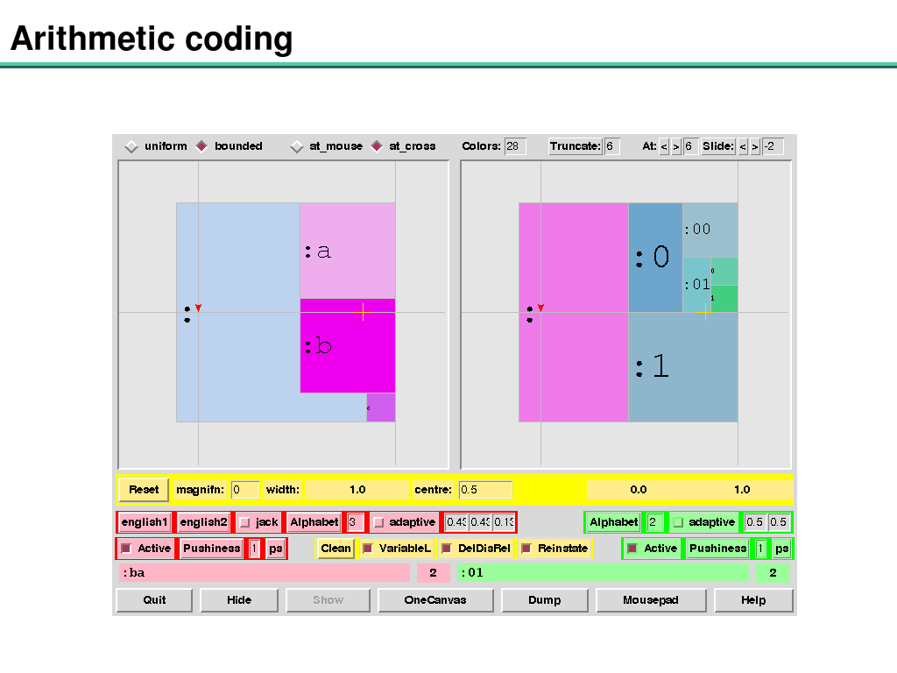

<span style="color:#2471a3;">**[section]**</span> 本页为算术编码演示程序的界面截图，可辨认的文字如下：

- 顶部工具栏：uniform（均匀）、bounded（有界）、at_mouse（在鼠标处）、at_cross（在十字线处）四种模式；参数框：Colors: 28、Truncate: 6、At: < > 6、Slide: < > -2。
- 左画布：单位区域按概率剖分成彩色子块，可见粉色块标 ":a"、品红块标 ":b"，其余大片浅蓝；左缘中部有红/蓝十字准星标记，右下角另有一极小的品红块〔无法辨认〕。
- 右画布：剖分进一步细分，可见大块 ":0" 与 ":1"，上方小块 ":00"、其下 ":01"（旁有绿色小角标 0 与 1）。
- 黄色控制条：Reset；magnify: 0；width: 1.0；centre: 0.5；最右端刻度 0.0 与 1.0。
- 参数行（左，红框）：english1、english2、jack、Alphabet 3、adaptive、0.43 0.43 0.14；Active、Pushiness: 1、ps；下方粉色回显条 ":ba" 与数字 2。
- 参数行（右，绿框）：Alphabet 2、adaptive、0.5 0.5；Active、Pushiness: 1、ps；下方绿色回显条 ":01" 与数字 2。
- 中排按钮：Clean、VariableL〔?〕、DelDiaRel〔?〕、Reinstate。
- 底排按钮：Quit、Hide、Show（灰置）、OneCanvas、Dump、Mousepad、Help。

〔本页为程序界面截图〕

### p.13 〔Other uses for arithmetic coding（算术编码的其他用途）〕

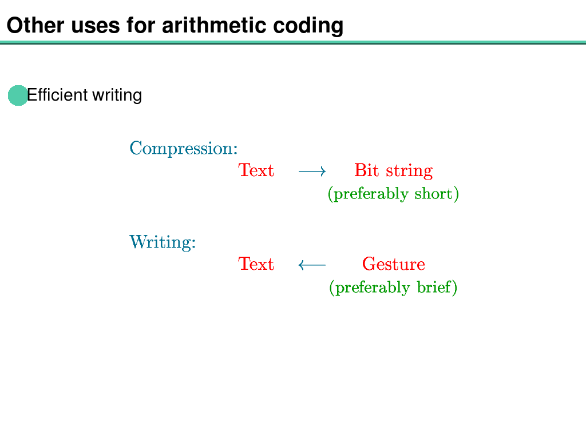

<span style="color:#2471a3;">**[section]**</span> Efficient writing（高效书写）

- Compression:（压缩：）Text（文本）$\longrightarrow$ Bit string（比特串）(preferably short)（越短越好）
- Writing:（书写：）Text（文本）$\longleftarrow$ Gesture（手势）(preferably brief)（越简短越好）

### p.14 〔Dasher（Dasher 文字输入软件）〕

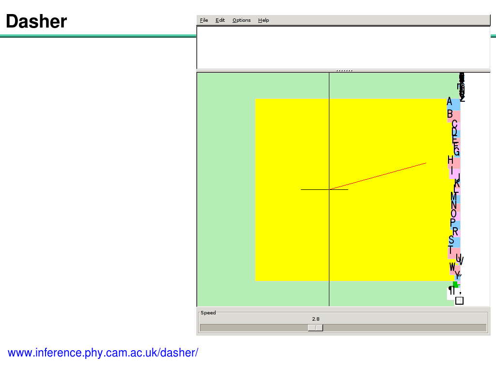

本页为 Dasher 文字输入软件的截图：

- 顶部菜单栏：File、Edit、Options、Help；菜单下为已输出文本的显示框（当前为空）。
- 主画布：绿色背景，中央一大块黄色区域；一条黑色竖线贯穿画布作准星，中心处有一小段水平黑线，红色细线从中心指向右上方（指示行进方向）。
- 画布右缘纵向排列彩色字母方块（黄、粉、蓝相间，块高与该字母的预测概率成正比）：A, B, C, D, E, F, G, H, I, J, K, M, N, O, P, R, S, T, U, V, W, Y 等字母块及标点块（下缘可见绿色小方块与「.」等符号）。
- 主画布右上缘有正在移出视野的黑色字符（形似 m）〔无法辨认〕。
- 底部：Speed（速度）滑杆，示数 2.8。
- 页面左下角以蓝色显示网址：www.inference.phy.cam.ac.uk/dasher/

〔本页为软件界面截图〕

> <span style="color:#1e8449;">**[note] Note（译者注）:**</span> 这条要回答的不是「Dasher 是什么软件」，而是「算术编码凭什么能变成一个界面」：它的设计问题在于，一个只输出 bit（比特）的编码器，怎么反过来当输入设备用；它要防的失败模式是「压缩与输入是两件不相干的事」。
>
> 先看压缩那半边。arithmetic coding（算术编码）把消息映射成 $[0,1)$ 里的一个实数：初始区间是 $[0,1)$，每读一个符号，按它的条件概率把当前区间切成若干段，只保留落中的那段。$N$ 步之后区间长度等于 $\prod_tP(x_t\mid\text{历史})=2^{-\sum_th(x_t)}$ —— 区间的长度就是「这条消息一共花了多少 bit（比特）」的精确版。输出只需在区间里挑一个最短的二进制小数，位数约 $-\log_2(\text{长度})$。这里没有整数锁链：一个符号可以只花 $0.0145$ bit（比特），这在符号码里是被禁止的。
>
> Dasher 做的事是把箭头反过来，让它变成译码。屏幕上那条从左到右的尺子就是当前区间，按概率切成彩色块，块宽正比于该符号的概率；你把指针推向某块，视野随之放大，选中的块铺满全屏，区间重置为整段。核心不变量是：指针累积经过的「信息距离」等于已输出文本的总 self-information（自信息）。于是输入速度乘以平均每字符自信息等于信息率，单位是 bit/s（比特每秒），它是手速与模型预测能力的乘积 —— 模型越准，同样的手速写出越多字。
>
> 一个可算的对比：用 p.3 那 27 字母表（单字符模型），空格 $p=0.1928$，$h=2.37$ bit（比特）；字母 $z$ 是 $p=0.0007$，$h=10.5$ bit（比特）。比值 $4.4$，意味着推向空格所需的位移只有推向 $z$ 的四分之一多一点 —— 常用的东西自动变大、更好打中，这是把概率直接翻译成体力。再叠上语言模型：Shannon 在 1951 年用猜字实验估计英文的 entropy（熵）在 $0.6$ 到 $1.3$ bit（比特）每字符之间，Dasher 的实测区间与之吻合；若手的速度是 $20$ bit/s（比特每秒），理论上限就是每秒 $15$ 到 $33$ 个字符 —— 这个量级正好解释截图里 Speed 2.8 那种「不用快，只要不断」的使用方式。
>
> 历史与人物。Dasher 出自剑桥大学 Cavendish Laboratory 的 Inference Group，作者是 David J. Ward 与 David J.C. MacKay，论文标题直译是「用逆算术编码做免手文字输入」（arXiv cs/0204030）。MacKay（1967–2016）就是这套讲义的作者，剑桥 Regius Professor of Engineering（钦定工程学教授），2016 年 4 月 14 日因胃癌去世；据皇家学会的回忆文章，Dasher 的起点是 1997 年他与 Michael Lewicki 在 NIPS 会议的通勤巴士上抱怨掌上设备输入太慢，两人意识到只要语言模型够好，输入就可以被「预测」出来，余下的界面问题交给信息论。设计动机是行动不便者：单指、眼动、sip-and-puff（呼吸开关）都只提供一维或二维的连续输入，而 Dasher 恰好只需要一个连续方向。同一组人后来还写过用呼吸信号输入文字的论文。
>
> 跨课程两条。6.006 的二分搜索：Dasher 每步在按概率剖分的区间树里选路，最坏深度是 $\lceil\log_2(1/p_{\min})\rceil$，平均深度是 entropy（熵）。二分搜索把区间对半砍，等价于假设所有候选等概率，所以平均步数恰好是 $\log_2n$，只在均匀分布时才等于熵 —— 这个差额就是「预测」值多少钱。CSAPP 第 2 章的浮点表示：真实实现不能用实数区间，因为区间长度按 $2^{-h}$ 指数缩小，双精度只有 53 位有效位，几十步后就切不动了；工程解法是用定点整数维护 $[lo,hi)$，并在区间过窄时重归一化（输出高位、把区间左移放大），这正是算术编码器里那个 E1/E2/E3 重归一化循环的全部内容。
>
> 收束：Dasher 证明了一件反直觉的事 —— 压缩与输入是同一个数学对象的两个方向，你可以把「消息有多短」翻译成「要花多大力气」，而后者恰恰是人机接口里最稀缺的资源。

### p.15 〔（无标题页）课堂问答题：编码流中 1 的概率〕

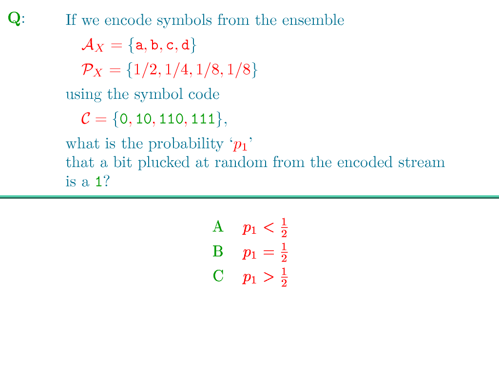

<span style="color:#2471a3;">**[example]**</span> 页面左上角为绿色「Q:」，题目：若我们对来自如下系综（ensemble）的符号进行编码

$\mathcal{A}_X = \{\text{a}, \text{b}, \text{c}, \text{d}\}$

$\mathcal{P}_X = \{1/2, 1/4, 1/8, 1/8\}$

所用符号码（symbol code）为

$\mathcal{C} = \{0, 10, 110, 111\}$，

what is the probability '$p_1$' that a bit plucked at random from the encoded stream is a 1?（那么从编码后的比特流中随机抽取一比特，它是 1 的概率「$p_1$」是多少？）

横线下方给出三个选项：

- A　$p_1 < \frac{1}{2}$
- B　$p_1 = \frac{1}{2}$
- C　$p_1 > \frac{1}{2}$

> <span style="color:#1e8449;">**[note] Note（译者注）:**</span> 这道题的正确答案是 **B**：$p_1=1/2$。而它值得写一整条，是因为背后有两层东西 —— 一层是「两种平均」的口径问题，一层是理想码比特流的统计性质；要防的失败模式是「凭直觉觉得 0 比 1 多，所以 $p_1<1/2$」。
>
> 先算。题目问的是「从编码流里随机抽一个 bit（比特）」，那么抽样是两阶段的：先按 $p_i$ 抽一个符号，再在该符号的码字里均匀抽一个位置。于是
>
> $p_1=\dfrac{\mathbb{E}[\text{码字中 1 的个数}]}{\mathbb{E}[l_i]}$，分子分母都是对同一个符号抽样的期望。
>
> 代入：$\mathbb{E}[\#1]=\frac12\cdot0+\frac14\cdot1+\frac18\cdot2+\frac18\cdot3=0.875$，$\mathbb{E}[l_i]=\frac12\cdot1+\frac14\cdot2+\frac18\cdot3+\frac18\cdot3=1.75$，相除得 $0.5$。用八个符号的样本流手验一遍：$a\,a\,a\,a\,b\,b\,c\,d$ 编码成 `0 0 0 0 10 10 110 111`，共 $14$ bit（比特），其中 $7$ 个 1，正好一半。以 $20$ 万个随机符号做模拟，实测 $p_1=0.5001$，误差在抽样噪声量级。
>
> 容易错的地方在这里：若先算每个符号的「1 的密度」再按 $p_i$ 加权，得到 $\frac14\cdot\frac12+\frac18\cdot\frac23+\frac18\cdot\frac33=0.333$，看着像 $p_1<1/2$。这个算法错在权重用在了错误的阶段 —— 问「抽到 1 的概率」时，长码字会被抽到更多次，正确权重是 $p_il_i/\mathbb{E}[l_i]$ 而不是 $p_i$。密度型统计量按符号加权，比特型统计量必须按比特加权；同一份数据换抽样口径，答案就变，这是概率论里最常见的陷阱之一。
>
> 再往深一层：为什么恰好是 $\frac12$ 而不是碰巧。当 $l_i=\log_2(1/p_i)$ 精确成立（这里 $1,2,3,3$ 都是整数），码树是 complete（完备）的，每个深度为 $d$ 的前缀节点承载的概率质量恰好是 $2^{-d}$ —— 换成直白的话：深度 $d$ 的每种前缀都一样重。于是「第 $d$ 位是 1」的概率等于所有以 1 结尾的深度 $d$ 前缀的质量和，共 $2^{d-1}$ 个、每个 $2^{-d}$，加起来还是 $\frac12$。每一个比特位置在边缘上都是公平硬币，整条流看上去就是随机比特串。
>
> 这条性质是理解「压缩后为什么像随机数」的钥匙。压缩并不生产偏斜的 bit（比特）流，它生产的是「长度恰好等于信息量」的流：单看某一位和抛硬币没区别，信息藏在「你抛了几次」里。反过来这也是压缩器的验收标准，输出若能通过统计检验（比如 1 的比例显著偏离 $\frac12$，或出现周期性），说明还有没榨干的冗余 —— 现代 compressor（压缩器）的质量评估里，随机性检验是标配而不是锦上添花。
>
> 一个反例把边界钉住：若改用等长码 $\mathcal{C}=\{00,01,10,11\}$ 编这四个符号，则 $\mathbb{E}[l_i]=2$、$\mathbb{E}[\#1]=0.625$、$p_1=0.3125$，与 $\frac12$ 相去甚远；而它比理想码每符号多花 $0.25$ bit（比特）。可见比特流的偏斜与压缩效率之间没有函数关系：理想码给出 $p_1=\frac12$ 且 $L=H$，非理想码可以偏斜也可以不偏斜。判断压缩好坏的指标是 $L$ 与 $H$ 的距离，不是流的偏斜度 —— 这一点如果搞反，会去优化一个不影响长度的量。
>
> 跨课程连接。Bertsekas 概率论的tower property（塔性质，全期望公式）正是本题的骨架：先对「落在哪个符号」取条件、再对符号分布取期望，两层抽样两个权重，塔性质提醒你的就是别把两层的权重混用。CSAPP 的伪随机数视角是第二个连接：一个输出「边缘均匀、内部有结构」的比特串，形态上和伪随机数生成器一模一样 —— 区别在结构由谁决定，压缩器的结构由输入消息决定（可逆、能解压），伪随机数的结构由种子决定（可复现、不可预测）。
>
> 收束回正文：p.11 那个九倍差距与这里的 $\frac12$ 说的是同一件事的两面 —— 符号码在单符号层面被整数锁死，只能靠「流的长度」而非「流的偏斜」承载信息；真正的压缩发生在长序列里。

### p.16 〔Recommended exercises（推荐练习）〕

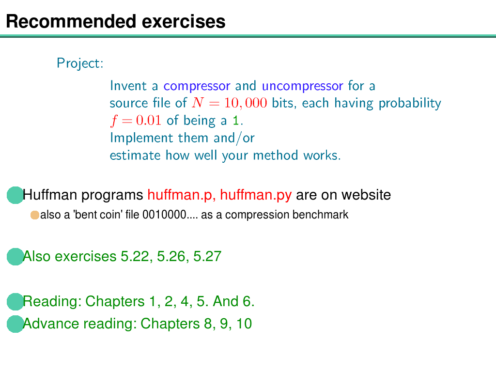

<span style="color:#2471a3;">**[section]**</span> Project:（项目：）为一个 $N = 10{,}000$ 比特、每比特以概率 $f = 0.01$ 取值为 1 的源文件，发明一对 compressor（压缩器）与 uncompressor（解压器）；Implement them and/or estimate how well your method works.（把它们实现出来，和/或估计你的方法效果如何。）

- Huffman programs（Huffman 程序）huffman.p、huffman.py 已放到课程网站上；
  - also a 'bent coin' file 0010000… as a compression benchmark（另附一个「弯硬币」文件 0010000…，可作压缩性能基准）
- Also exercises 5.22, 5.26, 5.27（另有习题 5.22、5.26、5.27）
- Reading: Chapters 1, 2, 4, 5. And 6.（阅读：第 1、2、4、5 章以及第 6 章）
- Advance reading: Chapters 8, 9, 10（预读：第 8、9、10 章）
