> <span style="color:#7f8c8d;">Source: MacKay《Information Theory, Inference, and Learning Algorithms》课程手写讲义 l6 · 行内双语视觉转录版 · 原图见 fig/l6/</span>

<span style="color:#2471a3;">**[lecture]**</span> **第 6 讲：推断与噪声信道的信息度量（Inference and Information Measures for Noisy Channels）**。本讲前半段收束数据压缩（Data compression）话题：算术编码（arithmetic coding）、预测器与 PPM、Dasher 输入法、随机数基准；后半段开启新主题——噪声信道（noisy channel）上的贝叶斯推断与信息度量（互信息 mutual information）。

### p.1 〔Information theory, pattern recognition, and neural networks（信息论、模式识别与神经网络）〕

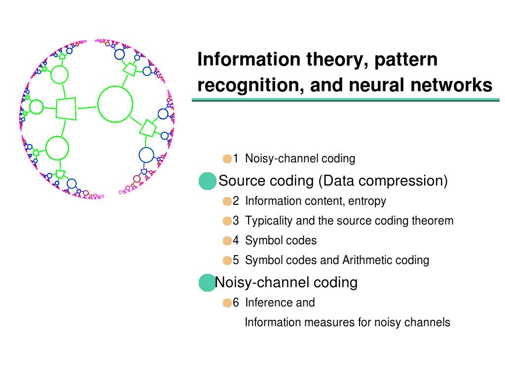

课程封面与大纲页。左侧是一幅圆盘内的分形树装饰图：绿色圆/方节点自圆心向外生长，越靠圆盘边缘节点越小越密，颜色渐变为蓝、红、品红的小环——〔本页左侧为纯装饰图示〕。

课程路线图（编号为讲次）：
- 讲次 1：噪声信道编码（Noisy-channel coding）；
- **信源编码（Source coding，即数据压缩 Data compression）**（青色圆点强调）：
  - 讲次 2：信息量（information content）与熵（entropy）；
  - 讲次 3：典型性（typicality）与信源编码定理（source coding theorem）；
  - 讲次 4：符号码（symbol codes）；
  - 讲次 5：符号码与算术编码（Arithmetic coding）；
- **噪声信道编码（Noisy-channel coding）**（青色圆点强调）：
  - 讲次 6：推断（inference）与噪声信道的信息度量（information measures for noisy channels）——即本讲。

### p.2 〔Q:（问题：）〕

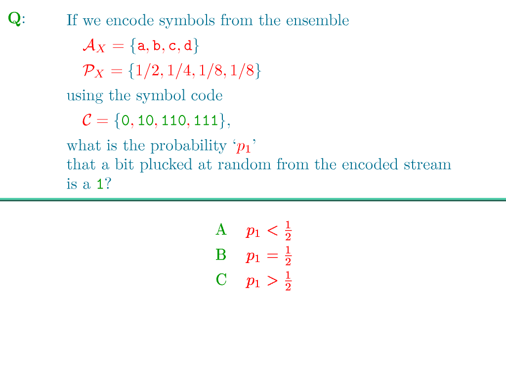

<span style="color:#2471a3;">**[example]**</span> **问（Q）：** 若用符号码（symbol code）对如下系综（ensemble）编码：
$\mathcal{A}_X = \{\mathsf{a},\mathsf{b},\mathsf{c},\mathsf{d}\}$，$\mathcal{P}_X = \{1/2,\,1/4,\,1/8,\,1/8\}$，
$\mathcal{C} = \{0,\,10,\,110,\,111\}$，
那么从编码后的比特流中随机抽取一个比特，它是 $1$ 的概率「$p_1$」是多少？
- A：$p_1 < \tfrac{1}{2}$
- B：$p_1 = \tfrac{1}{2}$
- C：$p_1 > \tfrac{1}{2}$

> <span style="color:#1e8449;">**[note] Note（译者注）:**</span> 这道题表面是一次加法，实际在问一件更基础的事：一个 symbol code（符号码）输出的 bit stream（比特流）里，有多大比例的位是 $1$。而这个问题没有唯一答案 —— 它取决于「随机抽一个 bit（比特）」这句话里的抽样单位。这句话有两种读法，读法不同答案不同，源页取 A 用的是第一种。
>
> 第一种读法：先按 $\mathcal{P}_X$ 抽一个 symbol（符号），再在它的 codeword（码字）内部均匀挑一位。抽样单位是 symbol，所以长码字不会因为长而被多抽，权重就是 $p_i$ 本身，条件概率是「该码字中 $1$ 的个数除以 code length（码长）」$o_i/l_i$。四个码字 $0$、$10$、$110$、$111$ 给出 $o=(0,1,2,3)$、$l=(1,2,3,3)$，代入得 $p_1=\frac12\cdot 0+\frac14\cdot\frac12+\frac18\cdot\frac23+\frac18\cdot 1=\frac13<\frac12$，选 A。
>
> 第二种读法：从整条输出流里按位置等概率挑一位。抽样单位变成 bit position（比特位置），长码字占据更多位置，自然被抽到更多次。生成一段很长的流，$\mathsf{a}$ 约占 $N/2$ 次、贡献 $N/2$ 位、其中 $1$ 的个数为 $0$；$\mathsf{b}$ 约 $N/4$ 次、贡献 $N/2$ 位、$1$ 的个数 $N/4$；$\mathsf{c}$、$\mathsf{d}$ 各约 $N/8$ 次、各贡献 $3N/8$ 位，$1$ 的个数分别是 $2N/8$ 与 $3N/8$。总位数 $N\cdot L=N\cdot\frac74$，$1$ 的总数 $N\cdot\frac78$，两者相除得 $p_1=\frac{7/8}{7/4}=\frac12$ —— 恰好是选项 B。
>
> 所以两条路都自洽，差别在代数上很清楚：第一种算的是 $\mathbb{E}[\,o(X)/l(X)\,]$，第二种算的是 $\mathbb{E}[\,o(X)\,]/\mathbb{E}[\,l(X)\,]$。这两个量一般不等，只有当 $o_i/l_i$ 对所有符号都相同时才相等。概率论里「随机变量的函数的 expectation（期望）不等于期望的函数」这条戒律，在这里变成一个可手算的分歧点，而不是一句口号。
>
> 那为什么仍然说「符号码只对 symbol 这一层最优」？因为无论按哪种读法，编码器都不对输出的位负责，它只对「符号到码字」这个映射负责。给一个更利落的反例：同一个 ensemble（系综）改用定长码 $\{00,01,10,11\}$，每个码字两位，$o=(0,1,1,2)$、$l=(2,2,2,2)$，按位置加权得 $p_1=\frac14\cdot 0+\frac14\cdot\frac12+\frac18\cdot\frac12+\frac18\cdot 1=0.3125$，远小于 $1/2$。可见输出流里 $1$ 的比例既可以小于、也可以等于、也可以大于 $1/2$，它由 source（信源）与 code（码）共同决定，与「压缩器做得好不好」无关。
>
> 这个事实有两处工程后果。其一，若你确实需要均匀随机的 bit（做 hash table（哈希表）的种子、做 Monte Carlo（蒙特卡洛）模拟、做密钥），不能直接拿压缩器的输出充数，因为那段流的统计结构里还留着信源的指纹。其二，反过来是一条极硬的判据：任何「随机数」只要能被通用压缩器明显压短，它就不随机 —— 第 13 页那张 Marsaglia 光盘正是拿这条判据当靶子的。
>
> 跨课程连接：6.042J 的期望一节强调 $g(X)$ 仍是 random variable（随机变量），$\mathbb{E}[g(X)]=\sum_i p_i\,g(i)$，这里的 $o(X)$ 与 $l(X)$ 就是两个这样的函数；6.431 的 Bertsekas 在 conditional expectation（条件期望）那一章反复练「先固定外层、再对里层求期望」的动作，和这里是同一套手法。区别在于本注真正关心的是比值在 $N\to\infty$ 时的极限：那时第二种读法收敛到 $\mathbb{E}[o]/\mathbb{E}[l]$，第一种收敛到 $\mathbb{E}[o/l]$，两者仍然不同 —— 所以「抽样单位」这个歧义必须在最开始就掐死，否则后面算 rate（速率）时会莫名其妙差一截。
>
> 一句话收束：这道题要你分清「按符号抽」与「按位抽」，并接受一个事实 —— 压缩的输出不必均匀；均匀是随机源的义务，不是编码器的义务。（MacKay 原 slide 对这种读法的取舍未能在官方 PDF 中定位到原题，⚠ 需回查；上面两套算术都可独立复核。）

### p.3 〔Last time - symbol codes（上次课：符号码）〕

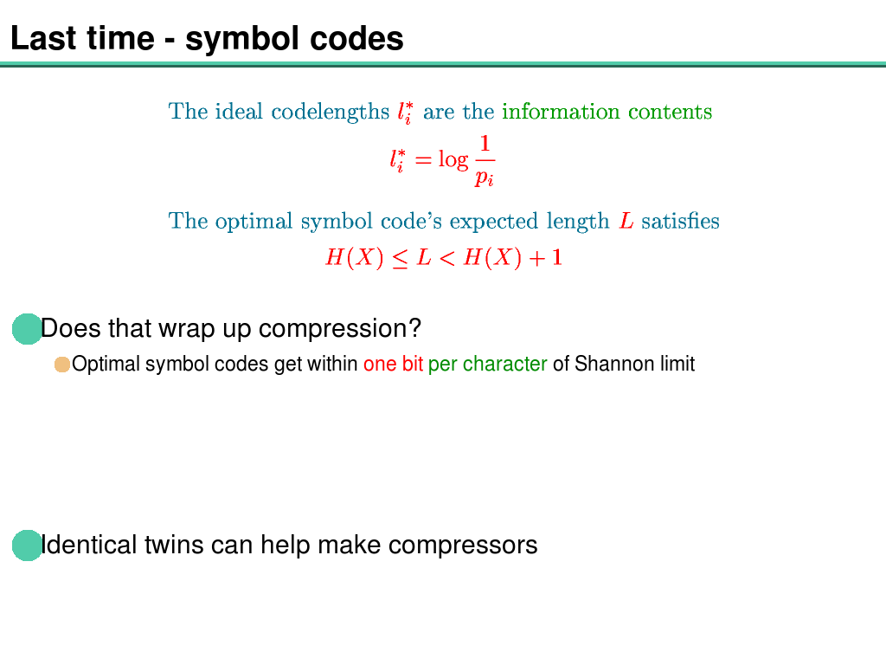

<span style="color:#2471a3;">**[section]**</span> 回顾上次课的符号码结论：
- 理想码长（ideal codelengths）$l_i^*$ 就是信息量（information contents）：
```math
l_i^* = \log \frac{1}{p_i}
```
- 最优符号码的期望长度（expected length）$L$ 满足：
```math
H(X) \le L < H(X) + 1
```

- 那么，压缩到此就完结了吗（Does that wrap up compression?）？最优符号码与 Shannon 极限（Shannon limit）的差距在每字符 1 比特（one bit per character）以内。
- 同卵双胞胎（identical twins）可以帮助构造压缩器。

> <span style="color:#1e8449;">**[note] Note（译者注）:**</span> $H(X)\le L<H(X)+1$ 里的这个「$+1$」不是误差余量，而是「prefix code（前缀码）要求每个码字的长度是整数」这件事的必然代价；配对编码把这份代价按符号数摊薄，$N$ 个一组就摊到 $1/N$。
>
> 先看取整这一步。ideal codelength（理想码长）$l_i^*=\log\frac{1}{p_i}$ 一般不是整数，而前缀码只能用整数长度 —— 因为一组整数长度 $l_i$ 能对应一棵二叉树，当且仅当它们满足 Kraft inequality（克拉夫特不等式）$\sum_i 2^{-l_i}\le 1$。所以只能向上取整 $l_i=\lceil l_i^*\rceil$，这一步每个符号最多亏一位：$l_i<l_i^*+1$，两边乘 $p_i$ 求和即得 $L<H(X)+1$。下界 $L\ge H(X)$ 来自另一侧：任何满足 Kraft 的整数码长都有 $\sum_i p_i l_i\ge\sum_i p_i\log\frac{1}{p_i}$，证法只用 $\ln x\le x-1$ 逐项放缩，一行就完。所以这个双侧不等式的两侧来源完全不同：下界是信息不等式，上界是取整。
>
> 再看「摊薄」。把相邻两个符号绑成一个 super-symbol（超符号），字母表变成 $|\mathcal{A}|^2$，entropy（熵）变成 $2H$，取整误差仍然至多一位，但这一位现在要由两个原始符号分，于是每符号至多 $1/2$。推广到 $N$ 个一组，误差上界 $1/N$。代价是码表从 $|\mathcal{A}|$ 项涨到 $|\mathcal{A}|^N$ 项 —— 纯组合爆炸，所以实践上不能真的取大 $N$，而要换个办法把「$N\to\infty$」做出来。本讲的 arithmetic coding（算术编码）就是这个办法：它不建码表，让区间随符号逐个收缩，等效地走到大 $N$ 的极限。
>
> 一个能手算的例子把「摊薄」变成数字。取 $p=(0.99,0.01)$，$H=0.0808$ 位。单符号最优码长 $(1,2)$，$L=1.01$，与熵的差 $0.929$ —— 几乎顶到 $+1$ 的上限。两符号一组，四个 pair 的概率是 $0.9801$、$0.0099$、$0.0099$、$0.0001$，最优码长 $(1,2,3,3)$，于是 $L_2=0.9801\cdot 1+0.0099\cdot 2+0.0099\cdot 3+0.0001\cdot 3=0.9801+0.0198+0.0297+0.0003=1.0299$。摊到每符号是 $0.5150$，与熵的差降到 $0.434$，正好接近减半；三符号一组的差距上界就到 $1/3=0.333$。这个 $0.929\to0.434\to0.333$ 的台阶，就是「identical twins（同卵双胞胎）」这个比喻的全部内容。
>
> 那为什么分组在极限上真能走到 $H$？靠的是 typicality（典型性）。长度 $N$ 的序列里，满足 $-\frac{1}{N}\log P(\mathbf{x})\approx H$ 的那些序列占了几乎全部概率，数量约 $2^{NH}$。给这 $2^{NH}$ 个典型序列编号只需 $NH$ 位，折合每符号 $H$ 位；非典型序列可以整体塞进一个「逃跑」分支，用很长的码字编码，而它们的总概率随 $N$ 指数衰减，对 expected length（期望长度）的贡献趋于零。这里的取舍值得记牢：符号码要求「每条序列都有界、处处成功」，分块编码允许「极少数序列很长、甚至失败」，换来的是一类平均意义的最优性。Shannon 在 1948 年的 A Mathematical Theory of Communication 里给出的 source coding theorem（信源编码定理）正是这个陈述。
>
> 跨课程看一眼。6.042J 的计数论证在这里直接可用：典型集不过是「数一数有多少序列满足某个平均条件」。6.431 的 law of large numbers（大数定律）给出使「典型」有定义的那条极限：$-\frac{1}{N}\sum_t\log p(x_t)$ 依概率收敛到 $H$，没有它，典型集只是空话。100B 实分析里的极限语言用来说清 $1/N$ 型上界如何随 $N\to\infty$ 消失。区别在于：符号码给的是有限 $N$ 下处处成立的严格不等式（每符号亏不到一位），分块编码给的是 $N\to\infty$ 才取到等号的渐近陈述 —— 前者是保证，后者是极限，两者不能混用。
>
> 一句话收束：$+1$ 是整数位长开出的账单，分组是把账单均摊的技术，而算术编码把「均摊」做成了一次区间收缩，所以后面的常数从 $1$ 降到 $2/N$。

### p.4 〔Arithmetic coding（算术编码）〕

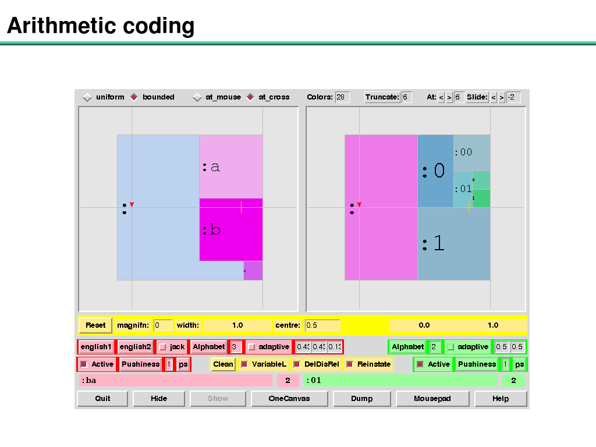

本页为 MacKay 的算术编码演示程序（applet）截图，直观展示算术编码的区间剖分。顶栏选项：uniform（均匀）、bounded（有界）、at_mouse（在鼠标处）、at_cross（在十字处）、Colors: 28、Truncate: 6、At: < > 6、Slide: < > -2。
- 左面板：单位区间按概率切成彩色区块：上方淡蓝大区块、右侧粉色区块标 `:a`，下方品红区块标 `:b`，右下角还有更小的深紫色小区块——对应已输入串 `:ba` 之后的细分。
- 右面板：区间按二进制剖分，标出 `:0`、`:00`、`:01`（右上角一小块绿色）与 `:1`——即以二进制前缀划分码区间。
- 底部控制条：Reset、magnfn: 0、width: 1.0、centre: 0.5、区间刻度 0.0–1.0；左侧模型设置 english1 / english2 / jack、Alphabet 3、adaptive 0.43 0.43 0.14；右侧 Alphabet 2、adaptive 0.5 0.9；Active、Pushiness 1、ps；Clean、VariableL、DelDisRel、Reinstate；状态行 `:ba`（2）与 `:01`（2）；按钮 Quit、Hide、Show（灰置）、OneCanvas、Dump、Mousepad、Help。

〔本页为软件截图型图示页〕

### p.5 〔Arithmetic coding（算术编码）〕

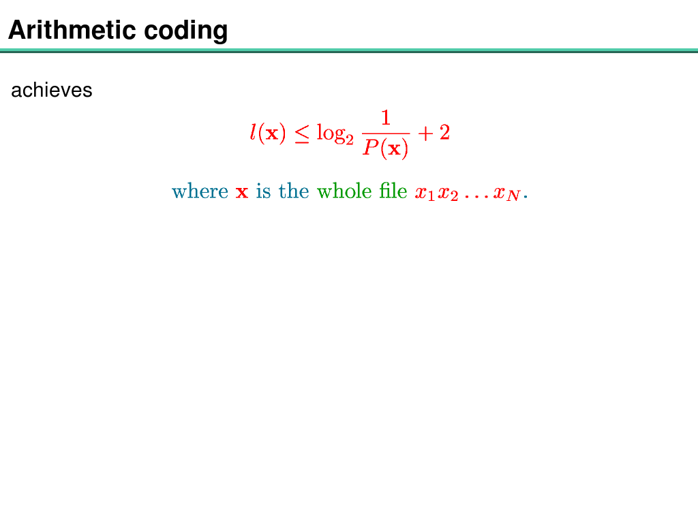

<span style="color:#2471a3;">**[theorem]**</span> 算术编码 achieves（达到）：
```math
l(\mathbf{x}) \le \log_2 \frac{1}{P(\mathbf{x})} + 2
```
其中 $\mathbf{x}$ 是整个文件（whole file）$x_1 x_2 \ldots x_N$。

> <span style="color:#1e8449;">**[note] Note（译者注）:**</span> 这条不等式是整个 arithmetic coding（算术编码）的验收标准：整条消息的码长不超过它的 ideal information content（理想信息量）加两位，而这两位的界不随文件长度增长 —— 它是常数，不是 per-symbol（逐符号）的债。这一条把「符号码每符号亏一位」和「算术编码整文件亏两位」彻底分开。
>
> 先看编码器在做什么。算术编码把消息映射成一个 subinterval（子区间）。初始区间是 $[0,1)$；每读入一个符号，就按它的条件概率把当前区间按比例切成若干段，取该符号对应的那一段。$N$ 个符号之后，区间长度恰好等于 $\prod_t P(x_t\mid x_{<t})=P(\mathbf{x})$。于是「码」这个东西从「一张符号表」变成「一个区间套」：解码器只要知道最后落进哪个子区间，就唯一还原出整条消息。
>
> 区间长度定下来之后，剩下的工作才是把它换成一个 bit string（位串）。做法是在区间里挑一个尽量短的二进制小数。这里有一条纯几何的判据：$m$ 位二进制小数的格点间距是 $2^{-m}$，所以只要 $2^{-m}\le P(\mathbf{x})$，即 $m\ge\log_2\frac{1}{P(\mathbf{x})}$，任何长度不小于 $P(\mathbf{x})$ 的区间里必定至少落进一个格点。取 $m=\lceil\log_2\frac{1}{P(\mathbf{x})}\rceil+1$ 就万无一失：第一个 $+1$ 位是向上取整的余量；第二个 $+1$ 位是为了让选中的格点连同它所代表的那段都落在区间内部，避免解码时恰好落在边界上产生歧义。两项加起来就是 $+2$。所以这两位的来历不是神秘常数，而是「取整」加「防边界」两笔小账。
>
> 一个能代入的例子把量级说清。取一个 100 字符的文件，全是 $\mathsf{a}$，模型给 $P(\mathsf{a})=0.9$（不必精确，只要是个「很偏」的模型）。则 $P(\mathbf{x})=0.9^{100}$。用 $\log_{10}0.9=-0.04576$ 得 $P(\mathbf{x})\approx 2.66\times 10^{-5}$，$\log_2\frac{1}{P(\mathbf{x})}\approx 15.2$，所以算术编码至多给 $18$ 位。同一个文件交给 Huffman coding（哈夫曼编码），$\mathsf{a}$ 的码字就是一位 $0$，总长 $100$ 位。差 $82$ 位，正好是注 #2 里「每符号亏一位」在 $100$ 个符号上的累积；而算术编码的亏损被 $+2$ 封顶，与文件多长无关。这就是「$2/N$ 摊薄」的具体数字：$N=100$ 时是 $0.02$ 位/符号，$N=10^{6}$ 时是 $2\times10^{-6}$ 位/符号。
>
> 但要注意，这个界是「对模型 $P$ 而言」的，不是「对真值而言」的。若 $P$ 与真实的 $\hat{P}$ 不符，$-\log P(\mathbf{x})$ 会大于真实 entropy（熵），多出来的部分正是 $N$ 倍 KL divergence（KL 散度）$\mathbb{E}_{\hat{P}}\log\frac{\hat{P}}{P}$。所以数据压缩被这条不等式干净地劈成两件事：概率建模决定你离 $H$ 有多远，算术编码只决定你离 $-\log P$ 有多远。这两笔账必须分开记，否则调参时会找不到责任方。
>
> 跨课程连接有两处特别直接。CSAPP 第 2 章的整数表示与溢出正好用得上：工程实现不用浮点保存 $[0,1)$，而是用 32 位或 64 位整数保存区间端点，每输出若干位就做一次 renormalization（重归一化）—— 把两端共同的前缀位吐出去、把剩余位左移，这既防下溢又不断产生输出。这就是「用有限寄存器模拟无限精度」，与 CSAPP 讲的移位、溢出、无符号回绕是同一套位运算。6.006 的 binary search（二分搜索）则是解码端的主力：给定码值 $v$，要判断它落在哪个符号的累积区间里，而累积分布函数 $F$ 恰好是单调数组，一次 `lower_bound` 用 $O(\log|\mathcal{A}|)$ 定位。区别在于 6.006 的数组是静态的，这里的 $F$ 每解出一个符号就要按新模型重标定一次，是「边查边改」的二分。
>
> 还可以对照一个更朴素的视角：算术编码其实是在做一次「把整条消息当成一个大整数」的转换，$P(\mathbf{x})$ 就是它在单位区间里的宽度。Huffman 树只能把每个叶子切成二进制小块，切法被树的形状锁死；算术编码不切，它只记录位置，所以精度可以任意接近区间本身的宽度。
>
> 一句话收束：算术编码的贡献不是「更聪明的树」，而是把「整数长度」这个约束整个拆掉；$+2$ 是拆除动作付出的全部代价，并且这份代价与文件长度无关。

### p.6 〔Data compression（数据压缩）〕

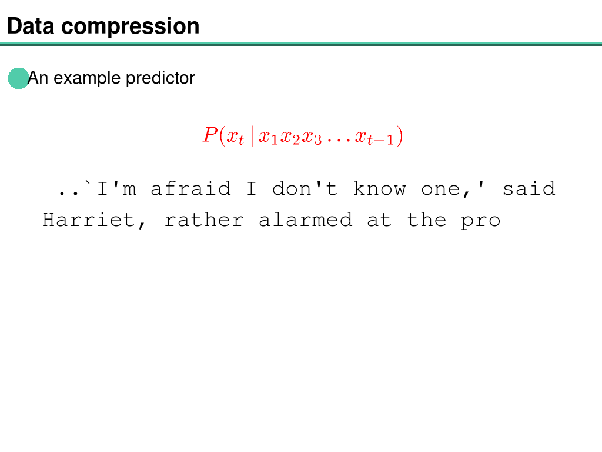

<span style="color:#2471a3;">**[section]**</span> 一个示例预测器（an example predictor）：
```math
P(x_t \mid x_1 x_2 x_3 \ldots x_{t-1})
```
演示文本（一段英语小说文字，用于现场演示「根据上文预测下一个字符」）：
`I'm afraid I don't know one,' said Harriet, rather alarmed at the pro…（「……『恐怕我不知道一个，』Harriet 说道，对这 pro……颇为惊慌」——模型此刻正要预测 "pro" 之后的字符。）

> <span style="color:#7f8c8d;">旁注：本页文本为等宽打字机字体，是课堂互动用的「猜下一字母」素材；结尾停在单词前缀 pro 处。</span>

### p.7 〔Data compression（数据压缩）〕

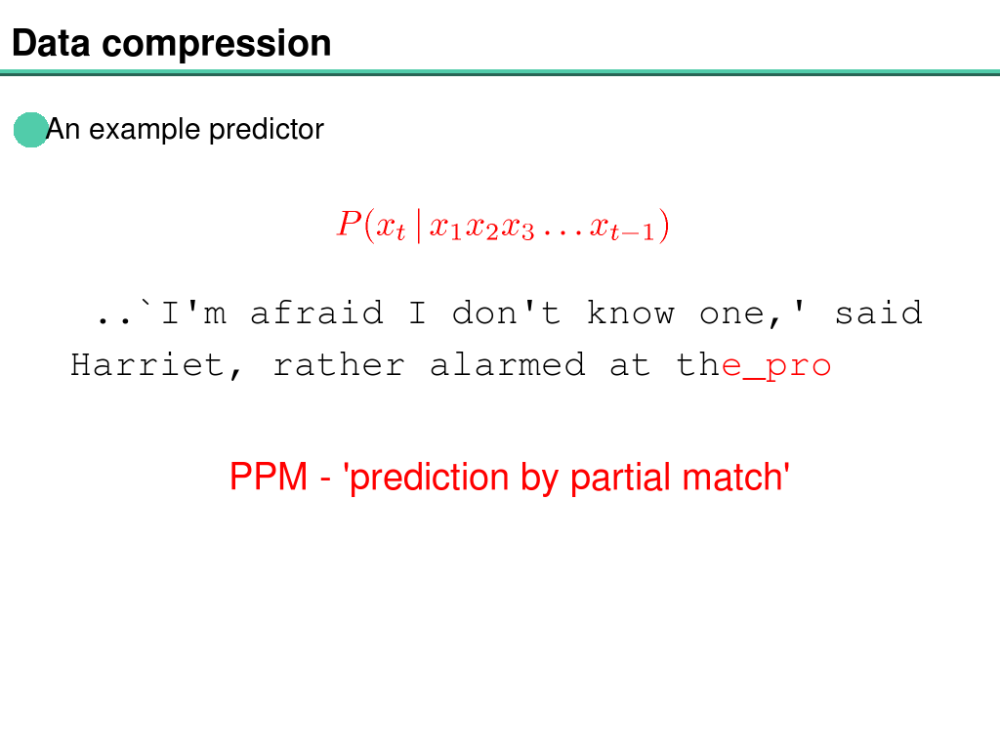

同一示例预测器 $P(x_t \mid x_1 x_2 x_3 \ldots x_{t-1})$。文本 `I'm afraid I don't know one,' said Harriet, rather alarmed at the_pro——本页把 "the pro" 的结尾以红色下划线标为 the_pro，表示模型刚读到哪里、正要预测下一字符。
红色大字：**PPM - 'prediction by partial match'**（PPM——「按部分匹配预测」算法）。

> <span style="color:#7f8c8d;">旁注：图中 the 之后红色的 pro 与红色下划线 _ 是幻灯片动画逐步标出的预测位置。</span>

### p.8 〔Six-gram model（六元语法模型）〕

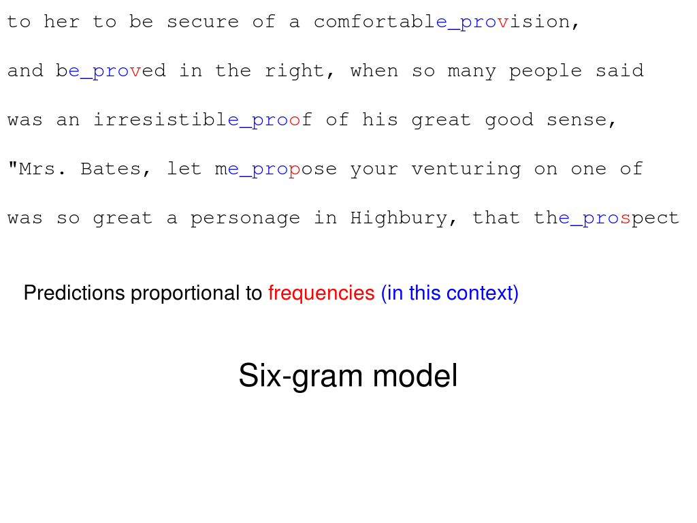

五行预测演示（取自简·奥斯汀风格文本，每行的 `_` 与其后彩色字母标出模型对下一字符的逐位补全）：
- to her to be secure of a comfortable_provision,（……以确保一份舒适的供给（provision），）
- and be_proved in the right, when so many people said（并且被证明（proved）是对的，当那么多人说……）
- was an irresistible_proof of his great good sense,（是他极有见识的无可抗拒的证明（proof），）
- "Mrs. Bates, let me_propose your venturing on one of（「Bates 太太，请允许我提议（propose）你试一试其中之一……）
- was so great a personage in Highbury, that the_prospect（在 Highbury 是如此了不得的大人物，以致这前景（prospect）……）

黑色文字：Predictions proportional to frequencies (in this context)（预测与该语境下的频次（frequencies）成正比）。
大字标题：**Six-gram model**（六元语法模型）。

> <span style="color:#1e8449;">**[note] Note（译者注）:**</span> 六元语法模型把「给定全部历史预测下一个字符」这件不可能的事，换成「给定最后 5 个字符去数频次」。这一步不是顺手近似，而是把无限状态的历史压成有限状态的等价类 —— 换来可估计性，付出稀疏性。
>
> 为什么必须截断？真实文本的条件依赖没有上界：`pro` 后面跟 `v` 还是 `b`，取决于更早出现的是 `the` 还是 `a`。但要让「频率当概率」成立，同一个条件事件必须被反复观测。历史越长，条件事件划得越细，重复次数越少，估计的方差越大。这就是所谓「维数灾难」在信息论里的样子：每多一个字符的条件，状态数乘上字母表大小，而语料是固定的。
>
> 严格的说法可以用 6.042J 的语言写。在「全体有限长历史」这个集合上定义关系：$\mathbf{h}\sim\mathbf{h}'$ 当且仅当两者的最后 $k$ 个字符相同。自反、对称、传递三条都显然成立，所以这是一个 equivalence relation（等价关系）；于是全体历史被 partition（划分）成等价类，每一类就是一个「上下文」。把类当成新的状态，状态空间从无限多降到 $|\mathcal{A}|^{k}$ 个。这是本节的第一性原理：n-gram 不是什么统计花招，它是对「历史」这个无限状态空间做一次等价类意义上的压缩。
>
> 稀疏有多大？取 $|\mathcal{A}|=27$（26 个字母加空格），$k=5$ 时 $27^{5}=14{,}348{,}907$ 个可能的上下文。一份 $10^{6}$ 字符的语料平均每个上下文只摊到 $6.9\times 10^{-2}$ 次观测。而自然语言的 n-gram 频次服从重尾分布，绝大多数类型只出现一次或两次，所以「见过五次的上下文」已经算高频样本。这个数字和字母表大小的高次方成正比，是任何 n-gram 方法都躲不开的墙。
>
> 一个能手算的例子把「可信」与「不可信」放在一起。`the ` 在语料里出现 5000 次，其中后面接 `p` 的 300 次，于是 $P(\texttt{p}\mid\texttt{the})=0.06$，代价 $-\log_2 0.06=4.06$ 位；接 `e` 的 2500 次，$P=0.5$，代价 $1$ 位。两条估计都可信，因为分母足够大。换到 `e_pro`：全语料只出现 1 次，且后面是 `v`，模型给出 $P(\texttt{v}\mid\texttt{e\_pro})=1$，代价 $0$ 位 —— 白送。但这是过拟合：若真实的下一字符是 `b`，模型给的概率是 $0$，代价无穷。所以任何可用实现都必须在每一层留一个 escape（逃逸）概率，把一部分概率质量让给短上下文，这正是 PPM（按部分匹配预测）的核心机制。
>
> 下一页 p.9 右侧那串从 `e_pro` 到 `_pro`、`pro`、`ro`、`o` 的退化链，就是这件事的图解：每一层上下文各给一份预测，长上下文有统计就用长的，没有就退一层。Cleary 与 Witten 在 1984 年把这套做法定名为 PPM，它至今仍是文本压缩的强基线；Dasher 输入法用的也是这一类语言模型。
>
> 跨课程连接。6.006 的 hash table（哈希表）是它的数据结构：以字符串为键、计数为值，期望 $O(1)$ 查找，把「数频次」从线性扫描降到常数。具体要建 $k+1$ 张表（从 $5$ 阶到 $0$ 阶），每读一个字符做 $6$ 次查找，命中就累加、未命中就转到短表并给长表记一个 escape。区别在于：6.006 的哈希假设键集合有限且已知，这里的键集合随语料增长、无上界，必须动态扩容；而且「回退」这个动作要求多张表协同，单表结构不够用。6.042J 的等价关系给出上面那段严格表述，6.431 的 law of large numbers（大数定律）给出「频率收敛于概率」的保证 —— 前提正是分母足够大，而这恰好是本节做不到的地方。
>
> 还有一处值得留心：图中的彩色字母只是把整份预测分布画出来的可视化手段，压缩器真正需要的是这份分布本身，随后交给算术编码去收缩区间。所以「六元语法模型」与「算术编码」是两个可以独立替换的部件，前者管模型，后者管编码，这与注 #3 里「建模与编码分开记账」是同一句话。
>
> 一句话收束：六元模型是 PPM 体系里最长的那一层；它单独用会被稀疏拖垮，而 PPM 的贡献就是给稀疏留一条体面的退路。

### p.9 〔Data compression - An example predictor（数据压缩·示例预测器）〕

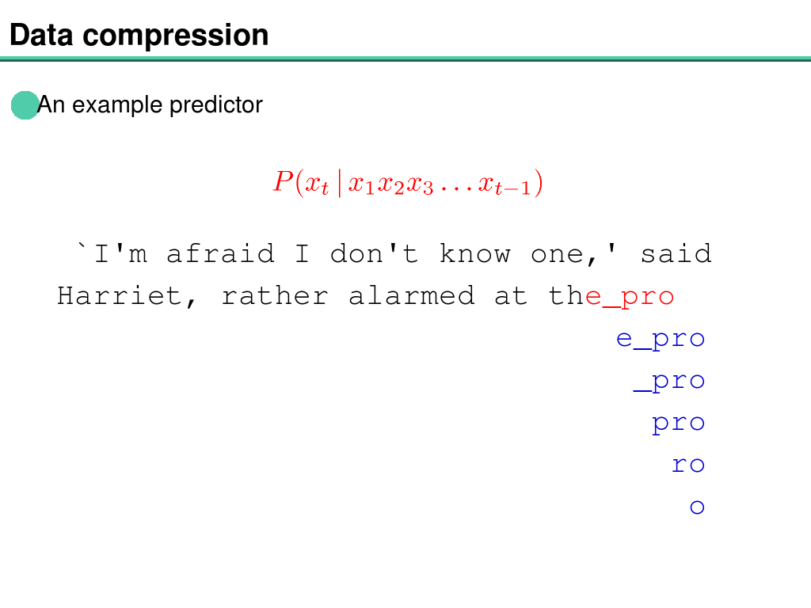

示例预测器 $P(x_t \mid x_1 x_2 x_3 \ldots x_{t-1})$。文本 `I'm afraid I don't know one,' said Harriet, rather alarmed at the_pro（"e_pro" 以红色标出，为当前上下文）。
右侧蓝色小字自上而下列出逐渐变短的上下文（PPM 按不同长度分别做预测）：
- e_pro（上下文 "…e_pro"）
- _pro（上下文 "_pro"）
- pro（上下文 "pro"）
- ro（上下文 "ro"）
- o（上下文 "o"）

即：从最长上下文 "e_pro" 开始，逐级退化为 "_pro"、"pro"、"ro"、"o"——这是 PPM 多模型混合（blend）的直观展示：各长度上下文各自给出一份对下一字符的预测，再按权重混合。

### p.10 〔Other uses for arithmetic coding（算术编码的其他用途）〕

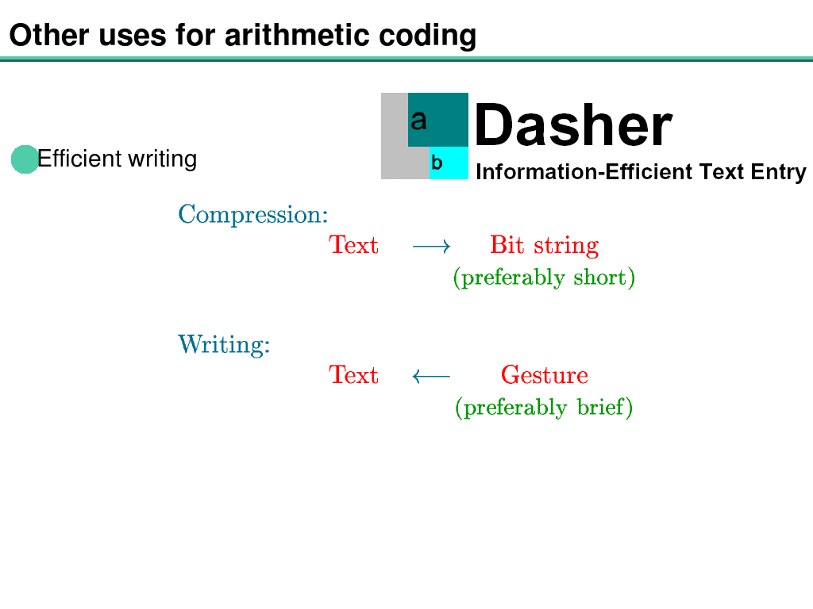

<span style="color:#2471a3;">**[section]**</span> 算术编码的其他用途：
- 高效书写（Efficient writing）——右上角为 Dasher 软件标志：两个小方格内含字母 a、b，旁书 **Dasher: Information-Efficient Text Entry**（Dasher：信息高效的文本输入）。
- 压缩（Compression）：文本（Text）⟶ 比特串（Bit string）（最好短，preferably short）。
- 书写（Writing）：文本（Text）⟵ 手势（Gesture）（最好简短，preferably brief）。

即：压缩是把文本变成一串尽量短的比特；书写是把一串尽量简短的手势（如鼠标轨迹）翻译回文本——两者互为逆过程，都可由同一个预测模型驱动。

### p.11 〔Dasher（Dasher 输入界面）〕

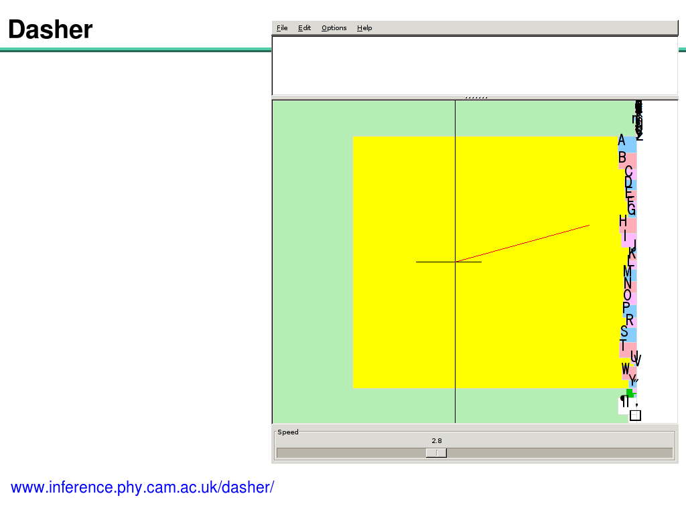

Dasher 软件界面截图：顶部为文本编辑框（已输出文本显示于右上角，呈浅色点线状，〔无法辨认〕）；主显示区为绿色背景、中央黄色大矩形，黑色十字准线位于中心，一条红色直线自准线指向右上方；字母 A–Z 沿右缘排成一列彩色矩形块（底部另有一个绿色小块与标点符号框），块的高度正比于当前语言模型给出的字符概率，随指针推进字母块向准线方向放大，指针进入哪个字母的方块即输出该字母。底部 Speed（速度）滑杆，示值 2.8。左下蓝色链接：www.inference.phy.cam.ac.uk/dasher/。

〔本页为软件截图型图示页〕

### p.12 〔Other uses for arithmetic coding（算术编码的其他用途）〕

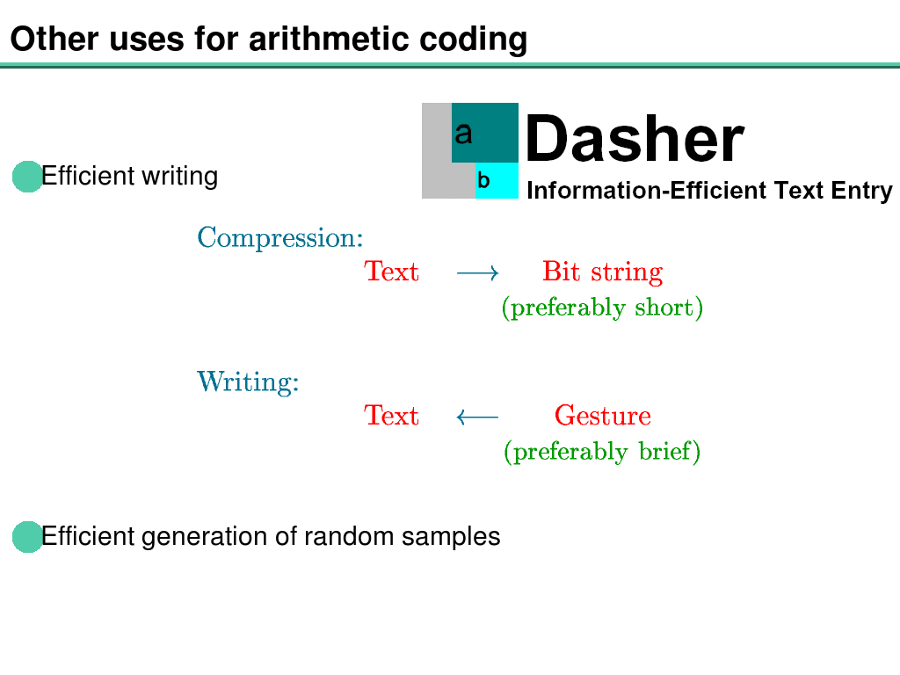

内容与 p.10 相同（Dasher 标志；压缩：文本 ⟶ 比特串（最好短）；书写：文本 ⟵ 手势（最好简短）），本页追加一条：
- 随机样本的高效生成（Efficient generation of random samples）。

### p.13 〔The Marsaglia Random Number CDROM（Marsaglia 随机数光盘）〕

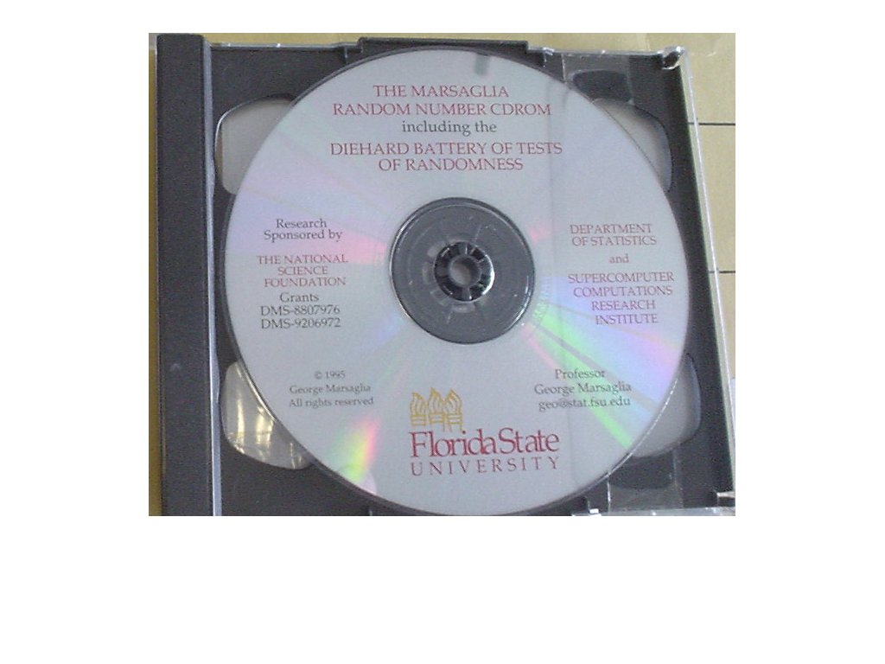

一张装在盒中的 CD 实物照片，盘面印字转录如下：THE MARSAGLIA RANDOM NUMBER CDROM including the DIEHARD BATTERY OF TESTS OF RANDOMNESS（Marsaglia 随机数光盘，附 Diehard 随机性测试套件）；Research Sponsored by THE NATIONAL SCIENCE FOUNDATION Grants DMS-8807976、DMS-9216972（研究由美国国家科学基金会资助，基金号 DMS-8807976、DMS-9216972）；DEPARTMENT OF STATISTICS and SUPERCOMPUTER COMPUTATIONS RESEARCH INSTITUTE（统计系与超级计算研究所）；© 1995 George Marsaglia All rights reserved；Professor George Marsaglia，geo@stat.fsu.edu；Florida State University（佛罗里达州立大学）。

〔本页为实物照片页〕

### p.14 〔Index of /pub/diehard/cdrom（/pub/diehard/cdrom 目录索引）〕

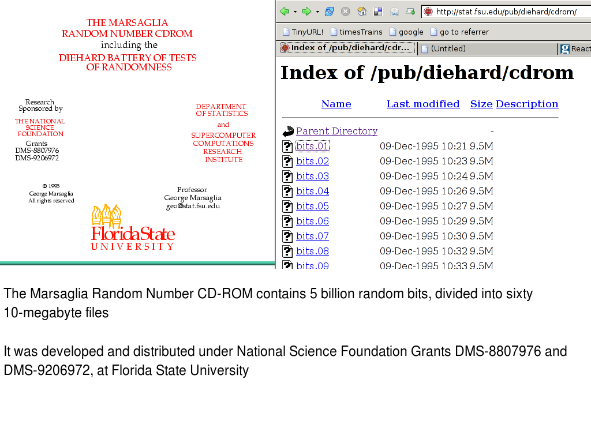

左侧重复 Marsaglia 光盘标签图（内容同 p.13），右侧为浏览器截图：目录页 Index of /pub/diehard/cdrom，表头 Name / Last modified / Size / Description，列出 Parent Directory 及 bits.01 至 bits.09（每文件 9.5M，修改日期均为 09-Dec-1995）。
页面下方文字：Marsaglia 随机数光盘（The Marsaglia Random Number CD-ROM）包含 50 亿（5 billion）个随机比特，分成 60 个 10 兆字节的文件。它由美国国家科学基金会基金 DMS-8807976 与 DMS-9206972 资助，在佛罗里达州立大学开发并发行。

> <span style="color:#1e8449;">**[note] Note（译者注）:**</span> 这一页为什么要专门放一张光盘？因为「真随机」不是哲学命题，而是一条可以被统计检验推翻的断言；同时它也是压缩的极端对照：完全没有结构的序列，任何压缩器都压不动。两个用途共用同一批比特。
>
> 先看压缩与随机的对偶关系。压缩算法的全部工作是在数据里找规律。若一段数据真的没有规律，最优压缩器也只能把它原样输出。于是「压不动」成了「随机」的操作性定义。要留意这条判据的方向是单向的：压不动不能证明随机（一个序列可能骗过所有常见压缩器与检验，却在某个更强的方法下露馅），但压得动一定证明不随机。这条单向性后面有用。
>
> Diehard（全套随机性检验）具体在做什么？George Marsaglia 在 1995 年把一整套统计检验与一批随机比特一起制成 CD-ROM 发行，那批比特就是本页与下一页列出的 `bits.01` 到 `bits.09` 这类文件。最基础的一项是频次检验：把 $4.8\times10^{9}$ 位分成 $10^{6}$ 组、每组 4800 位，数每组里 $1$ 的个数。若各位独立且 $p_1=\frac12$，每组 $1$ 的个数服从二项分布，均值 $2400$、标准差 $\sqrt{4800\times\frac14}=34.6$。把这 $10^{6}$ 个计数分桶做卡方检验，生成器只要有一点偏置，均值就会整体偏移几十个标准差，立刻报警。其余项目（游程、间隔、扑克、生日间距等）从不同角度找同一件事：可预测性。
>
> 那么偏置要多大才「压得动」？这是本节最值得手算的数字。设 $p_1=0.5001$，即万分之一量级的偏差。二元熵 $H=1-D(\frac12+\varepsilon\,\|\,\frac12)$，而 $D(\frac12+\varepsilon\,\|\,\frac12)\approx\frac{2\varepsilon^{2}}{\ln 2}\approx 2.885\,\varepsilon^{2}$ 位。取 $\varepsilon=10^{-4}$ 得 $2.885\times10^{-8}$ 位/位。整批 $4.8\times10^{9}$ 位，理论可压缩量只有 $4.8\times10^{9}\times2.885\times10^{-8}\approx138$ 位 —— 一百多位，不到二十个字节。这个数字说明：想靠压缩榨出极微弱的偏置，需要的样本量是 $1/\varepsilon^{2}$ 量级，即 $10^{8}$ 起。这也解释了 Diehard 为什么要用几百兆字节而不是几千位：检验的灵敏度与样本量成正比，而可压缩量的增长是线性的、偏差的平方在拖后腿。
>
> 反过来算一笔对照账。一个号称「纯随机」的 600 MB 文件若被通用压缩器压到 500 MB，那它必然含有真实结构：可能是生成器用了质量差 LCG（线性同余生成器），低比特位周期极短；也可能是把别的数据混了白噪声。反过来，若一个 600 MB 文件压完只小了几十字节，那说明压缩器没找到结构，但也仅此而已。所以「压缩率」是一个下界式的证据，而不是身份证明。
>
> 跨课程连接。CSAPP 里标准库 `rand()` 往往是线性同余，低位周期很短，拿它做加密或做仿真都会出事：仿真里它会制造出规则的条纹，加密里它能被直接反解。6.006 的随机化算法（哈希、快排的随机主元）假设的是「敌手猜不到」，只要种子对输入不可预测就够用，不需要统计上完美。6.042J 的期望与方差给出上面那个 $34.6$ 的计算：$\sqrt{np(1-p)}$。三者的要求强度不同：算法课要 unpredictability（不可预测），密码学要 unguessability（不可破解），统计检验只保证「没有简单可检测的偏差」。混用这三个层次会得出错误结论 —— 例如用 Diehard 全过就宣称「可以当密钥源」，这是跳级。
>
> 还有一点容易忽略：这张光盘的比特是「组合多个好的生成器与物理器件的输出」得到的，而不是靠一个算法算出来的。这提示了随机性的两级结构：pseudo-random number generator（伪随机数生成器）便宜、可复现、适合仿真；physical random source（物理随机源）慢、不可复现、适合种子。工程上常见的做法是拿物理源做种子、用伪随机数生成器拉长，两者各管一段。
>
> 一句话收束：这张光盘同时干两件事 —— 给压缩器一个「压不动的参照物」，给随机数生成器一个「能被挑刺的靶场」；而下一页的三张卡片展示的正是反面：人的直觉如何把有结构的东西误认成随机。

### p.15 〔Three cards（三张卡片）〕

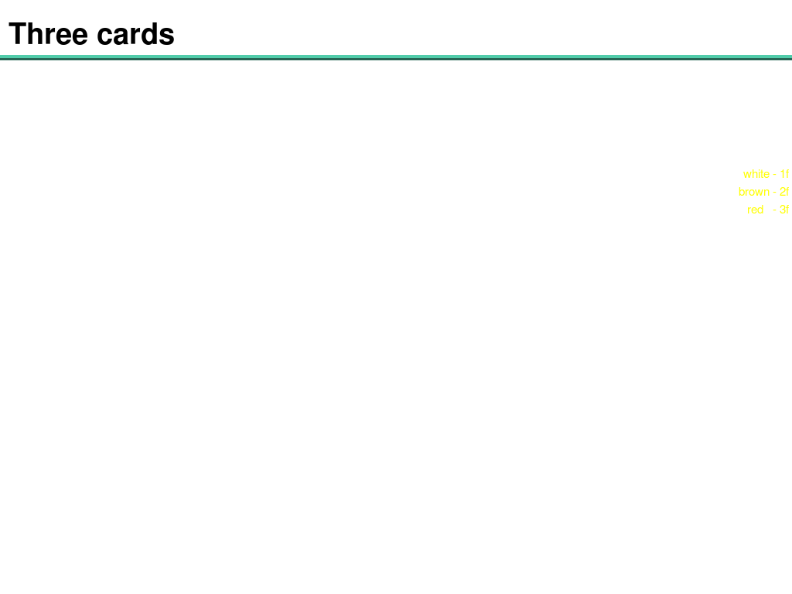

标题：Three cards（三张卡片）。页面几乎全白；右缘有三行被裁切的黄色小字，依稀可辨为 `white - 1〔无法辨认〕`、`brown - 2〔无法辨认〕`、`red - 3〔无法辨认〕`，应是对三张卡片的编号标注（卡片各面涂有白 white、棕 brown、红 red 三种颜色，具体每张卡片两面的配色在扫描中未显示）〔无法辨认〕。

### p.16 〔Three cards（三张卡片）〕

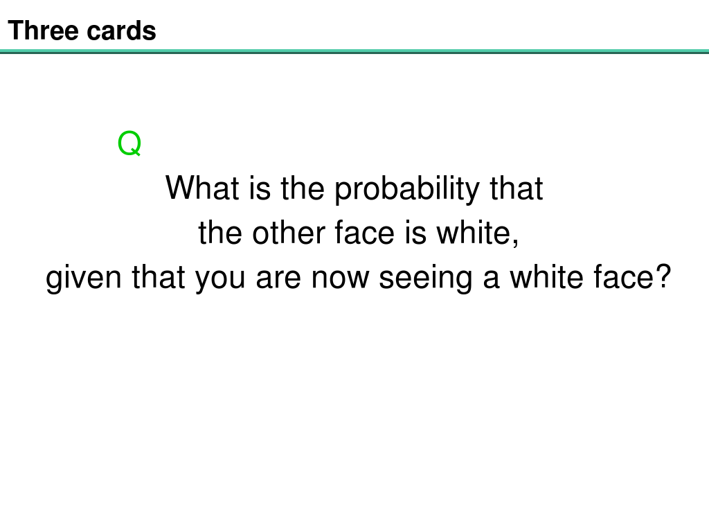

<span style="color:#2471a3;">**[example]**</span> 绿色 **Q**：你当前看到的一面是白色（white），那么另一面也是白色的概率是多少？

### p.17 〔Three cards（三张卡片）〕

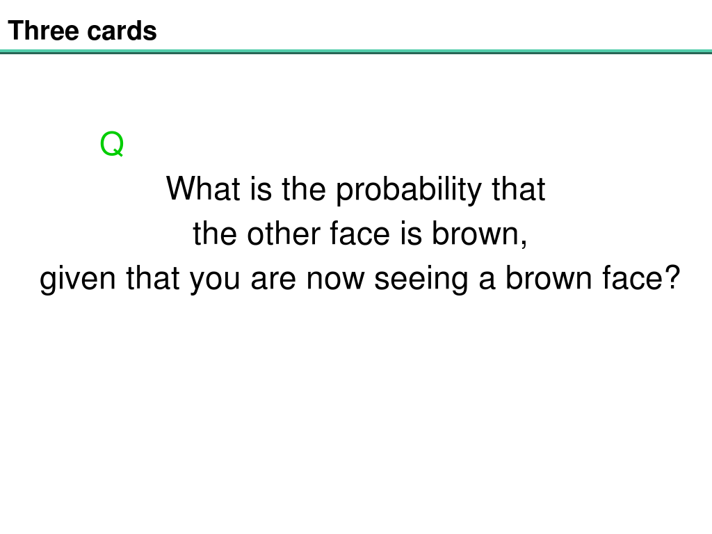

绿色 **Q**：你当前看到的一面是棕色（brown），那么另一面也是棕色的概率是多少？

### p.18 〔Three cards（三张卡片）〕

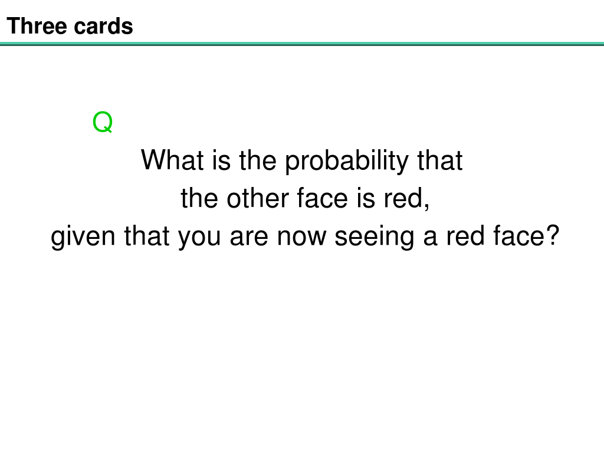

绿色 **Q**：你当前看到的一面是红色（red），那么另一面也是红色的概率是多少？

### p.19 〔Communication over noisy channels（通过噪声信道的通信）〕

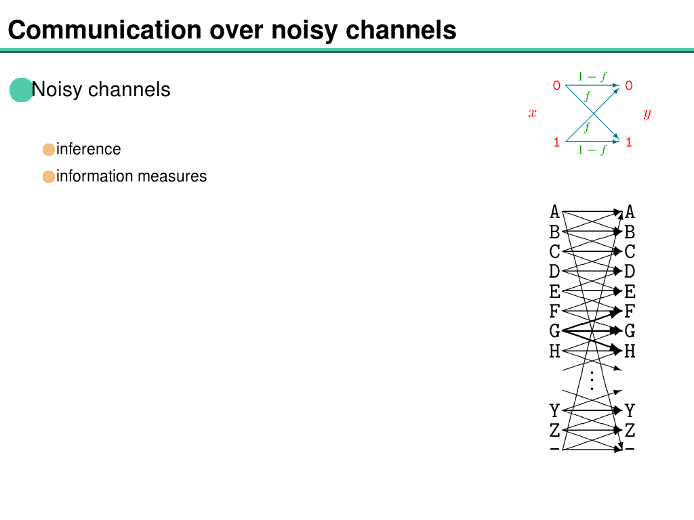

<span style="color:#2471a3;">**[section]**</span> 本讲新主题：噪声信道（Noisy channels）：
- 推断（inference）；
- 信息度量（information measures）。

右上小图：二元对称信道（binary symmetric channel）示意——输入 $x$（左侧红字 0、1），输出 $y$（右侧红字 0、1）；水平箭头标 $1-f$（不变），交叉箭头标 $f$（翻转）。
右下图：一个更复杂的信道图——左列字母 A–H、竖点省略号、Y、Z 以及符号 –，右列为同样的字母表，两列之间画出大量交叉箭头；其中 G 行的箭头最粗最密（G 几乎与所有输出相连），相邻的 F、H 也较强，其余字母箭头细疏——表示「几乎每个输入都可能被错传成任何输出」的强噪声信道。

### p.20 〔The rules - Three doors（游戏规则·三扇门）〕

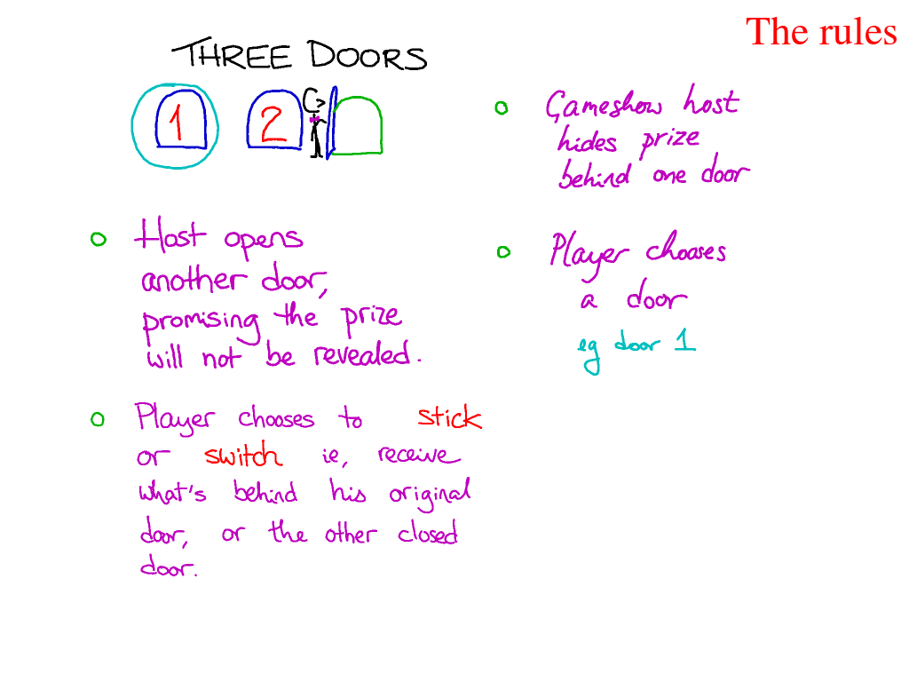

手写页。右上角红字：The rules（规则）。左上画着三扇门，编号 1、2、3（门 1 被蓝绿色圆圈圈出；门 3 前有一个简笔小人，旁有一个字母记号〔无法辨认〕）。手写规则（品红笔为主）：
- 游戏节目主持人（gameshow host）把奖品藏在某扇门后。
- 主持人打开另一扇门，并承诺打开的门后没有奖品（promising the prize will not be revealed）。
- 参赛者选择 stick（坚持）或 switch（换门）（二字为红笔强调），即要么拿自己原门后的东西，要么拿另一扇仍关着的门后的东西。
- 参赛者先选择一扇门，例如门 1（"eg door 1" 为青绿笔）。

> <span style="color:#7f8c8d;">旁注：这是美国游戏节目式的「三扇门」场景；规则的每一条（主持人知情、必开一扇空门、绝不 reveal 奖品）都会影响下面的概率推断。</span>

### p.21 〔Q（问题：坚持还是换门？）〕

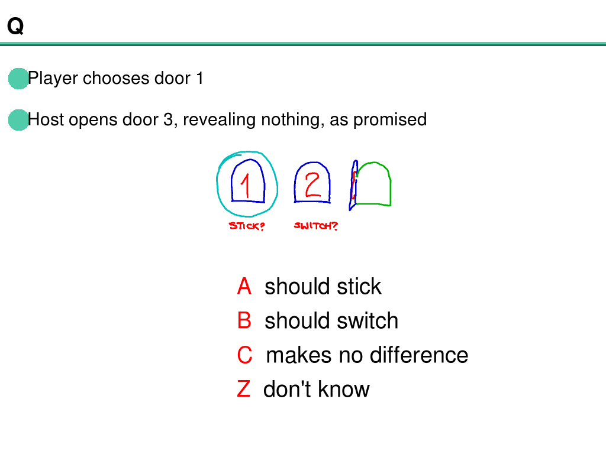

<span style="color:#2471a3;">**[example]**</span> 标题 **Q**。情境：
- 参赛者选择了门 1。
- 主持人打开门 3，如约什么也没露出来。
图中画有门 1、2、3：门 1 被青色圆圈圈出、下方红字 STICK?（坚持？）；门 2 下方红字 SWITCH?（换门？）；门 3 画成开着的样子。选项：
- A：应该坚持（should stick）；
- B：应该换门（should switch）；
- C：没区别（makes no difference）；
- Z：不知道（don't know）。

> <span style="color:#1e8449;">**[note] Note（译者注）:**</span> Monty Hall（蒙提霍尔）问题之所以常年争议，不在于概率算不准，而在于多数人把「主持人开哪扇门」当成与奖品无关的背景噪声。实际上主持人的行为规则 —— 他知情、必开一扇有奖之外的门、必避你所选的门 —— 就是 likelihood（似然）。规则一换，答案从 $2/3$ 掉到 $1/2$。
>
> 先把三个量摆清。设奖品在门 $1$、$2$、$3$ 的 prior（先验）各为 $1/3$。观察到的事件 $Y$ 是「主持人开了门 3」。三种情形下的似然：奖在门 $1$ 时，门 $2$、$3$ 都空，他可在两扇里随机挑，$P(Y\mid 1)=\frac12$；奖在门 $2$ 时，他不能开你所选的门 $1$、也不能开有奖的门 $2$，只能开 $3$，$P(Y\mid 2)=1$；奖在门 $3$ 时，他绝不能开有奖的门，$P(Y\mid 3)=0$。
>
> 于是 posterior（后验）正比于先验乘似然：$\frac13\cdot\frac12=\frac16$、$\frac13\cdot1=\frac13$、$\frac13\cdot0=0$。归一化后是 $\big(\frac13,\frac23,0\big)$。换门等于押「奖品在门 2」，胜率 $2/3$；坚持等于押「奖品在门 1」，胜率 $1/3$。这一步的算术只有三行，但它的成立依赖一个容易被读漏的前提：主持人知道奖品在哪。
>
> 把这条规则拿掉会怎样？假设主持人不知道奖品在哪，随便开一扇非你所选的门，恰好开出空门。此时 $P(Y\mid 1)=\frac12$、$P(Y\mid 2)=\frac12$（他有一半机会开出 2 号门，若真开出有奖的门游戏就作废）、$P(Y\mid 3)=0$，后验变成 $\frac12:\frac12:0$，换不换一样，答案就是 C。所以「主持人知情」这一条规则就是全部差别所在 —— 它不是数学细节，而是题目定义的一部分。很多人把「没区别」当答案，其实是在解另一道题。
>
> 一个频率表是这套推导最硬的验证。做 300 局，奖品均匀分布，每种情形各 100 局。策略「坚持」：只有奖在门 1 的 100 局赢，胜率 $1/3$。策略「换门」：奖在门 2 的 100 局全赢（主持人必开门 3，你换到门 2）；奖在门 3 的 100 局全输（主持人必开门 2，你换过去是空门）；奖在门 1 的 100 局也全输。合计 $200/300=2/3$。这张表有一个值得注意的性质：它不依赖「主持人在两扇空门之间怎么随机」这个细节 —— 那个随机只影响你观察到「开 3」的概率，不影响换门策略的胜率。这也是它难被直觉抓住的原因之一：结论对某个看似关键的参数不敏感。
>
> 用本讲后面的语言再读一遍会更有收获。「主持人开门」就是一个 channel（信道）：输入是奖品位置 $X$，输出是他开的门 $Y$。$H(X)=\log_2 3=1.585$ 位；观察到开 3 之后（对称地，开 2 也一样），后验是 $\big(\frac13,\frac23,0\big)$，条件熵 $H(X\mid Y)=\frac13\log_2 3+\frac23\log_2\frac32=0.528+0.390=0.918$ 位。于是 mutual information（互信息）$I(X;Y)=1.585-0.918=0.667$ 位，恰好是 $2/3$ 位。主持人这一开，替你消掉了三分之二的不确定性，而这三分之二正好对应换门多出来的那份胜率。信息与概率在这里是同一件事的两种记账方式。
>
> 跨课程连接。6.042J 的条件概率与贝叶斯公式给出上面那段推导，三囚徒悖论是它的同构版本：狱卒报出一个必死者，被报者的死刑概率从 $1/3$ 升到 $2/3$，升级的原因是狱卒的选择规则，不是死亡本身。6.431 的 Bertsekas 会用全概率公式把它写成树形分解，并用 conditional expectation（条件期望）比较两个策略的期望收益，写法不同、结论一致。CS144 里也能看到同类结构：发送端收到一个 ACK，只说明「到某处的路径当前通畅」，把它当链路质量的无偏估计就会误判，因为发送端自己的行为规则（拥塞窗口、重传、快速恢复）本身就是似然的一部分。
>
> p.15 到 p.18 的三张卡片是同一类陷阱的变体。经典配置是三张卡片分别为「白-白」「白-黑」「黑-黑」，看到的一面是白，那么这面来自双白卡片的概率是 $2/3$ —— 因为三个白面里有两个属于它。这里的教训与三门问题完全一致：不要数「还有几种结果」，要数「哪种生成机制能产出你看到的东西」。本页扫描未显示各卡两面的具体配色，所以上述结论按经典配置给出。
>
> 一句话收束：观测本身不携带信息，携带信息的是「观测的生成机制」；把机制写进似然，贝叶斯公式自己会给出答案。

### p.22 〔Information measures（信息度量）〕

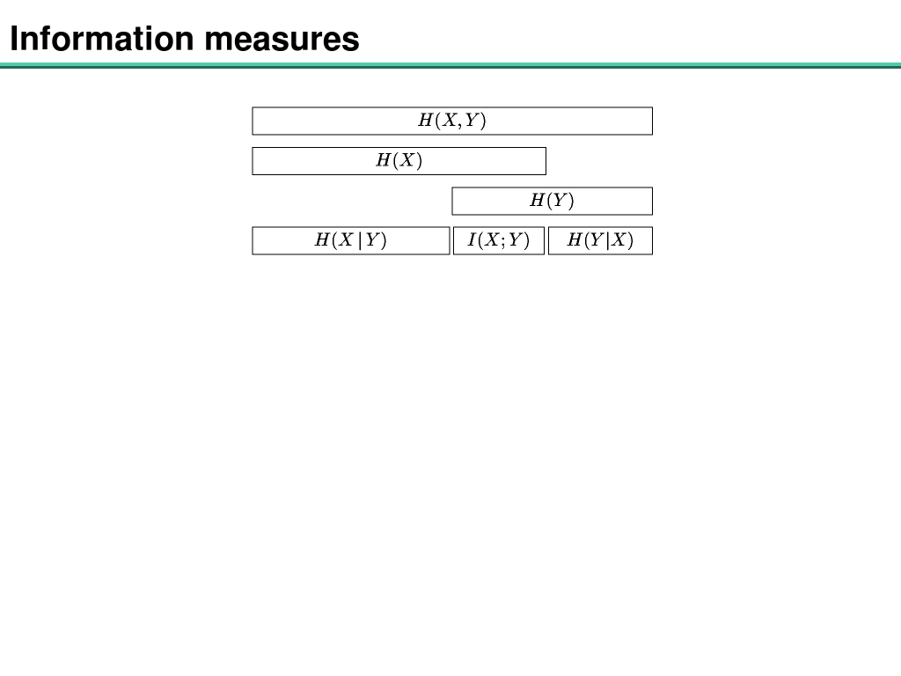

一排嵌套矩形框示意各信息度量的包含关系（「信息圆」图）：
- 最上层大框：$H(X,Y)$（联合熵 joint entropy）；
- 第二层框：$H(X)$（熵）；其下第三层右侧框：$H(Y)$；
- 最下层三框：$H(X \mid Y)$（条件熵 conditional entropy）、$I(X;Y)$（互信息 mutual information）、$H(Y \mid X)$（条件熵）。

直观读法：$H(X)$ 与 $H(Y)$ 是 $H(X,Y)$ 的两个「子块」，$I(X;Y)$ 是二者的「交叠」，$H(X\mid Y)$、$H(Y\mid X)$ 是各自的「独有部分」。

### p.23 〔Inference for channels（信道上的推断）〕

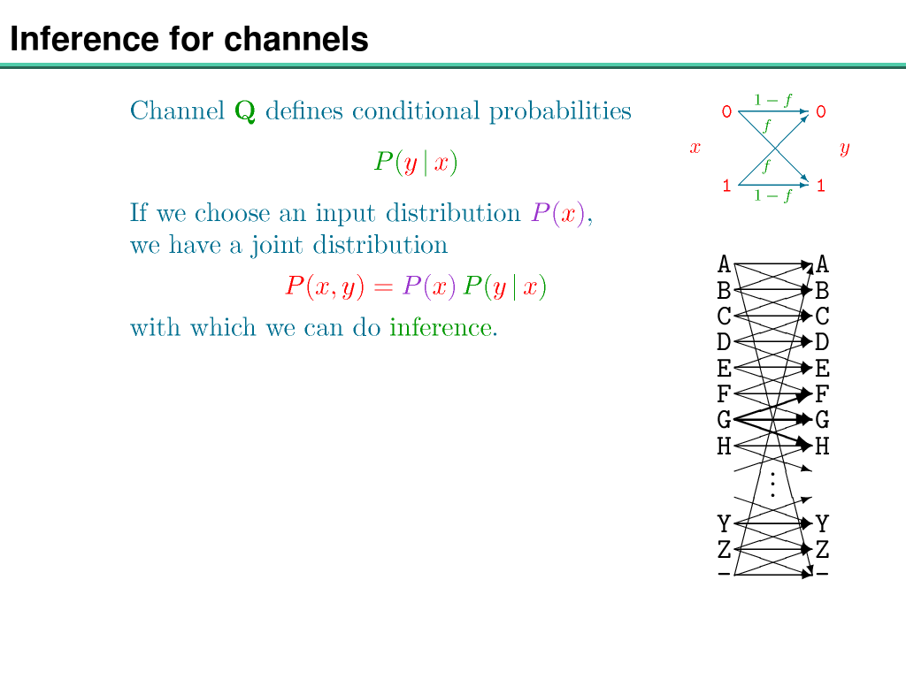

- 信道（channel）$Q$ 定义条件概率（conditional probabilities）$P(y \mid x)$。
- 若再选定一个输入分布（input distribution）$P(x)$，就得到联合分布（joint distribution）：
```math
P(x,y) = P(x)\, P(y \mid x)
```
- 有了联合分布，我们就可以做推断（inference）。

右侧为 p.19 的两张信道图（二元对称信道 $x\in\{0,1\}\to y\in\{0,1\}$，翻转概率 $f$、保持概率 $1-f$；以及 A–Z 字母信道，G 行箭头最粗最密）。

### p.24 〔Information measures for noisy channels（噪声信道的信息度量）〕

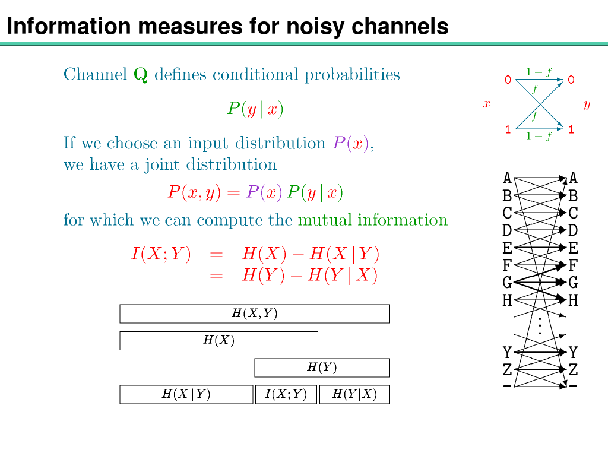

- 信道 $Q$ 定义条件概率 $P(y \mid x)$。
- 选定输入分布 $P(x)$，得联合分布 $P(x,y) = P(x)\,P(y \mid x)$。
- 对它我们可以计算互信息（mutual information）：
```math
I(X;Y) = H(X) - H(X \mid Y) = H(Y) - H(Y \mid X)
```
- 下方仍为 p.22 的嵌套框图：$H(X,Y)$；$H(X)$；$H(Y)$；$H(X\mid Y)$、$I(X;Y)$、$H(Y\mid X)$。
右侧为同前两张信道示意图。

> <span style="color:#1e8449;">**[note] Note（译者注）:**</span> 这一页的框图不是示意图，而是一个恒等式的几何投影：$H(X,Y)$ 是全集，$H(X)$、$H(Y)$ 是两个子集，$I(X;Y)$ 是交集。而这个「交集」之所以存在，是因为 $H(X,Y)$ 有两种分解方式，而两种分解必须给出同一个数。
>
> 先证明恒等式的来源，只用到一条 chain rule（链式法则）。一方面 $H(X,Y)=H(X)+H(Y\mid X)$；另一方面 $H(X,Y)=H(Y)+H(X\mid Y)$。两式相减得 $H(X)-H(X\mid Y)=H(Y)-H(Y\mid X)$，把这个公共值定义为 $I(X;Y)$。所以「从 $X$ 看，观察 $Y$ 消掉了多少不确定性」与「从 $Y$ 看，观察 $X$ 消掉了多少」必然相等 —— 这不是巧合，是同一个联合熵的两种记账方式。链式法则本身一行可证：$P(x,y)=P(x)P(y\mid x)$，代入熵的定义拆成两项即可。
>
> 把这条式子与集合容斥并排摆：$|A\cup B|=|A|+|B|-|A\cap B|$ 对应 $H(X,Y)=H(X)+H(Y)-I(X;Y)$。代入具体数字就全对上了。取 binary symmetric channel（二元对称信道）翻转概率 $f=0.1$、输入均匀：$H(Y)=1$ 位，$H(Y\mid X)=h(0.1)=0.1\log_2 10+0.9\log_2\frac{10}{9}=0.3322+0.1368=0.4690$ 位，于是 $I=1-0.4690=0.5310$ 位，$H(X,Y)=2-0.5310=1.4690$，$H(X\mid Y)=1-0.5310=0.4690$。四个数字满足全部三条关系，可以拿计算器逐项复核。
>
> 换一个输入分布，同一个信道给出完全不同的互信息 —— 这是最容易被忽略的一点。取 $P(X=0)=0.9$：输出边缘 $P(Y=0)=0.9\times0.9+0.1\times0.1=0.82$，$H(Y)=h(0.82)=0.82\log_2\frac{1}{0.82}+0.18\log_2\frac{1}{0.18}=0.82\times0.2864+0.18\times2.4739=0.2349+0.4453=0.6802$ 位。信道本身没变，$H(Y\mid X)$ 仍是 $0.4690$，所以 $I=0.6802-0.4690=0.2112$ 位。与均匀输入的 $0.5310$ 相比少了六成。这说明 channel capacity（信道容量）定义里的 $\max_{P(x)}$ 不是形式主义：输入分布选错，同一套硬件能传的信息要打对折。BSC 的容量是 $C=1-h(f)$，恰由均匀输入达到，所以这个「对折」是有意义的对照，不是构造出来的怪例。
>
> 另一种写法把互信息写成距离。$I(X;Y)=D_{\mathrm{KL}}\big(P(x,y)\,\|\,P(x)P(y)\big)=\sum_{x,y}P(x,y)\log\frac{P(x,y)}{P(x)P(y)}$。它度量的是 joint distribution（联合分布）离「$X$ 与 $Y$ 独立」这个假设有多远，两变量独立时恰为 $0$。非负性有一个三行证明，不需要任何超纲工具：令 $z=\frac{P(x)P(y)}{P(x,y)}$，用 $\ln z\le z-1$ 对每个 $(x,y)$ 放缩，得 $I\ge\sum_{x,y}P(x,y)(1-z)=1-\sum_{x,y}P(x)P(y)=1-1=0$。这就是「信息不能为负」的干净来源，也是「观测不会让你更困惑」这条直觉的形式版本。
>
> 把 max 取掉就得到编码定理的舞台。对固定信道，$C=\max_{P(x)}I(X;Y)$；对速率低于 $C$ 的传输，Shannon 在 1948 年证明存在编码使误码率任意小，而速率高于 $C$ 时不可能。这个定理与前面算出的 $0.531$ 是同一个数：本讲前半段说的「随后会证明该值可达」，指的就是它。要注意这里的分工：$I(X;Y)$ 是「给定输入分布与信道之后的瞬时量」，$C$ 是「把输入分布也优化掉之后的信道属性」。前者依赖你怎么用，后者只依赖信道本身。
>
> 跨课程连接。6.042J 的容斥原理提供类比骨架：把 $H$ 看成一个可加的权重，互信息就是交集的权重，三个圆的所有区域都由这四个量拼出来。6.431 的 conditional expectation（条件期望）给出 $H(X\mid Y)=\mathbb{E}_Y\big[H(X\mid Y=y)\big]$ 这个读法 —— 上面算 $H(X\mid Y=3)$ 的三门问题那一注，就是先固定 $y$ 再平均的具体实例。Strang 的线性代数里「到子空间的投影」提供一个有用的图像：把所有满足独立性的分布看成一个集合，KL 就是到它的距离。但要留心一个区别：KL 不对称，$D(P\|Q)\ne D(Q\|P)$，所以它不是 metric（度量）；用 6.042J 的话说，它不满足对称性，因此不构成等价关系，也就不能用来划分空间。这个限制在做模型比较时很实际。
>
> 还有一个常被跳过的细节：信息圆里各块的大小依赖输入分布，而集合的面积不依赖任何东西。所以「$H(X)$ 是子集」只是类比，不是同构 —— 类比成立在「可加性与容斥结构」，不成立在「固定大小」。分清这一点，后面看「互信息为零当且仅当独立」这类命题时就不会误以为它是集合命题。
>
> 一句话收束：信息圆不是把集合论套在熵上，而是链式法则的直接几何化；它随后被用来定义容量，而容量正是本讲后半段要证明可达的那个极限。

### p.25 〔Recommended homework（推荐作业）〕


- 阅读（Reading）：第 1–6 章；预习（Advance reading）：第 8、9、10 章。
- 更多推荐习题见网站上的 handout 2（讲义 2）（蓝字链接）。
  - Huffman 程序 `huffman.p`、`huffman.py` 已挂在网站上（红字标出文件名）。
  - 另有一个「弯币（bent coin）」文件 0010000……作为压缩基准（compression benchmark）。
