> <span style="color:#7f8c8d;">Source: MacKay《Information Theory, Inference, and Learning Algorithms》课程手写讲义 l7 · 行内双语视觉转录版 · 原图见 fig/l7/</span>

### p.1 〔Information theory, pattern recognition, and neural networks（信息论、模式识别与神经网络）〕

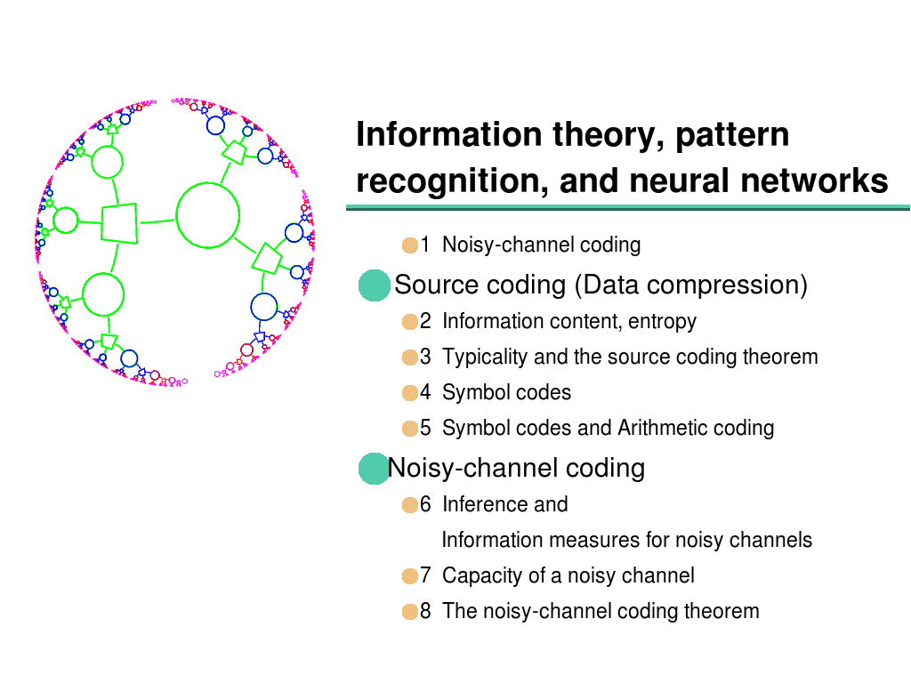

<span style="color:#2471a3;">**[lecture]**</span> 本页为课程总览页。左侧是一幅装饰性图形：圆形盘面内由绿色线条把圆、正方形、三角形节点连成多层树状网络，边缘呈自相似的密铺式结构〔本页左图无文字，为纯装饰性图示〕。右侧打印体课程大纲：

- 第 1 讲 Noisy-channel coding（噪声信道编码）
- **Source coding (Data compression)（信源编码，即数据压缩）**
  - 第 2 讲 Information content, entropy（信息量与熵）
  - 第 3 讲 Typicality and the source coding theorem（典型性与信源编码定理）
  - 第 4 讲 Symbol codes（符号码）
  - 第 5 讲 Symbol codes and Arithmetic coding（符号码与算术编码）
- **Noisy-channel coding（噪声信道编码）**
  - 第 6 讲 Inference and Information measures for noisy channels（推断与噪声信道的信息量度）
  - 第 7 讲 Capacity of a noisy channel（噪声信道的容量）
  - 第 8 讲 The noisy-channel coding theorem（噪声信道编码定理）

> <span style="color:#1e8449;">**[note] Note（译者注）:**</span> 这页大纲把整门课劈成两半：左半是 source coding（信源编码，即数据压缩），右半是 channel coding（信道编码，即可靠传输），本讲从第 7 讲 capacity（容量）切入后半。这一刀之所以劈得干净，是因为两个方向在数学上互为转置：source coding（信源编码）把一条真实消息压成尽量短的 bit（比特）串，目标是逼近 entropy（熵）；channel coding（信道编码）把一条已压好的 bit（比特）串故意拉长成带冗余的码字，目标是在码率低于 capacity（容量）时把错误概率压到任意小。前者在削减自由度，后者在增加自由度换抗噪，一减一增，恰好把同一个 bit（比特）串夹在中间。
>
> 为什么必须这样？先看信息在系统中的流向：一条消息从产生到被接收，要过两道窄门。第一道窄门是表示精度，你在 CSAPP 第 2 章见过 ASCII 用 7 bit（比特）表示一个字符，可英文文本的真实 entropy（熵）大约只有 $1.5$ bit（比特）每字符，多出来的部分纯粹是表示格式的浪费，source coding（信源编码）的任务就是把这份浪费挤掉。第二道窄门是噪声，无论压得多干净，bit（比特）在线上都可能被翻转，channel coding（信道编码）的任务是用可控冗余把翻转抵消掉。两道窄门的极限分别是 entropy（熵）与 capacity（容量），而这两个量在数学上是同一个动作的两次改写：entropy（熵）是 $H(X)=\sum_x P(x)\log_2\frac{1}{P(x)}$，即 self-information（自信息）对信源分布的 expectation（期望），分布一旦定死它就是常数；capacity（容量）是 $C=\max_{\mathcal{P}_X} I(X;Y)$，是把同一个 expectation（期望）再套一层最大值。所以本讲真正新增的东西只有一个：多出来的那层 $\max$。
>
> 算一个能动手复核的例子。设一份文本有 $N=10^6$ 个 ASCII 字符，每个字符硬件上占 8 bit（比特），共 $8\times10^6$ bit（比特）；测出这份文本的经验 entropy（熵）为 $1.5$ bit（比特）每字符，则最优 source coding（信源编码）可压到 $1.5\times10^6$ bit（比特），压缩比 $8/1.5\approx5.3$。现在要把这 $1.5\times10^6$ bit（比特）送过一条 binary symmetric channel（BSC，二元对称信道），设它每秒可用 $10^6$ 次、每次 capacity（容量）只有 $0.5$ bit（比特），则最大可靠速率是 $5\times10^5$ bit（比特）每秒，传完需 $1.5\times10^6/(5\times10^5)=3$ 秒。注意两个数必须分开看：压缩比只由信源决定，与 channel（信道）无关；传输时间只由 capacity（容量）决定，与信源无关。把两者混为一谈，是初学这门课最常见的错误。
>
> 跨课程连接有两条。其一是 6.431 probability（概率论，Bertsekas）里的 conditional expectation（条件期望）：mutual information（互信息）的写法 $I(X;Y)=H(X)-H(X\mid Y)$，减号右边就是看过信道输出后还剩多少不确定，这正是 conditional expectation（条件期望）那套语言；区别在于概率论关心单个 random variable（随机变量）的期望，这里关心两个 random variable（随机变量）联合分布的整张表。其二是 6.042J 离散数学的计数论证：6.042J 证明存在性时常用的招是「平均值有上界，故存在一个不超过上界的对象」，第 8 讲证明编码定理用的是同一招——随机码字的平均错误概率小，就存在一组具体码字错误概率小。
>
> 最后记住第 3 讲的 typicality（典型性）会在第 8 讲回归：它是 law of large numbers（大数定律）给编码定理搭的桥，桥的两端分别是 entropy（熵）与 capacity（容量）。

### p.2 〔Last time（上次课回顾）〕

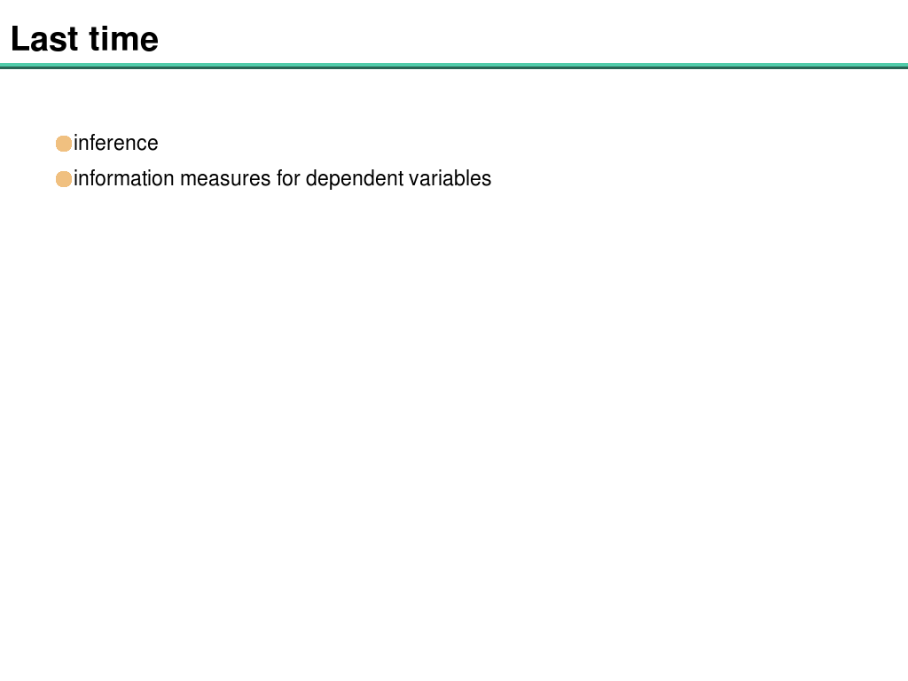

打印体标题 Last time（上次课）。两条打印 bullet：

- inference（推断）
- information measures for dependent variables（相关变量的信息量度）

### p.3 〔The rules（游戏规则）〕

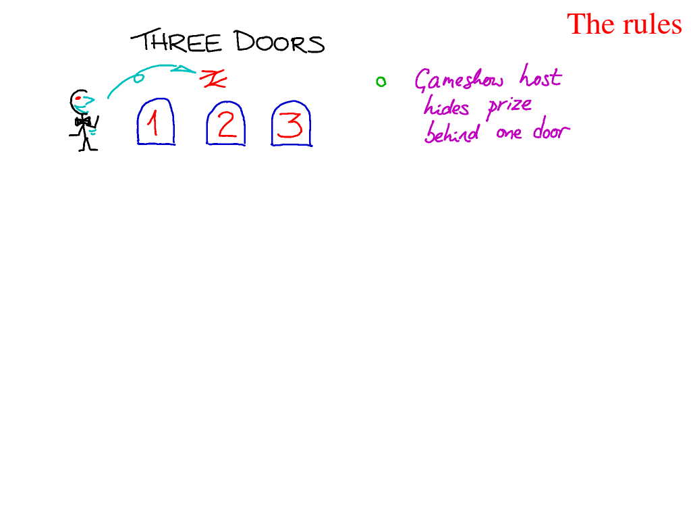

<span style="color:#2471a3;">**[example]**</span> 右上角打印体红字标题 The rules（游戏规则）。左侧手写图示：黑色手写大字 THREE DOORS（三扇门）；一个戴领结的火柴人（主持人）站在三扇拱形门左侧，门上红色编号 1、2、3；一条青色箭头从主持人头顶弯向门 2 方向，箭头末端有一个红色涂改符号〔无法辨认，形如被划掉的记号〕。右侧手写 bullet（洋红色手写，绿色小圆圈作项目符号）：

- Gameshow host hides prize behind one door（综艺节目主持人把奖品藏在其中一扇门后面）

> <span style="color:#7f8c8d;">旁注：箭头末端红色符号疑似被涂改的标记，原意〔无法辨认〕。</span>

### p.4 〔The rules（游戏规则）〕

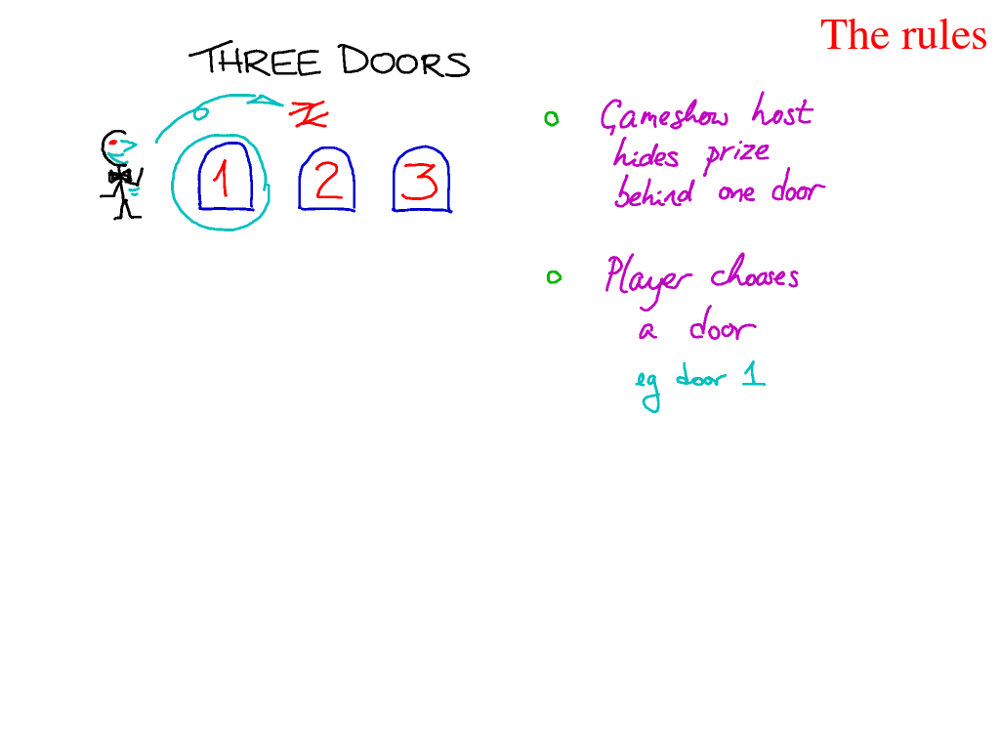

图示与上页相同，但门 1 被青色圆圈圈出（表示玩家选中的门）。右侧在原 bullet 之下新增一条手写 bullet：

- Player chooses a door（玩家选择一扇门）
  - eg door 1（例如门 1）〔此行为青色小字〕

### p.5 〔The rules（游戏规则）〕

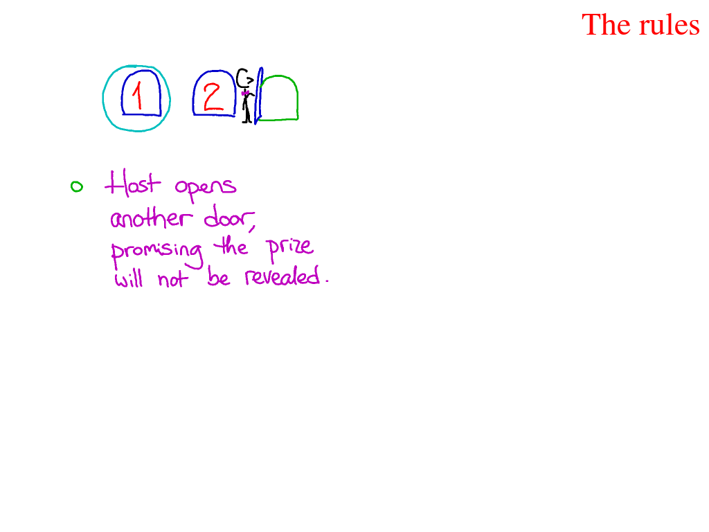

图示更新：门 1 仍为青色圈选，门 2 为蓝色，门 3 被主持人（火柴人）拉开、门框改画为绿色（表示已打开）。手写 bullet：

- Host opens another door, promising the prize will not be revealed.（主持人打开另一扇门，并承诺奖品不会被亮出来。）

### p.6 〔The rules（游戏规则）〕

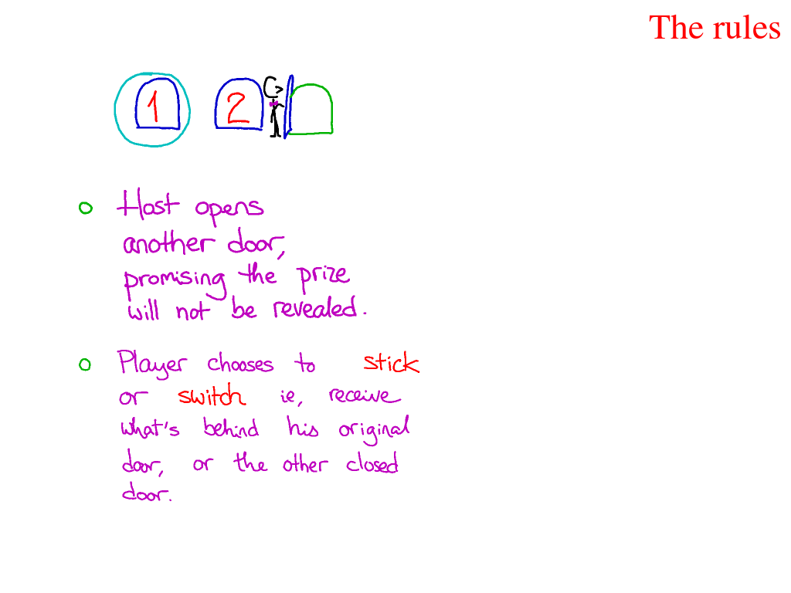

图示同上页（门 3 已被主持人打开）。在原有 bullet 之下新增一条手写 bullet（其中 stick、switch 两词用红色标出）：

- Player chooses to stick or switch, ie, receive what's behind his original door, or the other closed door.（玩家选择坚持（stick）还是换门（switch），即：拿走自己最初那扇门后的东西，或拿走另一扇仍关着的门后的东西。）

### p.7 〔Q（问题）〕

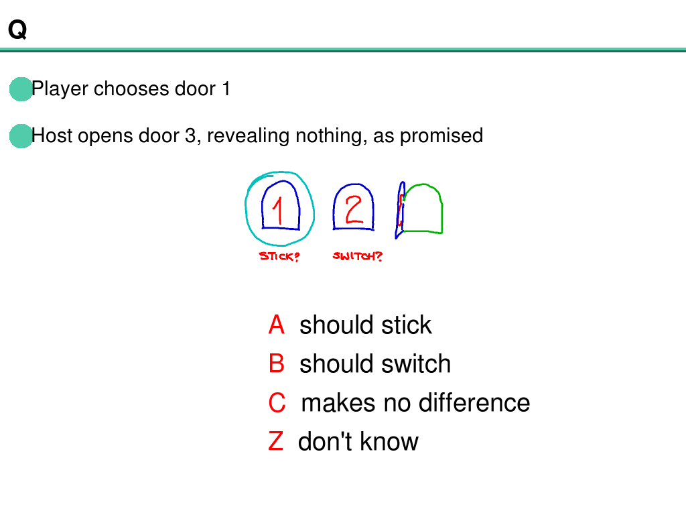

<span style="color:#2471a3;">**[example]**</span> 打印体标题 Q（问题）。两条打印 bullet：

- Player chooses door 1（玩家选择了门 1）
- Host opens door 3, revealing nothing, as promised（主持人如约打开门 3，门后空空如也）

中间手绘图：门 1 被青色圈出，正下方红字手写 STICK?（坚持？）；门 2 正下方红字手写 SWITCH?（换门？）；门 3 为绿色已打开状态。下方投票选项（打印体，选项字母为红色）：

- A should stick（应该坚持）
- B should switch（应该换门）
- C makes no difference（没有区别）
- Z don't know（不知道）

> <span style="color:#1e8449;">**[note] Note（译者注）:**</span> 三扇门这一页真正要教的不是「换门能赢」，而是一个更硬的命题：条件概率由「观察到的数据」和「生成数据的 protocol（协议）」共同决定，单看数据无法定出概率。这一句是本讲的骨架，后面信道译码把噪声的实现也当作数据来用，靠的正是同一个道理。
>
> 机制要逐句拆。设 $\mathcal{H}$ 是奖品所在的门号，$D$ 是主持人打开的门号。玩家先选门 1，于是先验被对称性钉死为 $P(\mathcal{H}=1)=P(\mathcal{H}=2)=P(\mathcal{H}=3)=\frac{1}{3}$，这一步与 host（主持人）无关。真正携带信息的是 likelihood（似然）$P(D\mid\mathcal{H})$，而它完全由 host（主持人）的行为规则决定：他不许开奖品门，也不许开玩家已选的门，在两扇可开的门里无偏好。于是奖品在门 1 时他只能在 2、3 之间随机挑一扇，$P(D{=}3\mid\mathcal{H}{=}1)=\frac{1}{2}$；奖品在门 2 时，门 1 被玩家占住、门 2 不许开，他只剩门 3 一个选择，故为 $1$；奖品在门 3 时他绝不开门 3，故为 $0$。三行 likelihood（似然）写完，Bayes 定理不过是一次归一化。相反地，如果 host（主持人）是随机开门的赌徒，开出空门只是运气，那么同一串数据给出的结论完全不同：这时 $P(D{=}3\mid\mathcal{H}{=}1)=\frac{1}{2}$、$P(D{=}3\mid\mathcal{H}{=}2)=\frac{1}{2}$、$P(D{=}3\mid\mathcal{H}{=}3)=0$，证据 $P(D{=}3)=\frac{1}{3}\times\frac{1}{2}+\frac{1}{3}\times\frac{1}{2}=\frac{1}{3}$，后验是 $\frac{1}{2},\frac{1}{2},0$，坚持与换门胜率相同，答案变成 C。同一个观察、两套 protocol（协议）、两个答案——这就是为什么「观察到门 3 是空的」这句话本身不构成概率陈述。
>
> 再给一个能自己算出量级的例子：把门数扩到 100，玩家选 1 号，host（主持人）按规则打开 3 到 100 号共 98 扇空门。若奖品在 1 号，他要在其余 99 扇里挑 98 扇，恰好挑中这一组的概率是 $\frac{1}{99}$；若奖品在 2 号，他被协议逼着只能开这 98 扇，概率为 $1$。未归一化权重为 $\frac{1}{100}\times\frac{1}{99}=\frac{1}{9900}$ 与 $\frac{1}{100}\times1=\frac{1}{100}$，总和 $\frac{1}{99}$，归一化后得 $\frac{1}{100}$ 与 $\frac{99}{100}$。于是换门胜率从三十三分之一量级跃到 $99\%$，比的不是「门多」，而是 host（主持人）那 98 次被迫的选择把信息一次性地堆到了唯一还关着的门上。
>
> 历史只作点缀：这个题最早由 Steve Selvin 于 1975 年以读者来信形式发表在 The American Statistician，1990 年 9 月 9 日 Marilyn vos Savant 在 Parade 杂志的 Ask Marilyn 专栏重提并给出正确答案，随后收到大量（其中近千位持博士学位）读者来信坚称她错了，争论本身成了「直觉与协议错配」的公开案例。
>
> 跨课程连接：6.431 probability（概率论，Bertsekas）把条件概率当作「部分信息下的重新赋权」这件事本身就是它的主旋律，那里你算的是 $P(A\mid B)=P(A\cap B)/P(B)$，这里你算的是同一条公式作用在一张假设目录上；区别在于概率论教材通常默认 protocol（协议）已给定，而这里 protocol（协议）恰恰是被拷问的对象。与 6.006 的连接在于「分析随机算法前必须先钉死随机性来源」：快排的平均复杂度只有在「输入随机」或「pivot 随机」二者中选一个明确假设才成立，选错假设结论就废，与这里的似然列必须由协议生成是同一种纪律。
>
> 一句话收束：看到数据先问它是被什么机制生产出来的，这就是从 p.7 的投票走向 p.8 至 p.10 那张表的全部理由。

### p.8 〔Solving Three Doors by Probability Theory（用概率论求解三门问题）〕

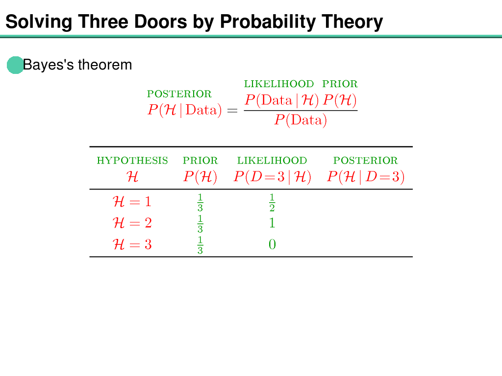

<span style="color:#2471a3;">**[theorem]**</span> 打印 bullet：Bayes's theorem（贝叶斯定理）。公式上方以绿色小标签标出三个组成部分（POSTERIOR 后验、LIKELIHOOD 似然、PRIOR 先验）：

```math
P(\mathcal{H}\mid \text{Data}) = \frac{P(\text{Data}\mid\mathcal{H})\;P(\mathcal{H})}{P(\text{Data})}
```

（分母 $P(\text{Data})$ 在图上未加彩色标签，即证据（evidence）。）

下方为一张表格（表头绿色打印体：HYPOTHESIS 假设、PRIOR 先验、LIKELIHOOD 似然、POSTERIOR 后验；表体红色手写体）。记 $\mathcal{H}$ 为"奖品在门 $\mathcal{H}$ 后面"这一假设，$D=3$ 为数据"主持人打开了门 3"：

| 假设 $\mathcal{H}$ | 先验 $P(\mathcal{H})$ | 似然 $P(D=3\mid\mathcal{H})$ | 后验 $P(\mathcal{H}\mid D=3)$ |
|:---:|:---:|:---:|:---:|
| $\mathcal{H}=1$ | $\frac{1}{3}$ | $\frac{1}{2}$ | （本页空缺） |
| $\mathcal{H}=2$ | $\frac{1}{3}$ | $1$ | （本页空缺） |
| $\mathcal{H}=3$ | $\frac{1}{3}$ | $0$ | （本页空缺） |

### p.9 〔Solving Three Doors by Probability Theory（用概率论求解三门问题）〕

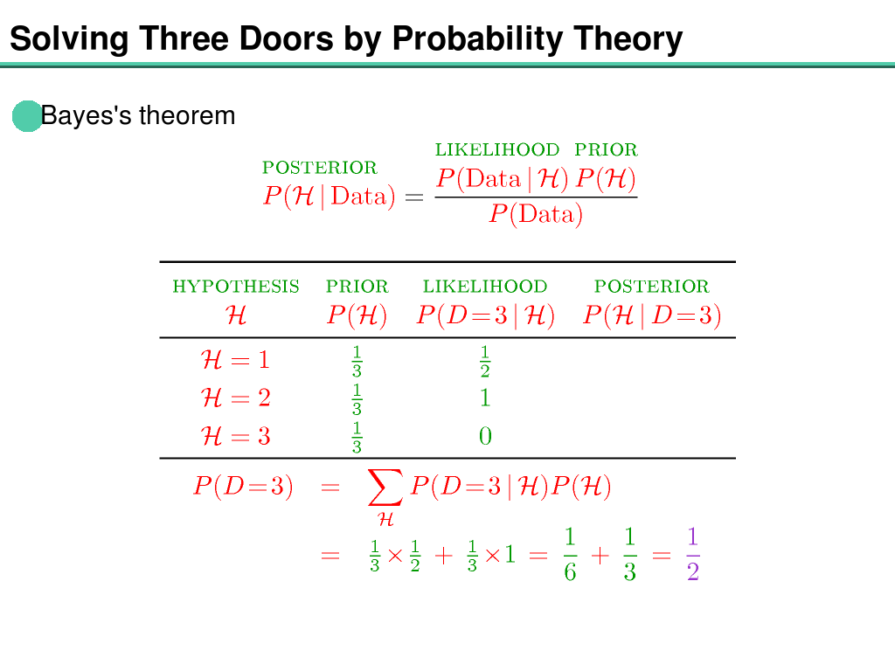

版式与 p.8 相同（贝叶斯定理公式与三行表格均未变，后验列仍空缺）。本页在表格下方新增证据（evidence）$P(D=3)$ 的计算（红色手写，最终结果 $\frac{1}{2}$ 为紫色）：

```math
P(D=3) \;=\; \sum_{\mathcal{H}} P(D=3\mid\mathcal{H})\,P(\mathcal{H}) \;=\; \tfrac{1}{3}\times\tfrac{1}{2} + \tfrac{1}{3}\times 1 \;=\; \tfrac{1}{6} + \tfrac{1}{3} \;=\; \tfrac{1}{2}
```

### p.10 〔Solving Three Doors by Probability Theory（用概率论求解三门问题）〕

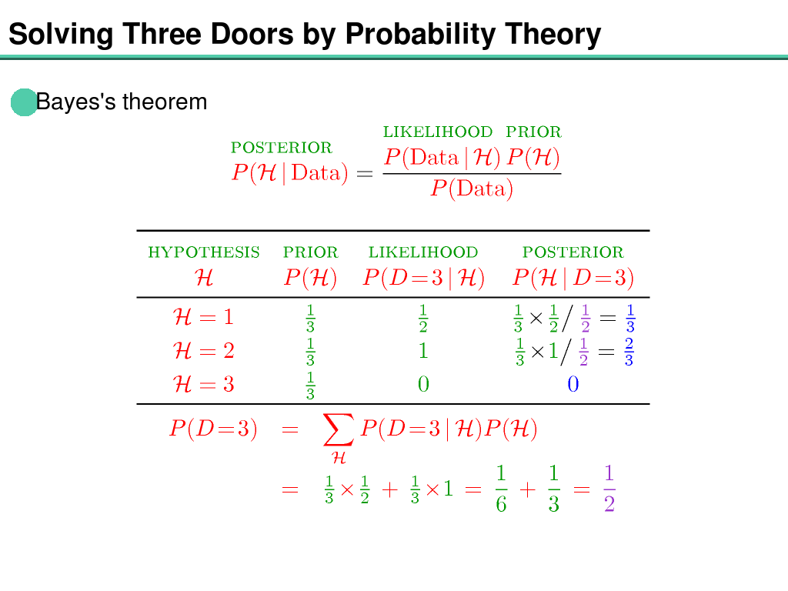

版式同前两页；本页表格的后验一列已填入（手写）：

| 假设 $\mathcal{H}$ | 先验 $P(\mathcal{H})$ | 似然 $P(D=3\mid\mathcal{H})$ | 后验 $P(\mathcal{H}\mid D=3)$ |
|:---:|:---:|:---:|:---:|
| $\mathcal{H}=1$ | $\frac{1}{3}$ | $\frac{1}{2}$ | $\frac{1}{3}\times\frac{1}{2}\,\big/\,\frac{1}{2} = \frac{1}{3}$ |
| $\mathcal{H}=2$ | $\frac{1}{3}$ | $1$ | $\frac{1}{3}\times 1\,\big/\,\frac{1}{2} = \frac{2}{3}$ |
| $\mathcal{H}=3$ | $\frac{1}{3}$ | $0$ | $0$ |

表格下方仍保留 p.9 的证据计算 $P(D=3)=\sum_{\mathcal{H}}P(D=3\mid\mathcal{H})P(\mathcal{H})=\frac{1}{2}$。

> <span style="color:#1e8449;">**[note] Note（译者注）:**</span> 这张表看似只是把数字填进格子，实质是把「谁生成了数据」翻译成一张 conditional distribution（条件分布），然后交给 Bayes' theorem（贝叶斯定理）做一次机械的重新赋权。它的四个格子对应四个角色：hypothesis（假设）是候选世界，prior（先验）是世界在开赛前的可能性，likelihood（似然）是「在这个世界里，看到这串数据的可能性有多大」，posterior（后验）是世界在看完数据后的可能性。三列之间只有乘法与除法，没有任何需要直觉介入的地方，这正是这张表值得背诵的理由。
>
> 机制要拆到「为什么必须除以证据」这一步。未归一化的权重是 prior（先验）与 likelihood（似然）的乘积，本页三行分别是 $\frac{1}{3}\times\frac{1}{2}=\frac{1}{6}$、$\frac{1}{3}\times1=\frac{1}{3}$、$\frac{1}{3}\times0=0$，和为 $\frac{1}{2}$。这三个数并不构成 distribution（分布），因为它们加起来不等于 $1$；而「世界只有一个」要求概率总和为 $1$，所以必须除以总和。分母 $P(D{=}3)=\frac{1}{2}$ 就是 total probability theorem（全概率公式）$\sum_{\mathcal{H}}P(D\mid\mathcal{H})P(\mathcal{H})$ 的结果，它的意义是「在任何世界里看到这串数据的总可能性」。除以它之后，$\frac{1}{6},\frac{1}{3},0$ 变成 $\frac{1}{3},\frac{2}{3},0$，比例不变、总和归 $1$。这一步不能用别的方式替代：如果你只做乘法不归一化，得到的数会被误读成概率，而误读的方向恰好是「把似然当成后验」，也就是把 $P(D\mid\mathcal{H})$ 与 $P(\mathcal{H}\mid D)$ 混为一谈——这是全部概率错误里最常见的一种，也是 p.7 投票中 C 选项的来源。
>
> 一个可复核的例子：把似然列整体改掉会怎样。若 host（主持人）是随机开门，三行 likelihood（似然）变成 $\frac{1}{2},\frac{1}{2},0$，权重为 $\frac{1}{6},\frac{1}{6},0$，和为 $\frac{1}{3}$，后验是 $\frac{1}{2},\frac{1}{2},0$。两组数字的差别全部落在 likelihood（似然）这一列上，prior（先验）与算法流程一字未改。这说明这张表是一个「协议注入器」：你只要能把 host（主持人）的行为规则写成条件概率，剩下的算术就是自动的。反过来，任何「我觉得应该是 $\frac{1}{2}$」的直觉，实际上都是在偷偷假定一个不同的协议。
>
> 跨课程连接有三条，都要精确到路径与区别。其一，6.431 probability（概率论，Bertsekas）第 1 章的 total probability theorem（全概率公式）：把样本空间按 $\{\mathcal{H}=1\},\{\mathcal{H}=2\},\{\mathcal{H}=3\}$ 切成三块互不相交的补丁，再对各块内部的概率求和，正是本页分母那一行；区别在于教材里的划分是抽象的 partition（划分），这里划分带语义——每一块就是一个「奖品在哪」的世界。其二，Strang 线性代数/18.065 的矩阵-向量乘法：把 likelihood（似然）写成 $3\times1$ 的向量、prior（先验）写成对角阵，则分母是 $\mathbf{1}^\top \mathbf{Q}\mathbf{p}$，后验是 $\mathbf{Q}\mathbf{p}$ 逐分量除以它；这不是装饰性的类比，p.15 计算输出分布 $P(y{=}1)=0.18$ 用的就是同一个乘法，只是那里不做归一化，因为输出分布本来就该由输入分布推出来。其三，CLRS 的 binary search（二分搜索）：每比较一次就把候选区间砍掉一半，其正确性依赖「数组已排序」这个先验承诺；本页的后验也依赖「host（主持人）遵守承诺」这个先验承诺，承诺一破，整条推理链就失效——这是两者的同构之处，区别在于二分搜索的假设是静态的、可离线检查的，而 protocol（协议）的假设往往只能靠信任或额外的验证（比如反复换局观察频率）来确认。
>
> 一句话收束：这张表把「信息」还原成了一次簿记，而簿记的输入只有两样——你事先相信什么，以及数据在各世界里的生成概率。

### p.11 〔Information measures（信息量度）〕

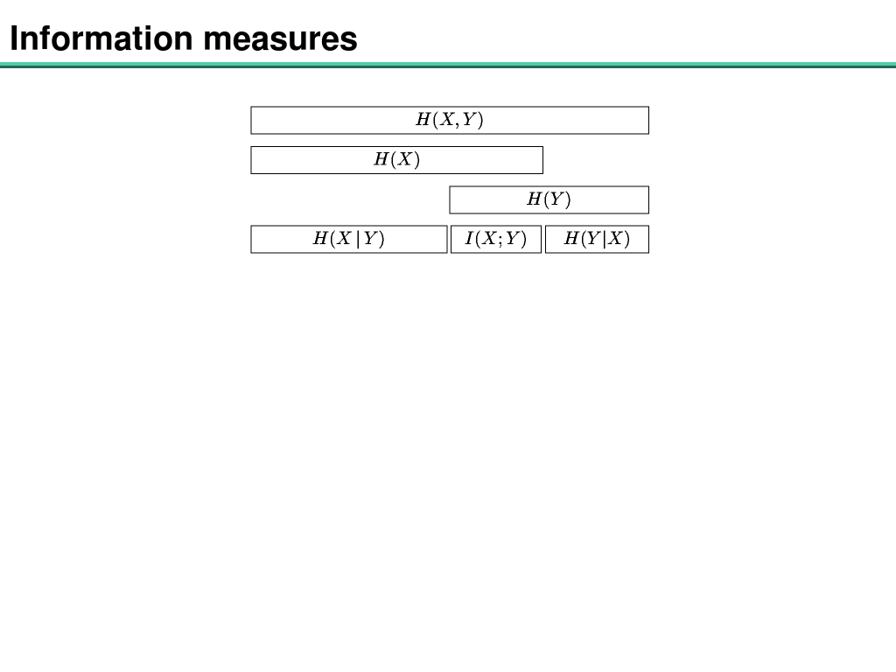

打印体标题 Information measures（信息量度）。本页是一张"盒式文氏图"，无其他正文：

- 最上方的长条框：$H(X,Y)$（联合熵，横贯整行，代表全部不确定性）；
- 其下一层左框：$H(X)$（右端恰好伸到 $I(X;Y)$ 左边界的位置，示意"部分重叠"）；
- 再下一层右框：$H(Y)$（左端同样伸入中部）；
- 最下一行三个并排小框：$H(X\mid Y)$（条件熵）、$I(X;Y)$（互信息，对应上下两框的"重叠带"）、$H(Y\mid X)$（条件熵）。

〔本页为纯框图页：以嵌套框的位置关系表达各信息量度之间的"面积"分解，无其他文字。〕

> <span style="color:#1e8449;">**[note] Note（译者注）:**</span> 这张盒式图不是示意图，而是一组恒等式的可视化记账：每一个框的面积都对应一个可算的量，框与框的包含关系对应一条可以证明的不等式。它的用途是在后面推导 capacity（容量）时，让每一次代数变形都能在图上找到位置，不至于在符号里迷路。
>
> 先把四个量的定义钉死，机制就从定义里长出来。joint entropy（联合熵）定义为 $H(X,Y)=\sum_{x,y}P(x,y)\log_2\frac{1}{P(x,y)}$，它衡量「把一对值一起说出来」平均需要的 bit（比特）数。conditional entropy（条件熵）定义为 $H(Y\mid X)=\sum_x P(x)H(Y\mid X{=}x)$，即先知道 $X$ 之后 $Y$ 剩余的不确定性。二者由 chain rule（链式法则）连接：$H(X,Y)=H(X)+H(Y\mid X)$，因为把一对值说出来的最省说法是「先说 $X$、再说剩下的部分」，两段代价相加。mutual information（互信息）则定义为 $I(X;Y)=H(X)-H(X\mid Y)$，即「知道 $Y$ 使 $X$ 的不确定性减少了多少」。把这两条式子联立，立刻得到 $H(X,Y)=H(X)+H(Y)-I(X;Y)$，这就是图上「大框 = 两个子框之和减去重叠带」。所以这张图的骨架其实是定义的直接推论，真正需要证明的只有一件事：重叠带不会超出任何一侧，即 $I(X;Y)\ge0$ 与 $I(X;Y)\le\min\{H(X),H(Y)\}$。而 $I(X;Y)$ 恰好可以写成 Kullback-Leibler divergence（KL 散度）$D_{\mathrm{KL}}\big(P(x,y)\,\|\,P(x)P(y)\big)$，即联合分布与「独立假设下的乘积分布」之间的差距；KL 散度非负，用 $\log$ 的凹性加 Jensen 不等式一行即可证完（$\log$ 是凹函数，凹函数的期望不超过期望的函数值）。于是「重叠不能为负」这条几何直觉，被翻译成了一条纯分析的凸性事实。
>
> 一个可手算的例子，全部数字都能复核。设 $X,Y$ 各取 $0,1$，联合分布为 $P(0,0)=P(1,1)=0.4$、$P(0,1)=P(1,0)=0.1$。两个边缘分布都是 $(0.5,0.5)$，故 $H(X)=H(Y)=1$ bit（比特）。给定 $Y{=}0$ 时 $X$ 的条件分布是 $(0.8,0.2)$，故 $H(X\mid Y)=H_2(0.8)=-0.8\log_2 0.8-0.2\log_2 0.2\approx0.2575+0.4644=0.7219$ bit（比特）。逐项代入联合熵：$-2\times0.4\log_2 0.4-2\times0.1\log_2 0.1\approx1.0575+0.6644=1.7219$ bit（比特）。于是 $I(X;Y)=1-0.7219=0.2781$ bit（比特），并且检验 $H(X)+H(Y)-I(X;Y)=1+1-0.2781=1.7219$，与直接算出的联合熵吻合到小数点后四位。这组数字的读法：两个各值 $1$ bit（比特）的 random variable（随机变量），共享了 $0.2781$ bit（比特）的信息，剩下的 $0.7219$ bit（比特）是各自独有、对方无论如何也给不出的部分。
>
> 跨课程连接：6.042J 离散数学里的 inclusion-exclusion（容斥原理）$|A\cup B|=|A|+|B|-|A\cap B|$ 与这张图是同一副骨架——把「并」拆成两个集合之和减去交；区别在于 6.042J 数的是元素个数（整数），这里数的是 bit（比特）（实数），因此「交」不一定能被单独数出来，只能由并减去两侧反推。Strang 的子空间维数公式 $\dim(U+V)=\dim U+\dim V-\dim(U\cap V)$ 是第三个同构物，它的「交」是真正的子空间，可以独立取到；而 entropy（熵）这一侧的交只能作为差出现，不能先独立定义再相加，这个差别是本讲后面所有推导必须小心的根源。
>
> 往前一步（拓展）：两个变量时这张图是可靠的，三个变量时它会失效。存在三变量分布使 $I(X;Y;Z)=I(X;Y)-I(X;Y\mid Z)$ 取负值，意味着「三元重叠区」不是面积而是带符号的量，画成文氏图会画出负的格子。这是 Cover 与 Thomas 第 2 章末尾专门讨论的陷阱，也是 network information theory（网络信息论）里多用户容量至今没有统一解法的原因之一；从你已知的东西出发，只需记住一句：两两之间的面积可加，三方共享的部分不一定可加。
>
> 一句话收束：把这张图当成账本，每一步推导都问「我现在在算哪一块面积」，后面定义 capacity（容量）时就不会把 $\max$ 加错位置。

### p.12 〔Communication over noisy channels（噪声信道上的通信）〕

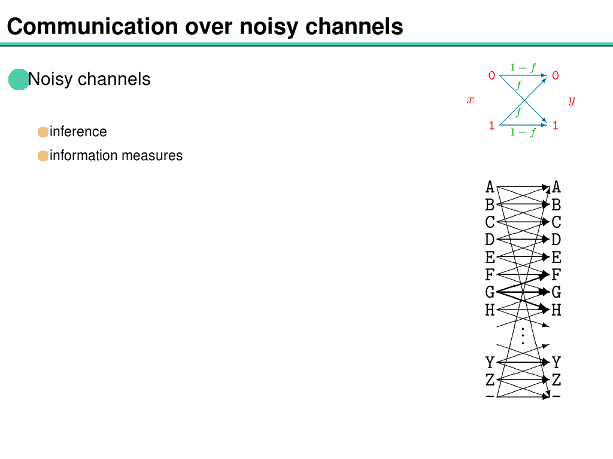

<span style="color:#2471a3;">**[section]**</span> 打印 bullet：Noisy channels（噪声信道），其下两条子 bullet：

- inference（推断）
- information measures（信息量度）

右侧两幅示意图：

1. 二元对称信道（binary symmetric channel, BSC）小图：左端输入 $x\in\{0,1\}$、右端输出 $y\in\{0,1\}$（红色标注）；0→0 与 1→1 的箭头标绿色 $1-f$，0→1 与 1→0 的两条交叉箭头标绿色 $f$。
2. 一幅"打字机"式大图：左列自上而下为字母 A、B、C、D、E、F、G、H，中间省略号，再到 Y、Z 与符号 –，右列同样一组字母与 –；两列之间画满细交叉箭头，表示每个输入都可能混叠到多个输出；其中从 G 发出的三支箭头（指向 F、G、H）被加粗，示意非零转移概率的局部结构。

### p.13 〔Inference for channels（信道上的推断）〕

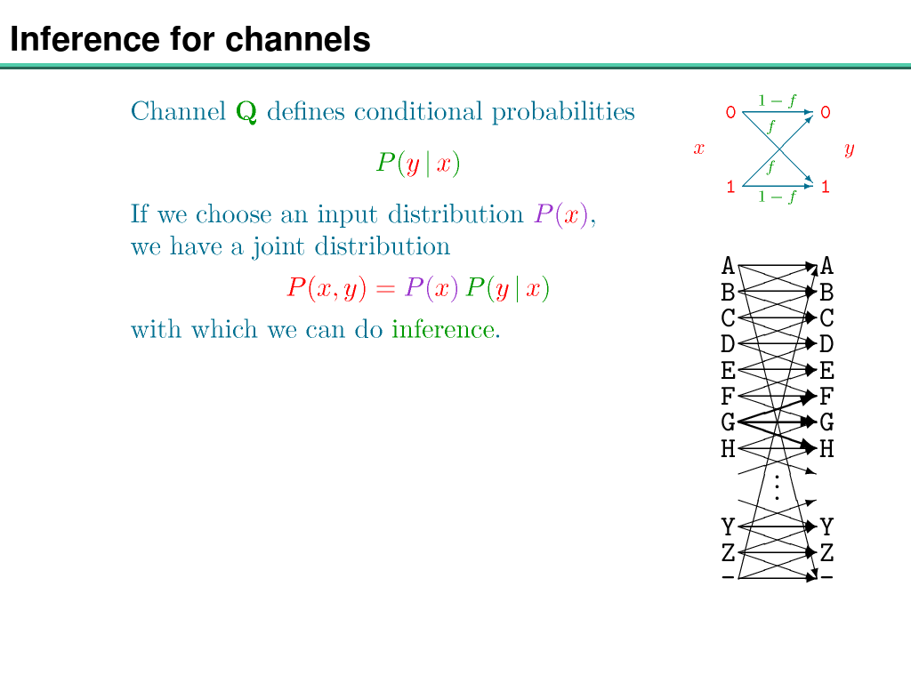

打印正文（关键词分别以绿、紫、红、绿等颜色强调）：

- Channel **Q** defines conditional probabilities（信道 Q 定义了一组条件概率）$P(y\mid x)$；
- If we choose an input distribution $P(x)$, we have a joint distribution（若再选定一个输入分布 $P(x)$，就得到一个联合分布）：

```math
P(x,y) = P(x)\,P(y\mid x)
```

- with which we can do inference.（据此我们就可以做推断（inference）。）

右侧仍为 BSC 小图与"打字机"大图（同 p.12）。

### p.14 〔Information measures for noisy channels（噪声信道的信息量度）〕

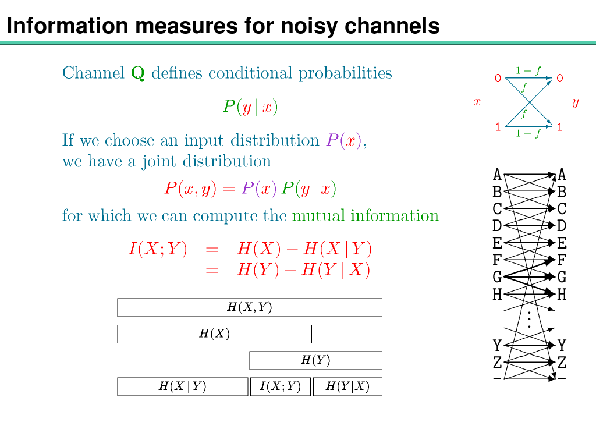

正文前三行与 p.13 相同（信道 $\mathbf{Q}$ 定义 $P(y\mid x)$；选定 $P(x)$ 得联合分布 $P(x,y)=P(x)P(y\mid x)$），但结尾改为：

- for which we can compute the **mutual information**（对它我们可以计算互信息）：

```math
I(X;Y) \;=\; H(X) - H(X\mid Y) \;=\; H(Y) - H(Y\mid X)
```

下方再现 p.11 的盒式文氏图（$H(X,Y)$、$H(X)$、$H(Y)$、$H(X\mid Y)$、$I(X;Y)$、$H(Y\mid X)$ 各框按原位排布），右侧仍为 BSC 与"打字机"两幅示意图。

### p.15 〔Mutual information for the BSC（二元对称信道的互信息）〕

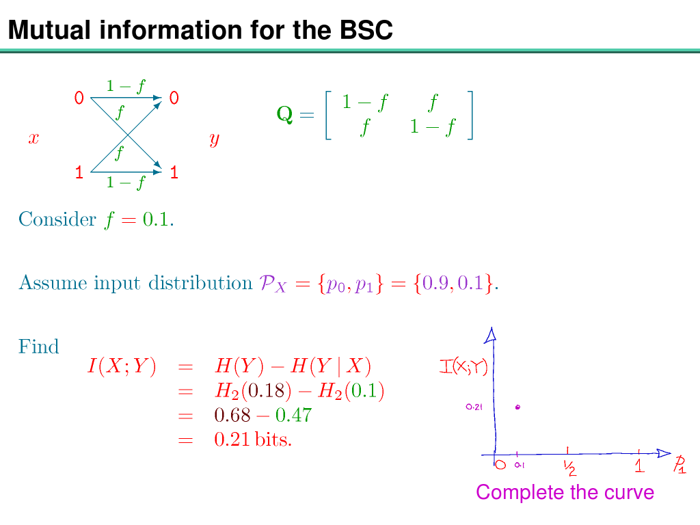

左上：BSC 示意图（输入 $x\in\{0,1\}$、输出 $y\in\{0,1\}$，转移概率 $1-f$ 与 $f$），旁边给出信道矩阵（绿色打印）：

```math
\mathbf{Q} = \begin{bmatrix}\;1-f \quad f\; \\ \;f \quad 1-f\;\end{bmatrix}
```

打印正文：

- Consider $f=0.1$.（取翻转概率 $f=0.1$。）
- Assume input distribution $\mathcal{P}_X=\{p_0,p_1\}=\{0.9,\ 0.1\}$.（设输入分布 $\mathcal{P}_X=\{p_0,p_1\}=\{0.9,0.1\}$。）
- Find（求 $I(X;Y)$）：

```math
\begin{aligned}
I(X;Y) &= H(Y) - H(Y\mid X)\\
&= H_2(0.18) - H_2(0.1)\\
&= 0.68 - 0.47\\
&= 0.21 \text{ bits.}
\end{aligned}
```

（四行依次以红、黑、绿、红色标出。）

右下角：一幅手绘坐标图：纵轴手写标注 $I(x,y)$，轴上标有 $0.21$；横轴手写标注 $p_1$，刻度为 $0.1$、$\frac{1}{2}$、$1$；图上仅在 $(0.1,\ 0.21)$ 处画了一个数据点。图下方打印洋红色文字：Complete the curve（请把整条曲线补全）。

> <span style="color:#1e8449;">**[note] Note（译者注）:**</span> 这一页真正在演示的是一个可复用的计算模板：对任何「给定输入后噪声与输入无关」的 channel（信道），先把 mutual information（互信息）拆成 $H(Y)-H(Y\mid X)$，再发现第二项是与输入分布无关的常数，于是最大化问题退化成单变量极值问题。这个模板后面在打字机信道、在三元混淆信道上都会再用一次，值得当成工具记住。
>
> 机制逐句拆。第一句是输出分布：由 total probability theorem（全概率公式）$P(y)=\sum_x P(y\mid x)P(x)$，取 $f=0.1$、输入分布 $(0.9,0.1)$，得 $P(y{=}1)=0.9\times0.1+0.1\times0.9=0.18$，对称地 $P(y{=}0)=0.82$。第二句是条件熵：给定 $x{=}0$ 时输出的条件分布是 $(0.9,0.1)$，给定 $x{=}1$ 时是 $(0.1,0.9)$，两者的 entropy（熵）都是 $H_2(0.1)\approx0.4690$ bit（比特）；由于无论走哪条分支都是同一个数，加权平均还是它，于是 $H(Y\mid X)=H_2(0.1)$，与输入分布无关。这一步是整页的关键：conditional entropy（条件熵）之所以能「提出来当常数」，靠的是 binary symmetric channel（BSC，二元对称信道）的行对称性——每一行都是同一组数的重排。第三句是收尾：$I(X;Y)=H(Y)-H(Y\mid X)=H_2(0.18)-H_2(0.1)\approx0.6802-0.4690=0.2112$ bit（比特），与讲义写的 $0.68-0.47=0.21$ 一致。
>
> 把模板再往下推一格，就能回答 p.15 那张图下方的「补全曲线」。设 $p_1$ 为输入 $1$ 的概率，则 $P(y{=}1)=f+p_1(1-2f)$；取 $f=0.1$ 得 $P(y{=}1)=0.1+0.8p_1$，于是整条曲线是 $I(p_1)=H_2(0.1+0.8p_1)-H_2(0.1)$。三个端点可核对：$p_1=0$ 时 $I=H_2(0.1)-H_2(0.1)=0$；$p_1=1$ 时 $I=H_2(0.9)-H_2(0.1)=0$（因为 $H_2$ 关于 $\frac{1}{2}$ 对称）；$p_1=\frac{1}{2}$ 时 $I=H_2(0.5)-H_2(0.1)=1-0.4690=0.5310$ bit（比特）。曲线是单峰、关于 $p_1=\frac{1}{2}$ 对称、两端归零的拱形，$(0.1,0.21)$ 只是拱上的一个点。这条曲线的峰值 $0.5310$ 就是该 channel（信道）的 capacity（容量），因为最大值点正是输出分布均匀的点。
>
> 再补一个极限情形做量级对照：把 $f$ 从 $0.1$ 调到 $0$，$H_2(0)=0$，$P(y{=}1)=p_1$，$I(p_1)=H_2(p_1)$，峰值 $1$ bit（比特）——这就是无噪 binary channel（二元信道）的容量，每用一次送一整个 bit（比特）。把 $f$ 调到 $0.5$，则 $P(y{=}1)=0.5$ 恒成立，$I\equiv H_2(0.5)-H_2(0.5)=0$，信道完全无用。$f=0.1$ 时容量只剩 $0.531$，相对无噪情形损失 $46.9\%$，而损失的正是 $H_2(0.1)$ 这一项——「每用一次必须付出的不确定税」。这条单调性也解释了工程上的一个常识：噪声越大可用速率越低，而降低是连续的、没有台阶的，不存在「噪声一旦超过某个门限就彻底不能传」的突变点。
>
> 跨课程连接：CSAPP 第 2 章的 bit（比特）级运算给了一个直接的心智模型——binary symmetric channel（BSC，二元对称信道）可以看成「以概率 $f$ 与一枚独立的 Bernoulli（伯努利）噪声 bit（比特）做一次 XOR（异或）」，发送端 $x$、噪声 $e$、接收端 $y=x\oplus e$；于是「噪声与输入独立」这条假设就是「$e$ 的分布不随 $x$ 变」，$H(Y\mid X)=H(e)=H_2(f)$ 立刻可读出来。区别在于 CSAPP 关心的是这条 XOR（异或）指令在硬件里如何落地（异或门的延迟、位运算的吞吐），这里关心的是它对信息量的影响。第二条连接给 CS144 计算机网络：链路层的 checksum（校验和）只能检出错误、不能纠正，因为它在接收端把整个报文压成一个值、丢掉了定位信息；而 $I(X;Y)=0.21$ bit（比特）这个数说明「每一次信道使用实际到达的信息量」是吞吐的硬上限，重传协议再聪明也无法突破它——重传只是用更多的信道使用去换可靠性，等于把 $0.21$ bit（比特）摊薄到多次上。
>
> 一句话收束：$0.21$ 这个数不是「一位 bit（比特）传了 $0.21$ 位」，而是「这套输入分布下，每次使用平均能搬动的信息量」，而能否更接近 $1$，正是下一步 capacity（容量）要回答的问题。

### p.16 〔The Capacity of a channel（信道的容量）〕

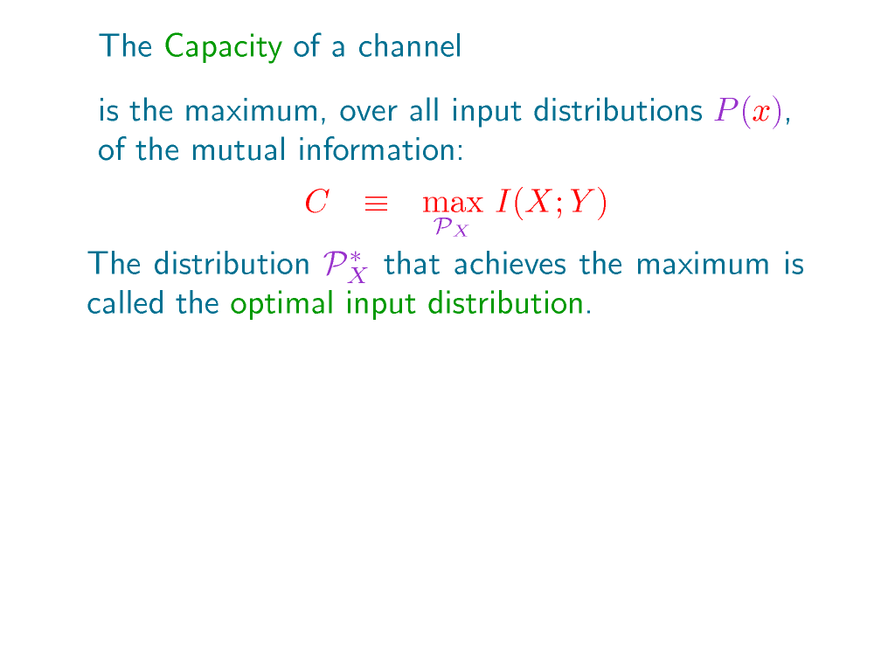

<span style="color:#2471a3;">**[definition]**</span> 本页无标题栏，正文直接给出定义（Capacity 为绿色强调，$P(x)$、$\mathcal{P}^*_X$ 为紫色）：

- The **Capacity** of a channel is the maximum, over all input distributions $P(x)$, of the mutual information:（信道的容量（capacity）是互信息在所有输入分布 $P(x)$ 上取到的最大值：）

```math
C \;\equiv\; \max_{\mathcal{P}_X}\, I(X;Y)
```

- The distribution $\mathcal{P}^*_X$ that achieves the maximum is called the **optimal input distribution**.（达到该最大值的分布 $\mathcal{P}^*_X$ 称为最优输入分布（optimal input distribution）。）

### p.17 〔The Capacity of a channel（信道的容量）〕

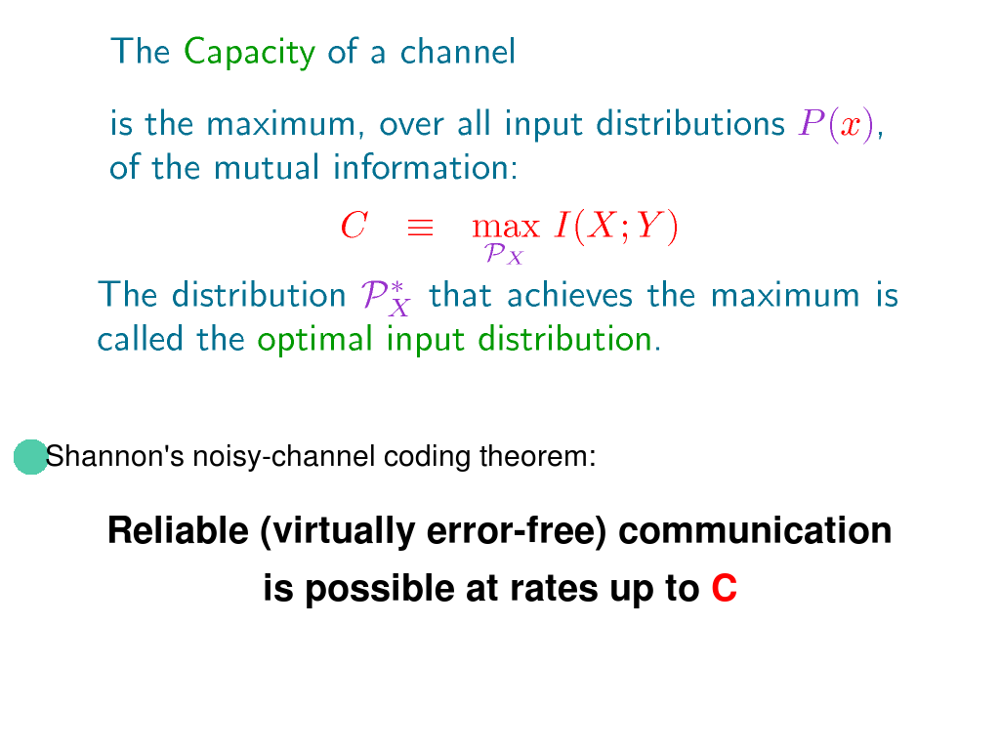

上半页与 p.16 完全相同：容量定义、$C\equiv\max_{\mathcal{P}_X}I(X;Y)$ 与最优输入分布 $\mathcal{P}^*_X$ 的命名。下半页新增打印 bullet：

<span style="color:#2471a3;">**[theorem]**</span>

- Shannon's noisy-channel coding theorem:（Shannon 噪声信道编码定理：）

> **Reliable (virtually error-free) communication is possible at rates up to C**（可靠（几乎无差错）的通信在码率（rate）不超过 $C$ 时是可能的；句末的 C 为红色加粗）

> <span style="color:#1e8449;">**[note] Note（译者注）:**</span> 这个定理的震撼之处在于它把「可靠性」和「速率」这两件在工程直觉上互相排斥的事，用一个不等式彻底解耦：只要码率低于 capacity（容量），你就能同时要高速率与低错误概率，代价只是分组长度变长、延迟变大。MacKay 在教材第 10 章把定理拆成三部分——两条正向、一条反向，反向那条（码率超过 capacity（容量）必错）才是让它成为「精确边界」而非「乐观上界」的一半。
>
> 机制的核心是「球堆」图像，可以完全用概率推出，不需要任何编码构造。固定分组长度 $N$、固定输入分布，则每条码字 $\mathbf{x}$ 对应的输出是一个随机向量 $\mathbf{y}$。由 asymptotic equipartition property（AEP，渐近均分性），当 $N$ 大时 $\mathbf{y}$ 以接近 $1$ 的概率落在一个 typical set（典型集）里，该集合的大小约为 $2^{N H(Y)}$；而已知发送的是哪条码字时，$\mathbf{y}$ 的典型集只有约 $2^{N H(Y\mid X)}$ 个元素。于是每条码字在输出空间里「占据」一个体积 $2^{N H(Y\mid X)}$ 的球，整个输出空间体积约 $2^{N H(Y)}$，能塞下的互不重叠的球最多约 $2^{N(H(Y)-H(Y\mid X))}=2^{N I(X;Y)}$ 个。只要码字数 $M$ 不超过这个数，就能挑出一组球互不重叠的码字，译码规则就是「找 $\mathbf{y}$ 落在哪个球里」；球一旦不重叠，错误概率为零。反过来，若 $M$ 超过它，任你怎么摆放都会有两个球相交，某些输出会被两条码字共享，错误不可避免。$M=2^{NR}$ 定义码率 $R$，于是 $R<I(X;Y)$ 可靠、$R>I(X;Y)$ 不可靠，对输入分布取最大值即得 $R<C$ 可可靠。
>
> 具体的数能让这个指数级差距落地。取 $f=0.1$ 的 binary symmetric channel（BSC，二元对称信道），其 capacity（容量）为 $C=H_2(0.5)-H_2(0.1)=0.5310$ bit（比特）每信道用。取分组长度 $N=1000$：输出空间约 $2^{1000}$ 个典型输出，每条码字的球约 $2^{469}$ 个，可塞球数约 $2^{531}$。选 $R=0.4$，即 $M=2^{400}$ 条码字，球数与空间的体积比是 $2^{400}/2^{531}=2^{-131}\approx3.7\times10^{-40}$——随机摆放时出现碰撞的概率小到可以忽略，这就是「随机码字」为什么有效：不是因为随机选得巧，而是因为桶太大了。若贪心选 $R=0.6$，比值为 $2^{69}$，远超 $1$，碰撞必然发生，这正对应反向定理所说的「越过容量必错」。
>
> 证明策略模板可以这样命名并记住：**「随机码字 + 典型集球堆 + 并集界」**。三步固定：第一步用 random variable（随机变量）化的码字（每条码字每个位置上独立按 $P(x)$ 抽取）把「设计一个码」换成「抽样一个码」，于是可以谈期望；第二步用 asymptotic equipartition property（AEP，渐近均分性）把每个条件输出集的大小钉成常数指数 $2^{N H(Y\mid X)}$；第三步用 union bound（并集界）把「有任意一条码字与它冲突」的概率压到 $M$ 倍单条冲突概率之下（这与生日悖论里的界是同一形状）。三步合起来得到平均错误概率上界 $2^{-N(C-R)}$，再取一次期望即得存在性。
>
> 跨课程连接：6.006 的 hashing（散列）与这个论证是同构的——把键散列到 $m$ 个桶里，载荷因子 $\alpha=n/m$ 决定碰撞概率，理想散列的期望冲突次数是 $\Theta(\alpha)$；这里的「桶」就是典型输出集，键就是码字，载荷因子是 $2^{NR}/2^{NI}=2^{-N(C-R)}$，随 $N$ 指数衰减。区别有两处：散列要求对所有输入序列都成立（最坏情形），所以要么用随机化散列函数、要么用完全散列；编码定理只要求平均、并要求 $N$ 足够大，因此它可以允许极少数坏码字存在——存在性论证只保证「有一组码字是好的」。第二处区别同样重要：散列的桶数是固定的 $m$，这里的桶体积 $2^{N H(Y\mid X)}$ 随 $N$ 指数增长，所以「足够大」这件事在编码里是本质的，在散列里反而不是。
>
> 历史坐标只放一句：Claude Shannon 于 1948 年在 Bell System Technical Journal 发表的 A Mathematical Theory of Communication 同时给出了 source coding（信源编码）的 entropy（熵）界与 channel coding（信道编码）的 capacity（容量）界，并引入 asymptotic equipartition property（AEP，渐近均分性）作为证明骨架；这三件事今天仍被合称为 Shannon theory 的三根柱子。
>
> 一句话收束：定理说的不是「存在好码」，而是「容量是硬的边界，越过它连一点点可靠性都买不到」——「virtually error-free」这个词的分量全在反向定理那一半。

### p.18 〔Ternary confusion channel（三元混淆信道）〕

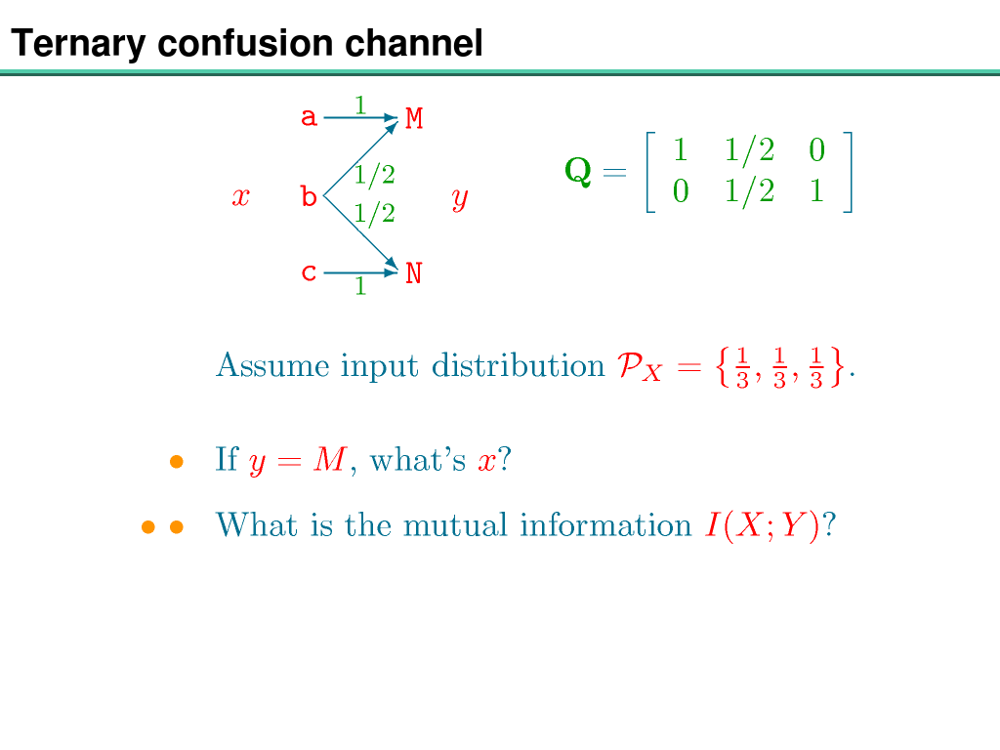

<span style="color:#2471a3;">**[example]**</span> 打印标题 Ternary confusion channel（三元混淆信道）。左侧信道图：输入 $x\in\{a,b,c\}$（红色小写字母），输出 $y\in\{M,N\}$（红色大写字母）；箭头旁绿色标注转移概率：$a\to M$ 为 $1$；$b\to M$ 为 $\frac{1}{2}$、$b\to N$ 为 $\frac{1}{2}$；$c\to N$ 为 $1$。右侧信道矩阵（绿色打印）：

```math
\mathbf{Q} = \begin{bmatrix}\;1 \quad 1/2 \quad 0\; \\ \;0 \quad 1/2 \quad 1\;\end{bmatrix}
```

打印文字：Assume input distribution $\mathcal{P}_X=\{\frac{1}{3},\frac{1}{3},\frac{1}{3}\}$.（设输入分布 $\mathcal{P}_X=\{\frac{1}{3},\frac{1}{3},\frac{1}{3}\}$。）

两条打印 bullet：

- If $y=M$, what's $x$?（若收到 $y=M$，$x$ 是什么？）
- What is the mutual information $I(X;Y)$?（互信息 $I(X;Y)$ 是多少？）

> <span style="color:#7f8c8d;">旁注：第二个问题的项目符号处并排画有两个橙色小圆点（疑为课堂标记），含义〔无法辨认〕。</span>

### p.19 〔Noisy typewriter（噪声打字机信道）〕

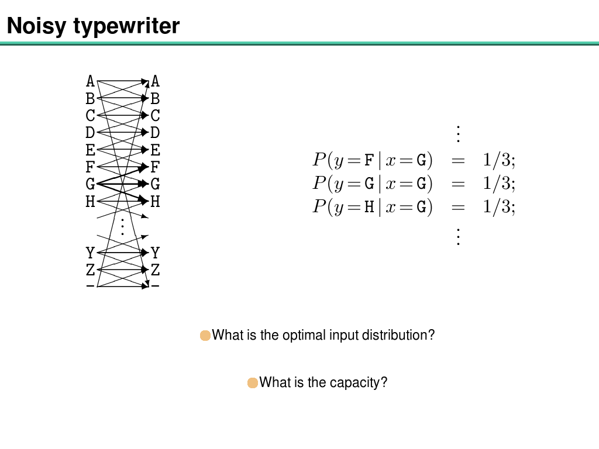

<span style="color:#2471a3;">**[example]**</span> 打印标题 Noisy typewriter（噪声打字机信道）。左侧信道图：左列自上而下为 A、B、C、D、E、F、G、H、省略号、Y、Z、–，右列同样一组字母与 –；每个输入字母发出三支箭头指向相邻的输出字母（细线交叉，整体呈"斜向重叠"结构）。右侧以 $x=G$ 为例给出条件分布（上下各有省略号 $\vdots$）：

```math
\begin{aligned}
P(y=\text{F}\mid x=\text{G}) &= 1/3;\\
P(y=\text{G}\mid x=\text{G}) &= 1/3;\\
P(y=\text{H}\mid x=\text{G}) &= 1/3;
\end{aligned}
```

下方两条打印 bullet（阶梯状缩进）：

- What is the optimal input distribution?（最优输入分布是什么？）
- What is the capacity?（容量是多少？）

> <span style="color:#1e8449;">**[note] Note（译者注）:**</span> 这个 channel（信道）的全部意义在于破除一个错误直觉：一个「每个字符都可能变成三个不同字符」的 noisy（有噪声的）通道，看起来必然要损失速度，可它其实一位信息都不必丢，只要你不按字母的自然顺序去用它。第 8 讲证明编码定理时用的正是这个图像——「大分组下的任何信道都长得像打字机信道」，所以这个例子不是练习，而是全课的原型。
>
> 机制从行对称性出发，一路推到容量，不需要任何优化技巧。第一，输出字母表与输入字母表同为 $27$ 个（A 到 Z 加连字符），每个输入以 $1/3$ 均匀落到自身与前邻、后邻三个输出上，故对任意 $x$ 都有 $H(Y\mid X{=}x)=\log_2 3$，加权平均得 $H(Y\mid X)=\log_2 3$，与输入分布无关。第二，$H(Y)\le\log_2 27$，因为输出只有 $27$ 个取值，等号当且仅当输出分布均匀。第三，两式相减得 $I(X;Y)=H(Y)-H(Y\mid X)\le\log_2 27-\log_2 3=\log_2 9$，且这个上界可被达到：取输入分布为 A、D、G、J、M、P、S、V、Y 这 $9$ 个字母各 $\frac{1}{9}$（即按字母序每 $3$ 个取一个，正好覆盖 $27/3=9$ 个位置），则这 $9$ 个输入的「混淆三角」互不重叠，输出分布在这 $27$ 个字母上完全均匀，$H(Y)=\log_2 27$，$I=\log_2 9$。于是 capacity（容量）$C=\log_2 9$。
>
> 算成数：$\log_2 9=3.1699$ bit（比特）每信道用，而原始输入字母表能承载的上限是 $\log_2 27=4.7549$ bit（比特），损失 $4.7549-3.1699=1.5850=\log_2 3$ bit（比特），恰好等于每次使用额外注入的那份不确定。效率比 $3.1699/4.7549=0.6667=\frac{2}{3}$，这个 $\frac{2}{3}$ 有直接的组合解释：$27$ 个输入挤在 $27$ 个输出上、每个输入占 $3$ 个输出，只有三分之一的输入位置能同时用。若把邻域从 $3$ 个改成 $2$ 个（自身与后邻各 $\frac{1}{2}$），同样的推导给出 $C=\log_2(27/2)\approx3.7549$ bit（比特），损失降到 $1$ bit（比特）——邻域越窄，容量越接近无噪上限，这条单调性值得记住。
>
> 用同一个模板再算一遍 p.18 的三元混淆信道，才算真的掌握。输入 $a,b,c$ 各 $\frac{1}{3}$，$a\to M$ 概率 $1$、$b\to M$ 与 $b\to N$ 各 $\frac{1}{2}$、$c\to N$ 概率 $1$。先算输出分布：$P(M)=\frac{1}{3}+\frac{1}{6}=\frac{1}{2}$，$P(N)=\frac{1}{2}$，故 $H(Y)=1$ bit（比特）。再算条件熵：三行分别是 $0$、$1$、$0$，加权得 $H(Y\mid X)=\frac{1}{3}$ bit（比特）。于是 $I(X;Y)=1-\frac{1}{3}=\frac{2}{3}$ bit（比特）。但这不是容量：把输入分布改成只在 $a,c$ 上各 $\frac{1}{2}$，则 $P(M)=P(N)=\frac{1}{2}$、$H(Y)=1$、$H(Y\mid X)=0$，得 $I=1$ bit（比特）。也就是说均匀分布不是最优，ability 是把会带来混淆的那个输入 $b$ 整个弃用。这个反例提醒了一件事：capacity（容量）永远是「对输入分布取最大值」，而最优分布可以故意不用某些输入——这在本讲后面讨论反馈与高斯信道时还会反复出现。
>
> 顺带把 p.18 的第一问算掉：收到 $y=M$ 时，$P(a\mid M)=\frac{1/3}{1/2}=\frac{2}{3}$，$P(b\mid M)=\frac{1/6}{1/2}=\frac{1}{3}$，$P(c\mid M)=0$，即往 $a$ 猜、错误概率 $\frac{1}{3}$。这与 $I=\frac{2}{3}$ bit（比特）在数值上同源——剩 $\frac{1}{3}$ 的不确定性，正好是 $H(X\mid Y)$。
>
> 跨课程连接：CSAPP 第 6 章的 cache（高速缓存）用地址的低若干位做 set index（组索引），本质是按「模组数」把地址分成互不冲突的桶；本页「每 $3$ 个字母取一个」正是按模 $3$ 分解输入空间，两者是同一个组合动作。区别在于 cache（高速缓存）的组数是 $2^k$、索引取的是二进制地址的低 $k$ 位，冲突表现为容量缺失；而这里字母数是 $27$（不是 $2$ 的幂），可取模是因为 $27$ 恰好被 $3$ 整除，若邻域宽度不能整除字母表长度，就得靠分组长度 $N$ 变大来「平均掉」边界效应。第二处区别更关键：cache（高速缓存）的冲突是被动的（程序地址由别人给定），这里的「非混淆子集」是主动挑选的（码字设计者自己选输入用哪些字母），这正是 channel coding（信道编码）比 cache（高速缓存）多出来的自由度。
>
> 一句话收束：容量不是「每次传多少」，而是「输入字母表中能同时使用的那些位置所占的比例」——打字机信道把这个比例赤裸裸地摆成了 $\frac{1}{3}$。

### p.20 〔Recommended homework（推荐课后作业）〕

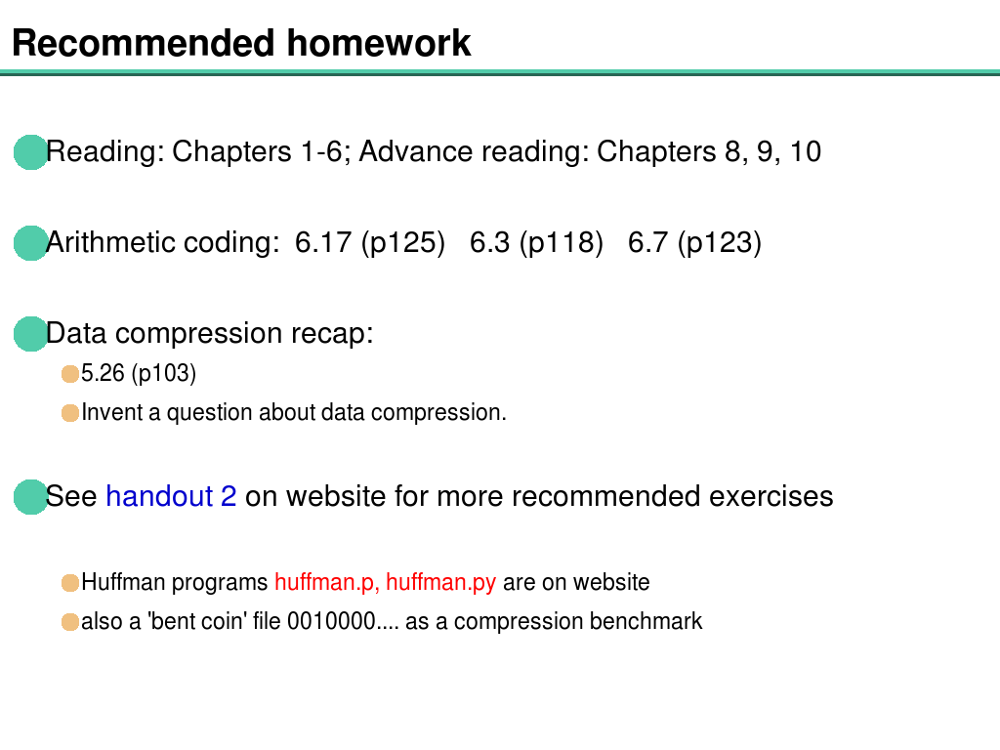

<span style="color:#2471a3;">**[note]**</span> 打印标题 Recommended homework（推荐课后作业）。各条打印 bullet（handout 2 为蓝色链接字，huffman.p、huffman.py 为红色）：

- Reading: Chapters 1-6; Advance reading: Chapters 8, 9, 10（阅读：第 1–6 章；预习：第 8、9、10 章）
- Arithmetic coding: 6.17 (p125) 6.3 (p118) 6.7 (p123)（算术编码：习题 6.17（第 125 页）、6.3（第 118 页）、6.7（第 123 页））
- Data compression recap:（数据压缩复习：）
  - 5.26 (p103)（习题 5.26（第 103 页））
  - Invent a question about data compression.（自己编一道关于数据压缩的题目。）
- See handout 2 on website for more recommended exercises（更多推荐习题见网站上的 handout 2）
  - Huffman programs huffman.p, huffman.py are on website（哈夫曼程序 huffman.p 与 huffman.py 已挂在网站上）
  - also a 'bent coin' file 0010000.... as a compression benchmark（另附一个"偏心硬币"文件 0010000…… 可作压缩基准测试）

> <span style="color:#1e8449;">**[note] Note（译者注）:**</span> 「偏心硬币」文件的价值在于它是一个「熵明明很低、符号码却压不动」的样本。它逼你把两件事分开：一是信源的真实 entropy（熵），二是你手上这族码能达到的下限。当两者之间出现缝隙时，问题不在信源，而在码族太窄。
>
> 机制第一步是最常被忽略的组合事实：二元字母表上的 prefix code（前缀码），每个码字至少长 $1$ bit（比特）。理由只需一个鸽巢式论证——码字必须非空（空串不能与别的码字区分），而长度为 $0$ 的码字只有一个，长度为 $1$ 的只有两个，若允许两个符号都用长度 $0$ 与长度 $0$ 就立刻撞车，故平均长度 $\ge1$。第二步是信源侧的事实：若 $1$ 的出现频率为 $p$，信源每个字符的 entropy（熵）是 $H_2(p)=p\log_2\frac{1}{p}+(1-p)\log_2\frac{1}{1-p}$，只要 $p\ne\frac{1}{2}$ 就严格小于 $1$。两件事合起来就是结论：只要码族限制在「一个字符一个码字」，平均长度被钉在 $1$ bit（比特）以上，而 entropy（熵）在 $1$ bit（比特）以下，中间那段差距永远拿不到。这不是编码器写得不好，是码族的结构性下限。
>
> 出路有两条，各自都能算出收益。第一条是分组编码：把 $n$ 个字符并成一个超符号再编码，超符号的 entropy（熵）是 $nH_2(p)$，而对任意信源都有 $nH_2(p)\le L_n\le nH_2(p)+1$（$L_n$ 是分组 Huffman 码的平均长度，上界来自「Huffman 码长不超过 $-\log P+1$」这条逐符号界），折回每字符即 $\frac{L_n}{n}\le H_2(p)+\frac{1}{n}$。取 $p=0.1$，$H_2(0.1)=0.4690$ bit（比特）：$n=1$ 时平均长度 $1$，冗余 $0.531$；$n=2$ 时四个超符号概率为 $0.81,0.09,0.09,0.01$，Huffman 给的长度是 $1,2,3,3$，平均 $1.29$，即每字符 $0.645$，冗余降到 $0.176$；$n=100$ 时冗余不超过 $0.01$。第二条是 arithmetic coding（算术编码）：它不要求码字长度是整数，直接把整条消息映射到 $[0,1)$ 上的一个区间，总长度落在 $N H+2$ bit（比特）以内，即冗余至多 $2$ bit（比特）总量、与 $N$ 无关。取 $N=10^6$，冗余只有 $\frac{2}{10^6}=2\times10^{-6}$ bit（比特）每字符，几乎贴住 entropy（熵）。
>
> 量级对照：$N=10^6$ 个字符的偏心硬币文件，原始占 $10^6$ bit（比特）；理论上限 $N H_2(0.1)=469000$ bit（比特），压缩到 $46.9\%$。逐字符 Huffman 只能做到 $10^6$ bit（比特），压不动分毫；$n=2$ 分组做到 $645000$ bit（比特），省 $35.5\%$；$n=100$ 分组做到约 $480000$ bit（比特），而 arithmetic coding（算术编码）做到约 $469002$ bit（比特）。这四行数把「码族决定下限」这件事摆得清清楚楚。
>
> 跨课程连接：CLRS 第 16 章的贪心算法给出 Huffman 码的最优性证明，用的是 exchange argument（交换论证）——把最优树的两片最深叶子与频率最小的两个符号交换，平均长度不增；这条论证保证「在逐字符前缀码这一族里，Huffman 最优」，而本页的 $1$ bit（比特）下限恰好说明「最优于这一族」并不等于「逼近 entropy（熵）」。第二处连接是 6.042J 的 pigeonhole principle（鸽巢原理）：两个符号只需区分「是二选一」，故至少 $1$ bit（比特），这是纯计数，与概率无关。第三处是 CSAPP 第 2 章的表示层视角：文件在磁盘上就是 bit（比特）串，压缩器改变的是这串 bit（比特）的统计分布，而不是它的语义；你完全可以用 `xxd` 看压缩前后的字节流，前者集中在少数取值、后者近似均匀——「压缩 = 把冗余转成均匀随机」这句话，在字节层面肉眼可见。
>
> 操作建议：网页上给的 huffman.py 与 huffman.p 可以直接跑，把实测长度与 $N H_2(p)$ 并排列出，再试 $n=1,2,3,4$ 的分组，看每字符长度如何从 $1$ 一路降到 $0.5$ 附近；这条曲线与 p.15 的 $I(p_1)$ 曲线是同一类形状——都是「某量对某个参数」的拱形或单调形，值得并排记在同一页纸上。文中习题编号（6.17 在 p.125、6.3 在 p.118、6.7 在 p.123、5.26 在 p.103）均指教材 Information Theory, Inference, and Learning Algorithms 的题号与页码。
>
> 一句话收束：熵是信源的天花板下的地板，码族是你脚下的鞋，鞋窄了怪不到天花板。
